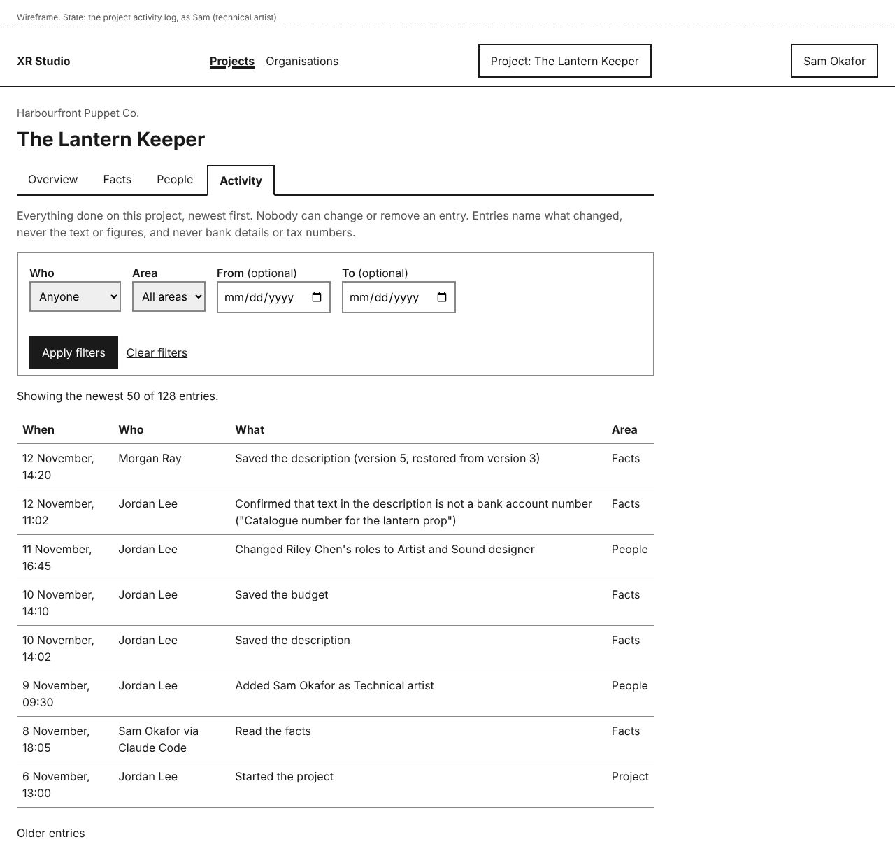
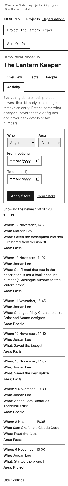
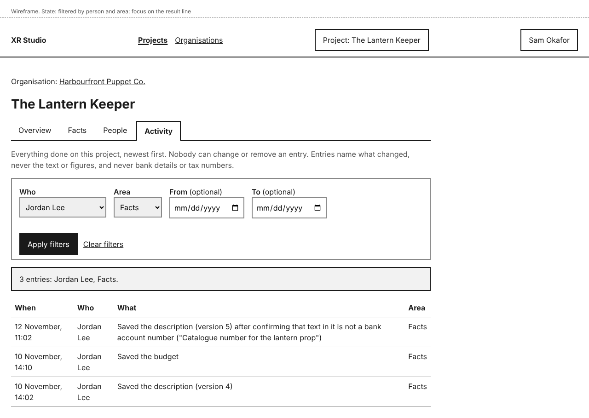
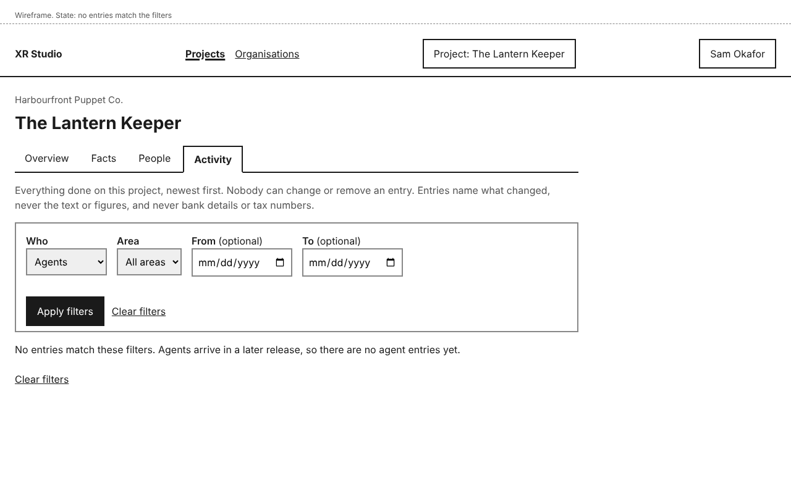
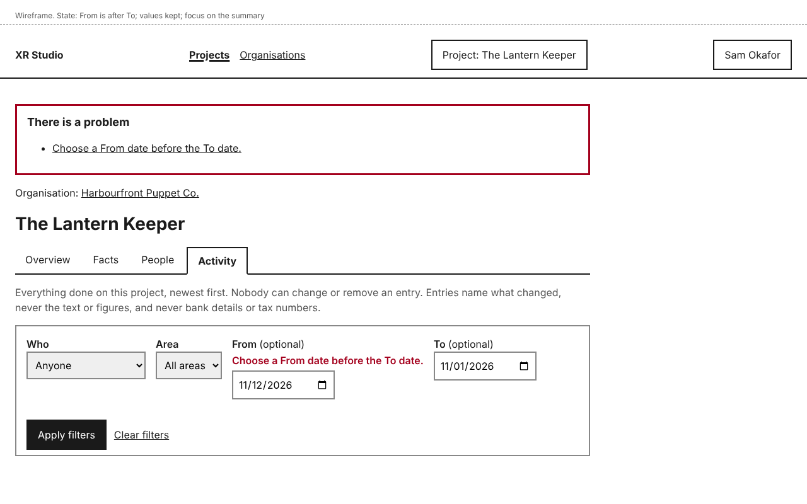
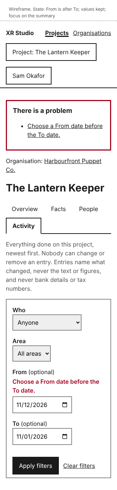
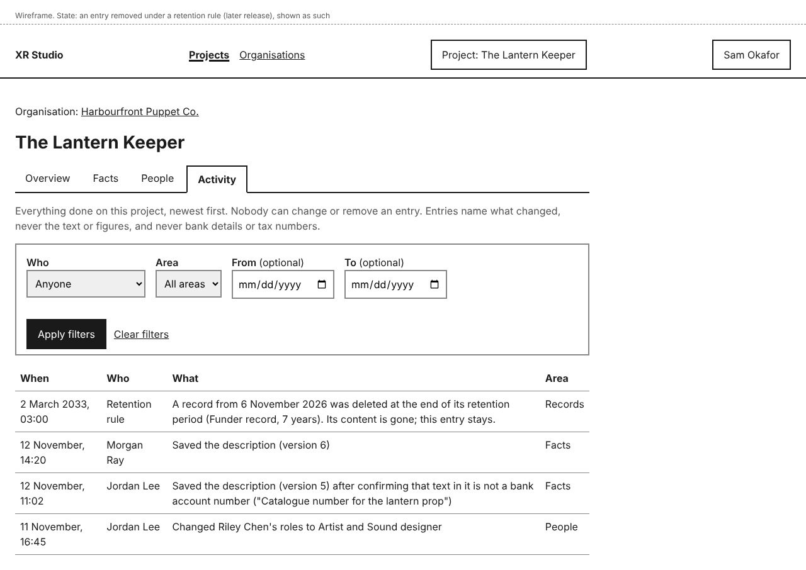
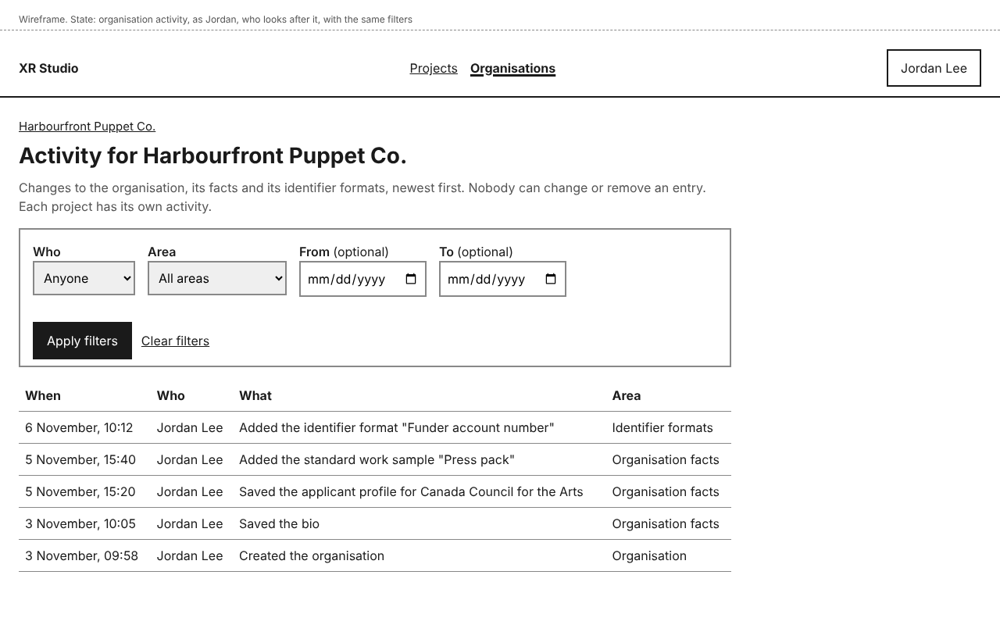

# Activity log design

A log of everything done on a project, which nobody can edit or remove (story-agent-work-read-activity-log). Slice 2 builds the log and fills it with people's actions: facts, people and roles, identifier confirmations, and the project itself. Agent actions, with their stage and tool, are added from slice 7, when agents and Claude Code sessions arrive; the page is designed for them now. Organisations get their own activity page for changes to the organisation, its facts and its identifier formats.

## Personas

- persona-technical-artist: Sam opens the log to see what happened and why something failed, filters it by who did it, area and date (goals), and from slice 7 by agent, stage and tool.
- persona-producer: Jordan checks who changed a fact or a role, and that an identifier confirmation was recorded.

## Flow

1. On a project, the **Activity** tab lists entries newest first: **When**, **Who**, **What** and **Area**. Fifty at a time, with **Older entries**.
2. Filters above the list: **Who**, **Area** (Project, Facts, People, and later areas as slices add them), **From** and **To** dates. **Who** lists everyone with an entry on the project, including people since removed, shown as "<name> (removed)", and **Agents**. **Apply filters** reloads the page; focus moves to the result line ("3 entries: Jordan Lee, Facts.") and the page title starts with it. **Clear filters** shows everything again.
3. An entry names what was done in words ("Saved the description (version 4)", "Changed Riley Chen's roles to Artist and Sound designer", "Saved the description (version 5) after confirming that text in it is not a bank account number ("Catalogue number for the lantern prop")"). It never contains the text or figures of a fact, and never an identifier: the only free text it can carry is a confirmation answer, which is checked against the identifier formats before it is saved (design-identifier-filter).
4. Slice 2 logs changes, not page views. It also logs the deletion of a held upload that was not confirmed within 24 hours, by "XR Studio" (design-identifier-filter; approver's decision, 2026-11-12). A confirmation that text is not an identifier is logged where the item lives: the project's activity for its facts and work samples, the organisation's for organisation facts and standard work samples.
5. Times in Activity, and on project and organisation facts, are shown in the viewer's own time zone. **From** and **To** take whole days in that zone and include both days, so the same date in both shows that one day (approver's decision, 2026-11-12).
6. From slice 7, entries made through Claude Code name the person and the channel ("Sam Okafor via Claude Code"; decision-agent-runtime), and an agent entry names the project, stage, tool and the person who requested or approved it (story-agent-work-read-activity-log); **Who** can then be filtered by agent and by **Stage**.
7. An entry removed under a retention rule (from the keep-records story, a later release) stays in the list as an entry of its own: "A record from <date> was deleted at the end of its retention period (<rule>). Its content is gone; this entry stays."
8. On the organisation page, people who look after it have **Activity** for the organisation's own changes, with the same filters (its areas are Organisation, Organisation facts and Identifier formats).

## Who can open the log

| Log | Who |
|---|---|
| A project's activity | Director, Producer, Technical artist (approver's decision, 2026-11-12) |
| An organisation's activity | People who look after the organisation (approver's decision, 2026-11-12) |

Other roles do not see the **Activity** tab; opening its address gives "This page is not available" (design-dashboard-shell). Entries about a fact a reader may not see (the budget, for example) show only that it was saved, with no value, as every entry does.

## Mock-ups

| Screen or state | Mock-up | Notes |
|---|---|---|
| Project activity, as Sam |  | Phone: . A removed person is in **Who**. |
| Filtered by person and area |  | Focus on the result line; title starts with it. |
| No entries match |  | Says agents arrive in a later release. |
| From after To |  | Phone: . Values kept. |
| An entry left by a retention deletion (later release) |  | Shown as its own entry. |
| Organisation activity |  | Same filters, organisation areas. |

## Layout

- **Activity** is the last project tab, shown only to roles that may read it. On the organisation page, **Activity** is in the navigation for people who look after it, next to **Identifier formats**.
- The list is a table with a caption on wide screens and one block per entry at 320 pixels, each value labelled.
- Control names: **Activity**, **Who**, **Area**, **From**, **To**, **Apply filters**, **Clear filters**, **Older entries**.

## States and errors

- **Filtered:** result line "<n> entries: <filters>." with focus and the page title starting "<n> entries: <filters>".
- **No entries match:** "No entries match these filters." with **Clear filters**; title starts "No entries match". Filtering by **Agents** in slice 2 adds "Agents arrive in a later release, so there are no agent entries yet."
- **From after To:** "Choose a From date before the To date." in an error summary that takes focus, page title starting "Error:". Values kept.
- **No way to change an entry:** there is no edit or delete control anywhere, and the API has none.

## How it works

- **How does the system know?** The activity log is an append-only ledger in the record (decision-project-record-model). Each command writes its entry in the same transaction as its change, so an entry exists exactly when the change does. The **Who** list is read from the people named in the project's entries, so removed people stay in it.
- **What enforces each promise?**
  - "Nobody can edit or remove an entry": the application's database role can insert into the log but cannot update or delete it. Only the separate retention role can remove an entry's content, and it leaves its own entry. A database test tries an update and a delete as the application role and both are refused.
  - "Every action is logged": every command writes its entry; there is no write path outside the command layer. A test runs each slice 2 command and checks its entry.
  - "No identifiers or fact values in the log": entries are built from the command's name and the names of what changed, never from field values; the one free-text part, a confirmation answer, is checked against the identifier formats before it is written. The identifier test searches the log for test identifiers and finds none.
  - "Only some roles can open the log": checked per request. A test signs in with each role.
- **What is published together?** Not applicable.

## Accessibility

- The list is a table with a caption and column headers on wide screens; at 320 pixels each entry is a block with labelled values.
- After a filtered load, focus moves to the result line (`tabindex="-1"`) and the page title starts with the result, so screen reader users hear the outcome, following the slice 1 notice pattern. Date fields have visible labels.
- All mock-ups were checked with axe (WCAG 2.2 AA tags) with no violations, and the phone frames have no horizontal scrolling.

## Open items

- Agent and Claude Code entries with stage and tool, and filters by agent and stage: slice 7.
- Retention deletions: with story-contracts-and-payment-keep-records.
- Erasure requests against the log: pending the legal review (decision-project-record-model).
