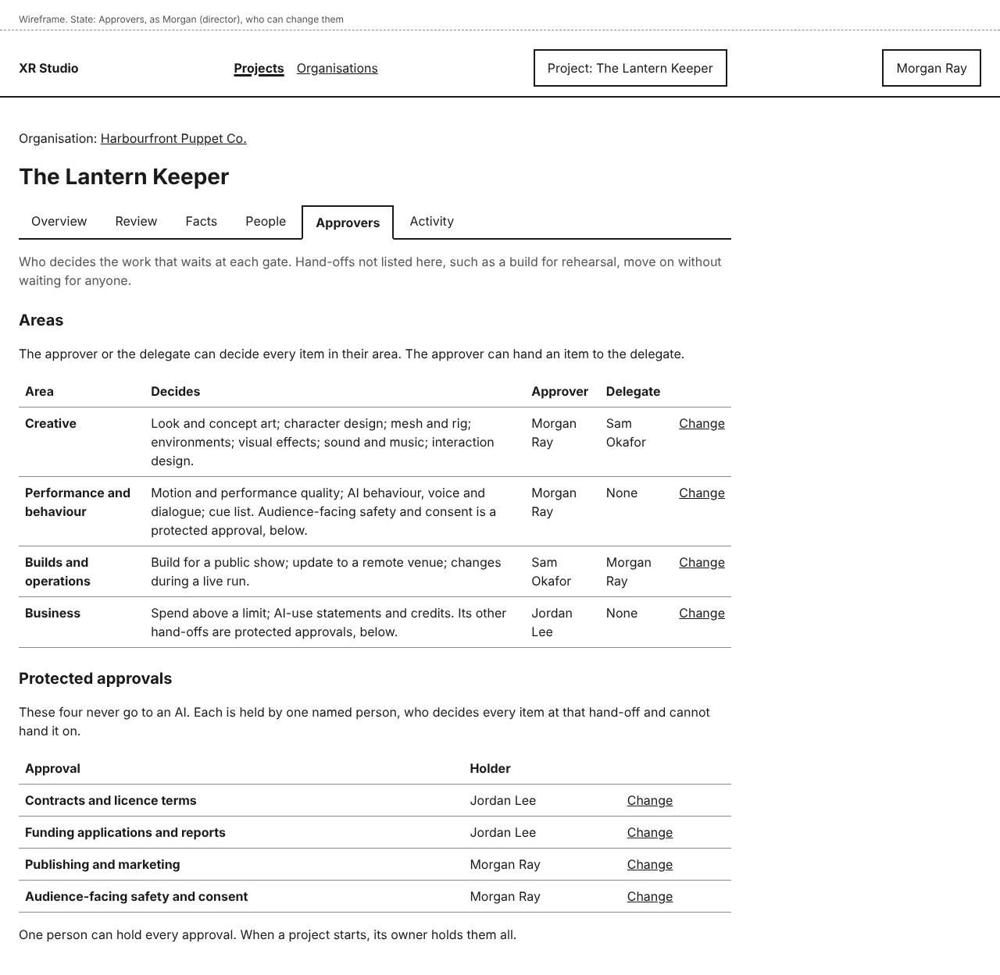
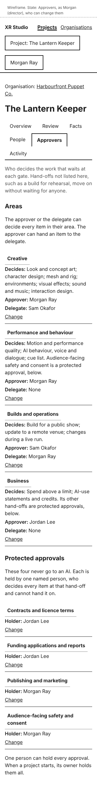
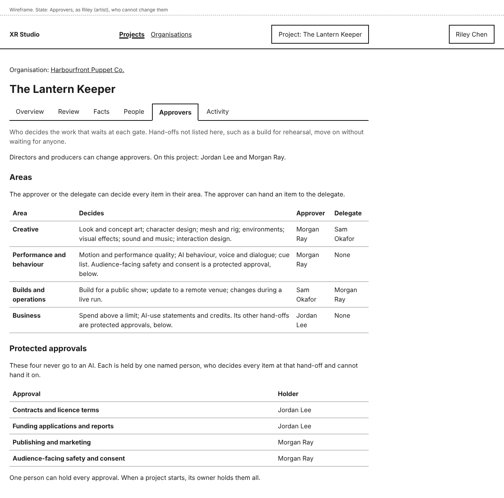
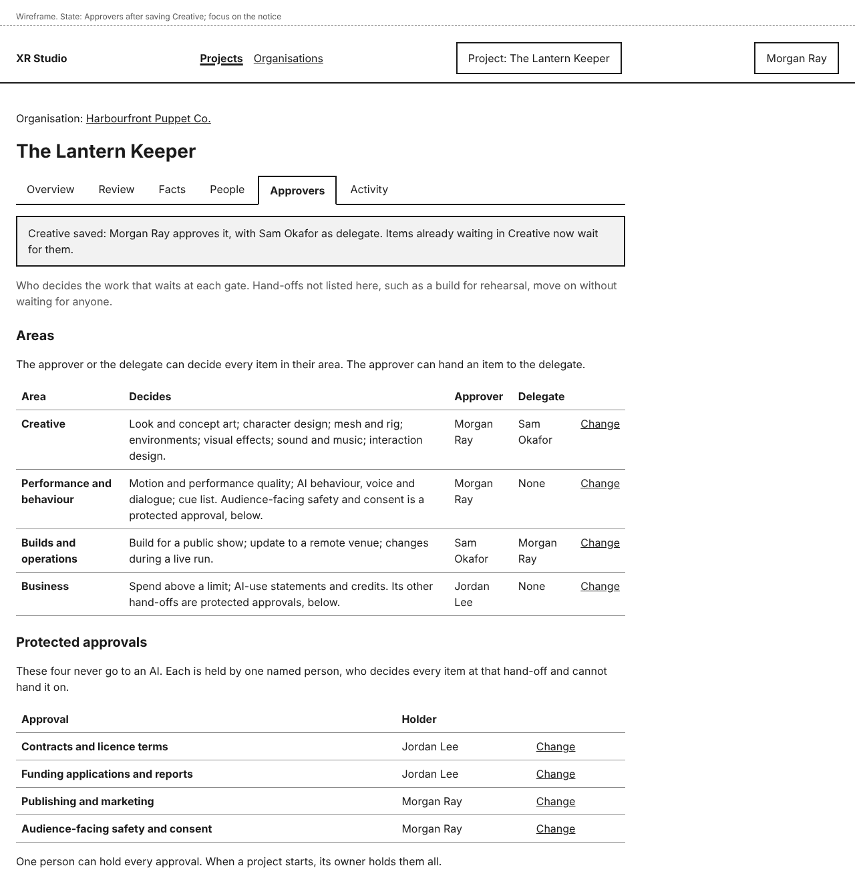
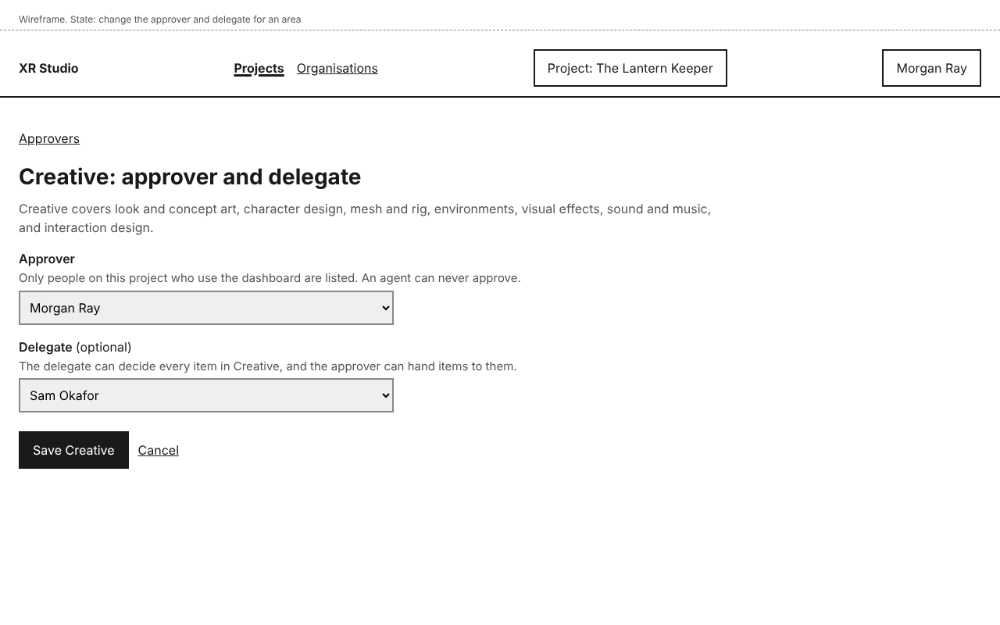
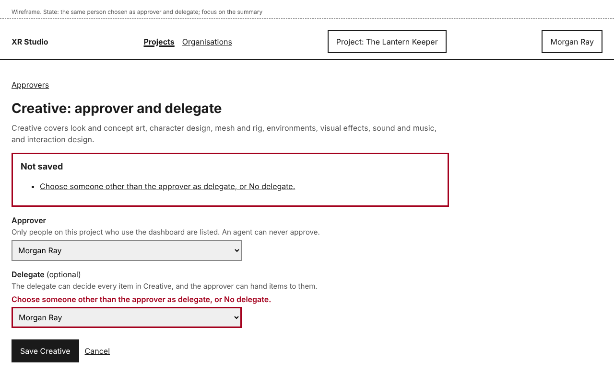
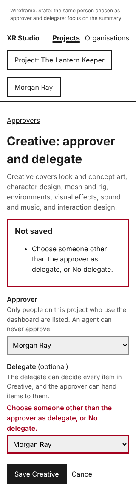
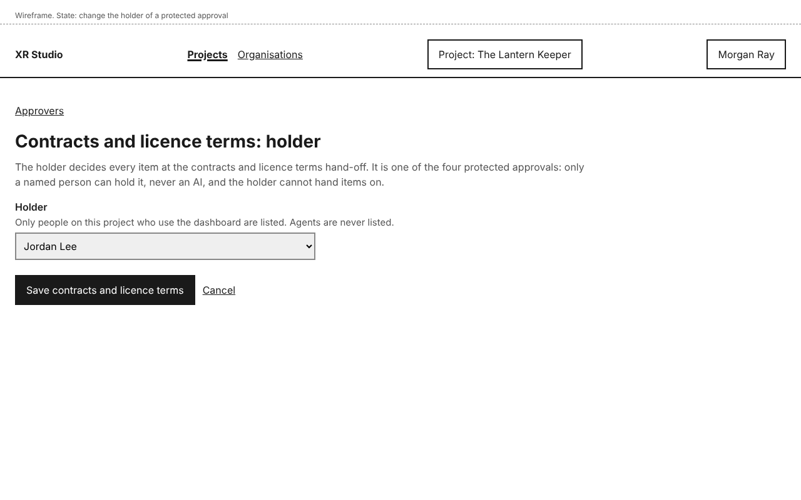
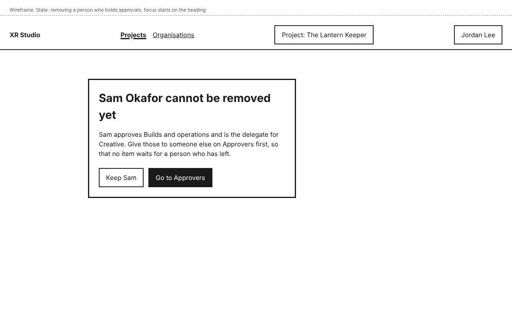

# Approvers design

Who decides the work that waits at each gate (story-project-record-name-approvers). Each of the four areas of the gate list (REQ-workflow-2) has an approver and, if the project has one, a delegate. The four protected approvals (REQ-workflow-7) each have one named holder. Slice 3 builds this page together with the review queue (design-review-queue), because a gate with nobody to decide it would stop all work (epic-review-and-status, release groups).

## Personas

- persona-director: Morgan names who approves each area, delegates an area to a named person when the project has one, and keeps the four protected approvals with people (goals). On a solo production Morgan holds everything, with nothing to set up: the project's owner holds every approval from the start (goals: run a whole production alone).
- persona-producer: Jordan sees who decides what, so they know who a held item is waiting for (goals: know what is blocked and who owns it).

## Flow

1. On a project, the **Approvers** tab sits after **People** and before **Activity**. Everyone on the project who uses the dashboard can open it.
2. Under **Areas**, a table lists the four areas: **Creative**, **Performance and behaviour**, **Builds and operations** and **Business**. Each row shows what the area decides (its gated hand-offs, from REQ-workflow-2), its **Approver**, and its **Delegate** ("None" when there is none).
3. Under **Protected approvals**, a table lists the four protected approvals with their **Holder**: **Contracts and licence terms**, **Funding applications and reports**, **Publishing and marketing** and **Audience-facing safety and consent**. Each is also a hand-off in the gate list (the first three in Business, the last in Performance and behaviour), and items at it go to its holder, not to the area's approver or delegate.
4. The page says that hand-offs not listed, such as a build for rehearsal, move on without waiting, and that one person can hold every approval.
5. A person with the Director or Producer role sees **Change** on each row `[proposed]`. Others see the tables and a line naming who can change them.
6. **Change** on an area opens **<Area>: approver and delegate**: an **Approver** list and a **Delegate (optional)** list with **No delegate** first. Both list only people on the project whose roles open the dashboard; agents are never listed. **Save <Area>** returns to the tab with a notice; focus moves to it.
7. **Change** on a protected approval opens **<Approval>: holder** with a **Holder** list of the same people. **Save <approval>** returns to the tab with a notice.
8. A change applies at once to items already waiting: they wait for the new approver and delegate, or the new holder (design-review-queue).

## Mock-ups

| Screen or state | Mock-up | Notes |
|---|---|---|
| Approvers, as Morgan, who can change them |  | Phone:  |
| Approvers, as Riley, who cannot |  | Names who can change them. |
| After saving an area |  | Focus on the notice. |
| Change an area's approver and delegate |  | |
| Same person as approver and delegate |  | Phone: . Focus on the summary. |
| Change a protected approval's holder |  | No delegate for these. |
| Removing a person who holds approvals |  | Shown on **People** instead of the removal confirmation. |

## Layout

- The tab order on a project becomes **Overview**, **Review**, **Facts**, **People**, **Approvers**, **Activity** (Review is added by design-review-queue). **Activity** stays last.
- On wide screens both lists are tables. At 320 pixels each row becomes a block with "Decides:", "Approver:", "Delegate:" or "Holder:" before each value, as on **People**.
- Control names: **Approvers**, **Areas**, **Protected approvals**, **Change**, **Approver**, **Delegate**, **No delegate**, **Holder**, **Save <area>** (for example **Save Creative**), **Save <approval>** (for example **Save contracts and licence terms**), **Cancel**, **Keep <name>**, **Go to Approvers**.

## States and errors

- **A new project:** its owner is the approver of all four areas and the holder of all four protected approvals, with no delegates `[proposed]`. So a solo production needs no setup, and no item can ever wait for nobody.
- **Same person as approver and delegate:** "Choose someone other than the approver as delegate, or No delegate." Nothing is saved; the choices are kept.
- **Saved:** "Creative saved: Morgan Ray approves it, with Sam Okafor as delegate. Items already waiting in Creative now wait for them." and "Contracts and licence terms saved: Jordan Lee holds it."
- **Removing a person who holds an approval:** refused until their approvals are given to someone else `[proposed]`. **People** shows "Sam Okafor cannot be removed yet" with which approvals they hold, **Keep Sam** and **Go to Approvers**, instead of the removal confirmation (design-people-and-roles). The same applies when a role change would leave them with only roles that do not open the dashboard: the change is refused with the same text in an error summary.
- **A person who cannot change approvers** sees no **Change** links, and opening a change page directly shows **This page is not available**.
- **Agents:** cannot be chosen, and an agent session asking to change an approver, delegate or holder is refused by the command layer.

## How it works

- **How does the system know?** Approvers, delegates and holders are assignments in the record, separate from roles (decision-identity-and-roles), read on every request. Who an item waits for is worked out from them when the page is drawn, so a change shows on everyone's next page load.
- **What enforces each promise?**
  - "An AI can never be chosen for a protected approval" (and, in this design, for any approval): the assignments accept only person principals, enforced by a database constraint as well as the command layer (decision-identity-and-roles). Tests: the command refuses an agent session, and a direct insert of an agent fails.
  - "Only people who use the dashboard can be chosen": the command refuses a person whose roles on the project do not open the dashboard. A test.
  - "Only Directors and Producers change approvers": the permission table. A test signs in with each role.
  - "No item waits for nobody": a new project starts with its owner in every assignment, and removal or a role change that would leave an assignment with a person who cannot decide is refused. Tests.
  - Every change is logged in the project's **Activity**, in a new area **Approvers** ("Named Sam Okafor as delegate for Creative", "Gave the contracts and licence terms approval to Jordan Lee").
- **What is published together?** Not applicable.

## Accessibility

- Each **Change** link names its row in visually hidden text ("Change Creative").
- Notices take focus on load, and the page title starts with the outcome. Errors use an error summary that takes focus, with links to the field, and text plus a thicker border on the field, not colour alone.
- The refusal on **People** is a modal dialog like the removal confirmation: focus starts on its heading, **Keep <name>** comes first, Escape closes it.
- Targets are at least 44 by 44 pixels. No horizontal scrolling at 320 pixels.
- All mock-ups were checked with axe (WCAG 2.2 AA tags) with no violations.

## Open items

- Who can change approvers: Directors and Producers, the same people who manage roles `[proposed]`. Limiting it to Directors would add no protection, since a Producer can give themselves the Director role.
