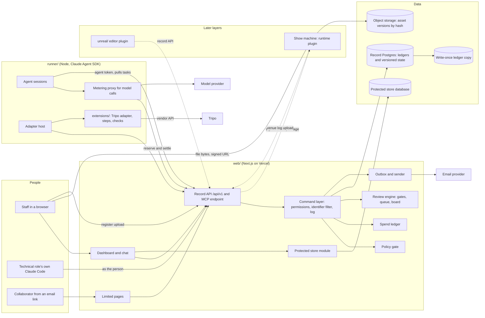

# Layer 1 architecture overview

<!-- docs/design/architecture.md. An overview of the backbone. The reasons for each choice are in the decision notes it links to. Screens and their mock-ups belong in each feature's own design. -->

## Scope

This page covers Layer 1, the project backbone: the four epics epic-project-record, epic-agent-work, epic-provenance-and-policy and epic-review-and-status, and their 30 stories. It also names the boundaries that later layers and the business layer build on. The reasons for each choice are in these decision notes:

- decision-system-shape: what runs where, and how the parts talk.
- decision-project-record-model: ledgers, versioned state, restore and backups.
- decision-offline-show-package: how records reach show machines with no internet.
- decision-identity-and-roles: principals, roles, data classes and limited pages.
- decision-agent-runtime: the runner, chat, enforcement and spend.
- decision-extensions-and-adapters: adapters, steps and checks.
- decision-policy-gate-and-provenance: terms, the gate and provenance.
- decision-protected-store: identifiers kept away from agents.
- decision-notifications: email, the badge and digests.

## Components

Solid lines are built in Layer 1. Dotted lines are boundaries that Layer 1 keeps open for later layers. The protected store module is built with the business layer (story-contracts-and-payment-protect-sensitive-data). Layer 1 builds only the identifier filter in the command layer, with a starter list of formats Jordan can edit.

| Component | Sub-project | Runs on | Layer 1 stories it serves |
|---|---|---|---|
| Dashboard and chat | `web/` | Cloud, in the browser | start-project, record-facts, add-person, name-approvers, same-project-state, set-up-organisation, close-project, see-how-it-was-set-up, see-review-queue, decide-on-items, feedback-and-versions, status-board, what-needs-me, starter-targets, motion-quality-gate, direct-an-agent, read-activity-log, spend-limit, no-term-choice, record-terms |
| Limited pages | `web/` | Cloud | collaborator-sign-off, record-terms (Robin confirms) |
| Command layer and permission table | `web/` | Cloud | add-person, name-approvers, agent-permissions, same-project-state, close-project, and every criterion of the form "an agent cannot" |
| Ledgers and versioned state | `web/` with Postgres | Cloud | record-facts, read-activity-log, feedback-and-versions, back-up-and-restore, provenance-record, record-terms, decide-on-items |
| Review engine | `web/` | Cloud | hold-gated-hand-off, see-review-queue, decide-on-items, status-board, what-needs-me, motion-quality-gate, starter-targets, quality-and-licence-gate |
| Policy gate | `web/` | Cloud | block-generation, no-term-choice, record-terms, tool-adapter |
| Spend ledger | `web/` | Cloud | spend-limit, tool-adapter |
| Outbox and sender | `web/`: immediate items sent after commit, a scheduled job for digests and retries | Cloud | notifications, collaborator-sign-off (codes and links) |
| Backups and restore drill | Scheduled jobs and providers | Cloud | back-up-and-restore, close-project (final backup) |
| Object storage | Managed | Cloud | back-up-and-restore, feedback-and-versions, provenance-record |
| Agent runner and metering proxy | `runner/` | A cloud worker first; a studio workstation from Layer 3 | direct-an-agent, agent-permissions, spend-limit, record-facts (agent drafts), set-up-organisation (agent drafts) |
| Adapter host and extensions | `runner/`, `extensions/` | Inside the runner | tool-adapter, extend-the-workflow, quality-and-licence-gate (checks), provenance-record |
| Shared schemas | `contracts/` | Build time | extend-the-workflow, tool-adapter, and the show package later |

## Boundaries other work must respect

- **One write path.** Every change to project state goes through the record's command layer, through `/api/v1` or the MCP endpoint over it. No sub-project writes to the database directly. The runner holds no database credentials. File bytes go to object storage from a signed URL, but a file joins the record only when its upload is registered through a command, which scans agent-readable documents for identifiers.
- **Enforcement lives in the record.** Grants, the list of actions agents can never take, role visibility, the policy gate and the spend ledger are checked by the record. Clients only repeat checks to give better messages. The one exception is folder access for agents' file tools, which the runner enforces as a second point, logging each file-tool call through the record before it runs. The agent's subprocess holds no vendor keys.
- **Agents act for a person.** Each agent session carries the requesting person. It can never do more than that person. A person's own Claude Code is not an agent: it acts as the person, on the "via Claude Code" channel (decision-agent-runtime).
- **Ledgers are append-only.** The activity log, approvals and sign-offs, terms, provenance, spend, mode switches and the deletion register are never updated or rolled back by a restore. The one exception is deletion under a retention rule, made by a separate database role used only by the retention job, which removes content and leaves a register entry. A restore also never touches access control, the spend limit or the no-term choice.
- **Out of the live path.** Show machines read a signed show package and write a venue log. Nothing in a show build calls the record, the runner or the internet in show mode.
- **No identifiers outside the protected store.** Agent-readable fields are filtered on write.
- **Contracts are versioned.** The API, the extension messages, the term vocabulary, the provenance fields, and the show package and venue log formats live in `contracts/` with versions.

## Approver's decisions (2026-11-12)

- The project record runs in the cloud: Next.js on Vercel, managed Postgres and object storage (decision-system-shape).
- Everything is hosted in Canada: AWS Aurora PostgreSQL for the record and, separately, the protected store, S3 with Object Lock and AWS KMS, all in ca-central-1, and Vercel functions in `yul1` (Montréal). The region check was done before slice 0 (decision-protected-store, decision-project-record-model). Amended on 2026-11-13 for previews that hold only made-up data: see "Amendment (2026-11-13)" below.
- Chat with agents is in the dashboard. Technical roles whose roles cannot see protected-store data may also use their own Claude Code over the record's MCP endpoint. It is the person's own tool, not a project agent: it acts as the person, is logged as such, and the agent rules and spend limit do not apply to it (decision-agent-runtime).
- The architect's recommendations were accepted for the rest: the agents' model use counts under the spend limit; the first runner is an always-on cloud worker; granting a tool approves sending its inputs to that vendor; generation outside the pipeline is caught at the adapter and by an import check; offline role changes take effect at the next show package refresh; backups at a second provider are kept 90 days with quarterly restore drills; staff sign in with email links and passkeys; extensions are reviewed by pull request and a review item; the spend limit is in CAD; closing a project is built with or after keep-records; show content uses Git LFS with locking.

## Amendment (2026-11-13): previews hold made-up data and may be hosted outside Canada

The project lead decided this on 2026-11-13.

- A preview is a trial copy of XR Studio deployed for one pull request. It holds only made-up fixture data: made-up people, projects, files and email.
- A preview may be hosted outside Canada. The rule above, that everything is hosted in Canada, does not apply to it.
- Real data never goes in a preview. A preview never holds a production secret, and never connects to the production database, object storage, protected store or email.
- Nothing else changes. The deployed product, and anything that holds real project data, stays in Canada as decided on 2026-11-12. The decision notes that say where real data lives (decision-system-shape, decision-project-record-model, decision-protected-store) are unchanged.

"Trying the product" below says what a preview is made of. design-trying-the-product says how the rule "real data never goes in a preview" is kept.

## Trying the product

Added on 2026-11-13 with design-trying-the-product. XR Studio can be tried in two places besides the deployed product. Both are trial copies: builds started with the trying setting on, holding only made-up fixture data.

- **Local trial copy:** started on a person's own machine with one command, and deleted when it stops.
- **Preview:** deployed for each pull request, and deleted when the pull request closes.

Each external service the deployed product uses has a stand-in in a trial copy. The lead approves this table with the architecture.

| Service in the deployed product | Local trial copy | Preview | What the stand-in hides |
|---|---|---|---|
| Record database: Aurora PostgreSQL in ca-central-1 | PostgreSQL in a container that the command starts and removes | A Postgres database made for that pull request only, at a managed provider outside Canada, removed when the pull request closes | Aurora's own behaviour: failover, point-in-time recovery, how its login user joins the `xr_app` role, and the latency of the Canadian region. The same migrations create `xr_app` and `xr_retention` in every place, so the append-only rules are real in a trial copy, except that **Start** empties the copy as the database's owner (design-trying-the-product). |
| Web functions: Vercel, region `yul1` | The production build, run on the person's machine | A Vercel preview deployment, with its functions in `yul1` like production's | Locally, cold starts and regional latency. In a preview, the short distance between the functions and the database: the preview's database is further away. |
| Object storage: S3 with Object Lock and AWS KMS in ca-central-1 (the S3 transport is not built yet) | A folder that the command creates and removes | The preview's own database: file bytes are kept in a table, with a limit of 4 MB for each file | Upload from the browser straight to storage through a signed address; in a preview, files up to 2 GB and the progress bar on a long upload; Object Lock; encryption with KMS. |
| Email: Amazon SES in ca-central-1 (not built yet) | Nothing is sent. Each message is kept in the trial copy's database and listed on its **Email sent by this copy** page. | The same | Delivery: bounces, spam filters, security scanners that use up a single-use link, how a message looks in a mail program, and sending limits. |
| Scheduled jobs: Vercel Cron (deleting held uploads every 5 minutes; later digests, backups and retention) | Not run | Not run | A held file is not deleted after 24 hours in a trial copy. It is already hidden and cannot be confirmed after that time. The job has its own tests. |
| Passkeys: the person's browser or password manager | Real, for the local address | Real, for that preview's own address | A passkey made in one trial copy does not work in another, or in the deployed product. |
| Write-once ledger copy, backups at a second provider, the protected store and its key service, the agent runner with its metering proxy and model provider, the record's MCP endpoint for a person's own Claude Code, Git LFS for show content, and Tripo | Not built yet, so absent | Not built yet, so absent | Everything about them. The slice that builds each one adds its row here before it is built. A paid or metered service gets a fake in a trial copy, never a real key. |

No tutorial yet needs a service that a stand-in cannot give. When one does, it names the service in its `needs:` line, and it runs in one shared staging place with real services, hosted in Canada, before a release. That place is not built, and is decided when the first such tutorial is written.

## Build order

Each slice is small enough to review on its own, and ends with something a person can use or a test can prove. Slices follow the epics' release groups.

| Slice | Stories | Sub-project | How it is verified |
|---|---|---|---|
| 0. Skeleton | None (it is the base for the rest) | `web/`, `contracts/` | CI runs the build, type check, lint and unit tests. A migration is generated and applied by the pipeline (PG-001). An automated accessibility check runs on an empty page. |
| 1. Organisations, projects and people | set-up-organisation (without facts), start-project, add-person | `web/` | Unit tests of the permission table for all eleven roles. End-to-end tests of creating an organisation and a project, the missing-field error, adding a person with two roles, and a role change applying at the next request. |
| 2. Facts, the identifier filter and the activity log | record-facts (without agent drafts), set-up-organisation (facts), read-activity-log (person actions) | `web/` | End-to-end tests of editing, history and visibility by role. The identifier filter with a starter list of formats Jordan can edit: a test identifier is refused in a fact and in a registered document, and a confirmed false match is saved and logged. A database test that the application role cannot update or delete log rows, and that only the retention role can delete ledger content. |
| 3. Gates and the queue | name-approvers, hold-gated-hand-off, see-review-queue, decide-on-items | `web/` | End-to-end tests with seeded items. A test that an agent principal cannot hold a protected approval. Batch accept, and a revision request that needs feedback. |
| 4. Versions, board and first view | feedback-and-versions, status-board, what-needs-me | `web/` | End-to-end tests of comparing and restoring with later versions kept, and the board changing with no reload. A manual WCAG 2.2 AA check (WEB-002). The first-task test with a person new to the pipeline. |
| 5. Backup and restore | back-up-and-restore | `web/`, scheduled jobs | A scripted project restore on a seeded project: working state returns, ledgers are untouched, the restore is logged, a record in the deletion register stays gone, and a role removed after the restore point stays removed (as do the spend limit and the no-term choice). A daily dump to the second provider, with the last backup's time and result shown in the dashboard. The write-once ledger copy (hashes and references only), with a check that object lock is on. One scripted disaster restore from a dump, replaying ledger entries and re-applying the deletion register. One drill on a real project before real work relies on it. |
| 6. Spend limit | spend-limit | `web/`, `runner/` | Tests of a new project blocked with the plain-words message, a reservation at the limit refused, metered calls serialised per project, the actual cost settled from vendor usage and the recorded price table, and USD work blocked until Jordan records a rate. Built before any metered tool or model use. |
| 7. Chat, agent grants and Claude Code | direct-an-agent, agent-permissions, same-project-state, read-activity-log (agent entries), agent drafts in record-facts and set-up-organisation | `runner/`, `web/` | The metering proxy is verified against the installed SDK: every model request is reserved before it is sent, and none reaches the model with no limit set. Integration tests with a scripted model that try each forbidden action, a file-tool call outside the grant and a direct vendor call from the shell, and check each refusal and its log entry. A test identifier in a chat message is refused before the runner sees it. A thread is private until shared, and a shared reply quoting prompts is hidden from a role that cannot read them. A dashboard change checked in a chat answer, and the reverse. A short live-model smoke test. Claude Code: a token is refused for a role that can see protected-store data; an issued token is refused on its next call after the person gains such a role; its calls are logged as the person via Claude Code. |
| 8. Terms and the gate | record-terms (without Robin's page), no-term-choice, block-generation (block only) | `web/` | Table tests of the gate covering each use, destination, end date, unconfirmed loosening and the no-term choice. A test that an agent cannot record a term. |
| 9. Notifications | notifications | `web/` | Tests of the digest, one email per item and an immediate blocking alert against a test mailbox, with immediate items sent after commit and not waiting for the scheduled job. A badge count test. A search of sent mail for test identifiers. |
| 10. Collaborator page | collaborator-sign-off, record-terms (Robin confirms and asks for changes), block-generation (wait for sign-off) | `web/` | End-to-end test with a code read from a test mailbox. Tests that the link alone shows only the item preview, cannot decide and cannot open Robin's terms or pay, and that every other project URL is refused. A remembered device. A preview-only share. |
| 11. Provenance and the first adapter | provenance-record, quality-and-licence-gate, tool-adapter, block-generation (import check for assets registered through the record) | `runner/`, `extensions/`, `web/` | Tests with recorded Tripo responses. A fake generator replaces Tripo by a pin change, with no other change. Failed checks show what failed. An asset registered with no provenance record is listed for the holder of the contracts and licence terms approval. One live Tripo run under a small limit. |
| 12. Extensions | extend-the-workflow | `extensions/`, `runner/` | A sample check is added as a package, pinned by one project, and its version is shown. The pin change appears as a review item and takes effect only after the builds and operations area approver accepts it. A failing version reports its reason. |
| 13. Starter values and the motion gate | starter-targets, motion-quality-gate (gate and item types) | `web/` | A test set of values is drafted, accepted in one step, changed with a reason, and one is left unset and listed. The motion gate's full test needs Layer 2 inputs, so it waits for that layer. |
| 14. Setup summary and closing | see-how-it-was-set-up (sections that exist in Layer 1), close-project | `web/` | The story's tests with simulated projects. Close needs retention fields from story-contracts-and-payment-keep-records, so the closing half of this slice is built with or after that story (approver's decision, 2026-11-12). Its final backup uses slice 5's dump job. |

## What Layer 1 does not fully meet

- story-review-and-status-motion-quality-gate is tested with a rehearsal take and mapping versions from Layer 2.
- story-review-and-status-starter-targets lists values from stories in later layers. Layer 1 builds the mechanism and tests it with a sample set. The full UC-2 set and the offline use of accepted values come with Layers 4 and 5.
- story-project-record-see-how-it-was-set-up lists characters, mappings, capture sources and engine versions, which later layers record. Layer 1 builds the summary with the sections that exist.
- story-project-record-close-project relies on retention rules (business layer) and guest data (Layer 6).
- story-agent-work-spend-limit's last criterion refers to the cost view in epic-budgets-and-cost. Layer 1 shows spend against the limit only.
- story-project-record-add-person's show-machine criterion needs the show package (Layer 5) and the pre-show check (Layer 4). Layer 1 applies role changes at the next request in the cloud.
- story-provenance-and-policy-block-generation's import check runs in Layer 1 for assets registered through the record. Outside files brought in through the content import arrive with Layer 3 (story-character-path-own-tool-generated-work).
- Organisation-level agent work needs an organisation spend limit that no story defines yet `[open]` (decision-agent-runtime).
