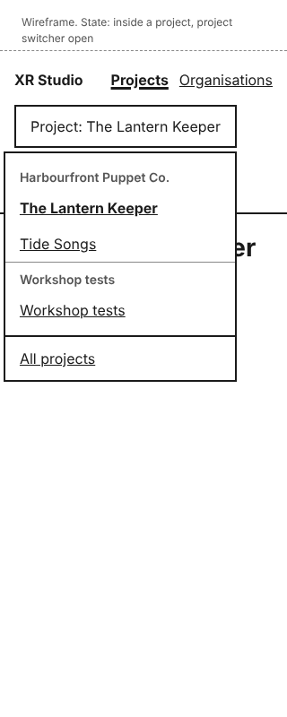
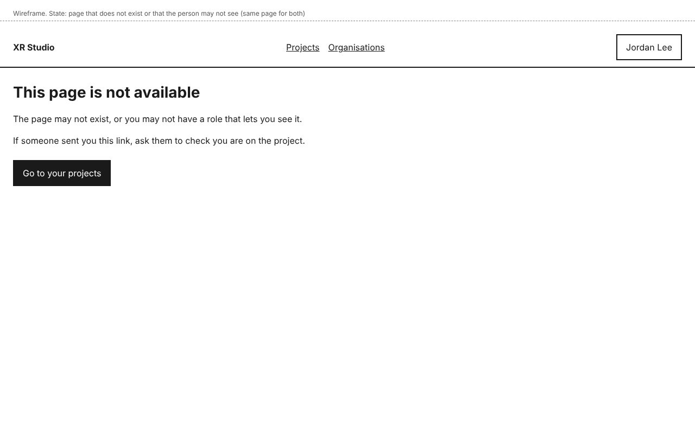
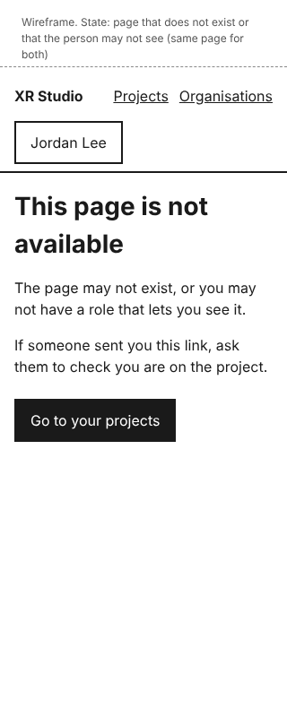

# Dashboard shell design

The frame every signed-in screen sits in: the header, the main navigation, the project switcher, the account menu, the home page before and after a person has projects, and the "not available" page. Later slices add project tabs and pages inside this frame, not a new one (decision-navigation-and-urls).

## Personas

- persona-producer: Jordan works on several productions and needs to get from one to another, and to see which projects they are on and in what role (goals: know where every stage stands and who owns it).
- persona-director: Morgan's frustration is that each stage has its own tools and hand-offs. One frame, one list of projects and one switcher keeps the dashboard to a single place.
- persona-artist: the project cards show the person's own roles, so Riley knows what they are on each project before opening it.

## Flow

1. After sign-in, the person lands on the page they asked for, or on **Projects** (design-sign-in).
2. With no projects, they see "You are not on any projects", what to do if they expect to be on one, and **Start a project** and **Create an organisation**.
3. With projects, they see one card per project: its name, its organisation, **Your roles**, and an **Owner** tag on projects they own.
4. Opening a project shows its pages (design-organisations-and-projects) and a header button **Project: <name>**. Choosing it lists the person's projects grouped by organisation, then **All projects** below a line, outside the groups.
5. The header button with the person's name opens **Your account** and **Sign out**.
6. Opening an address the person may not see, or one that does not exist, shows **This page is not available** with **Go to your projects**.

## Mock-ups

| Screen or state | Mock-up | Notes |
|---|---|---|
| Home, no projects |  | First sign-in, or after being removed from every project. |
| Home, with projects |  | Phone:  |
| Inside a project, project switcher open |  | Phone:  |
| Account menu open |  | |
| Page not available |  | Phone: . Same page whether the page does not exist or the person's roles do not allow it. |

## Layout

- Header, left to right: **XR Studio** (the product name, approver's decision, 2026-11-12; goes to **Projects**), the main navigation (**Projects**, **Organisations**), the project switcher (only inside a project), and the account menu button showing the person's name.
- The current section in the main navigation is shown bold and underlined. On the **Projects** and **Organisations** pages themselves it has `aria-current="page"`; inside a project, **Projects** has `aria-current="true"`, and the open project tab has `aria-current="page"`.
- At 320 pixels the header wraps: the product name and navigation on one line, the switcher and account button below. Project cards stack in one column. The switcher menu stays within the screen.
- Content is at most 960 pixels wide, left-aligned, with 24 pixels of padding (16 at phone width).
- Control names: **Projects**, **Organisations**, **Project: <project name>**, **All projects**, **Your account**, **Sign out**, **Start a project**, **Create an organisation**, **Go to your projects**, and **Your roles** and **Owner** on each card.
- Slice 4 replaces the home page with "What needs you" (story-review-and-status-what-needs-me) for people on projects; the project list stays one click away under **Projects**.

## States and errors

- **No projects:** the empty home page. Any signed-in person may start a project or create an organisation (approver's decision, 2026-11-12). Only people added to a project with a dashboard role, or on the deployment's list of first addresses, have accounts, so sign-up stays closed.
- **Only roles without dashboard access:** these people get no account and never see this frame (design-people-and-roles). Someone who has an account from an earlier role but now has only such roles sees "Nothing in the dashboard for you yet" (design-people-and-roles).
- **Page not available:** the neutral page above, for any address the person may not see, so addresses do not reveal which projects exist.
- **A project removed from the person while they are in it:** their next action shows "You no longer have access to this project" (design-people-and-roles). The record keeps who had which role, so this page is shown only to someone who had a role on that project; everyone else gets **This page is not available**.
- **Loading:** pages are rendered on the server; there is no separate loading state in slice 1.

## How it works

- **How does the system know?** The project list, **Your roles** and the **Owner** tag come from the person's role assignments and the projects' owners in the record, read on each request, so a role given or removed in another session shows on the next page load. Nothing is cached in the browser beyond the page itself.
- **What enforces each promise?**
  - "Sees only what their role allows" (story-project-record-same-project-state): the list is built from the person's own assignments on the server; a project the person is not on is never sent to the browser. A test signs in as two people on different projects and checks each list.
  - "Addresses do not reveal what exists": the server answers with the same page and status for a missing page and a page the person may not see. A test compares the two responses.
- **What is published together?** Not applicable.

## Accessibility

- Landmarks: a skip link, `header`, a `nav` labelled "Main", and `main`. Each page has one `h1`.
- The switcher and account menu are buttons with `aria-expanded` and `aria-controls`; the menus open on Enter or Space, close on Escape, and return focus to their button. Menu items are links or buttons, reachable by Tab. In the switcher, each organisation's projects are a nested list labelled by the organisation's name (`aria-labelledby`), and **All projects** sits after the groups.
- A menu opened over the page never hides the focused element (WCAG 2.4.11). Targets are at least 44 by 44 pixels.
- No horizontal scrolling at 320 pixels.
- All mock-ups were checked with axe (WCAG 2.2 AA tags) with no violations.

## Open items

- None for slice 1.
