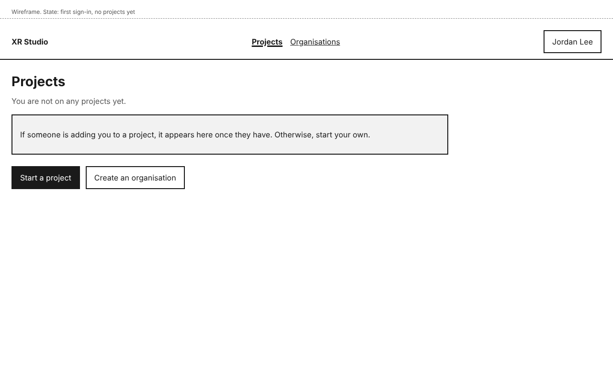
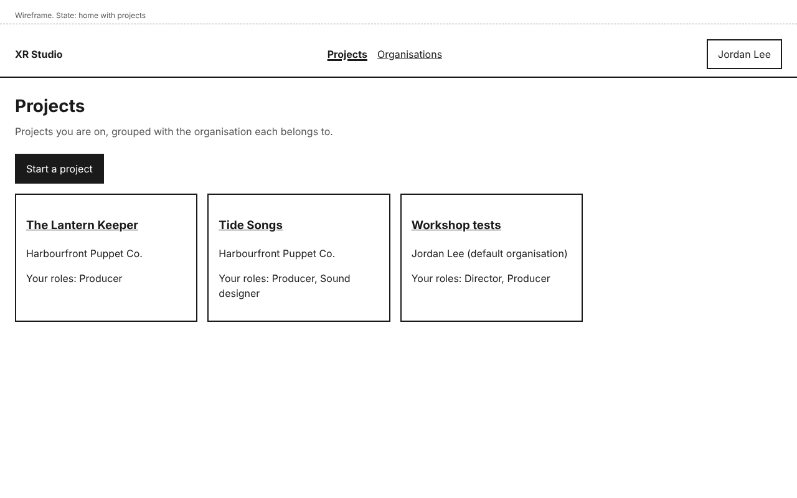
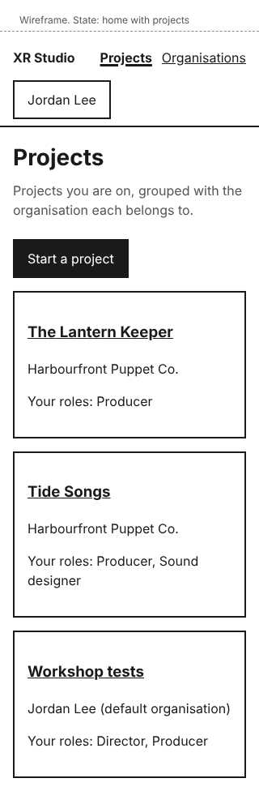
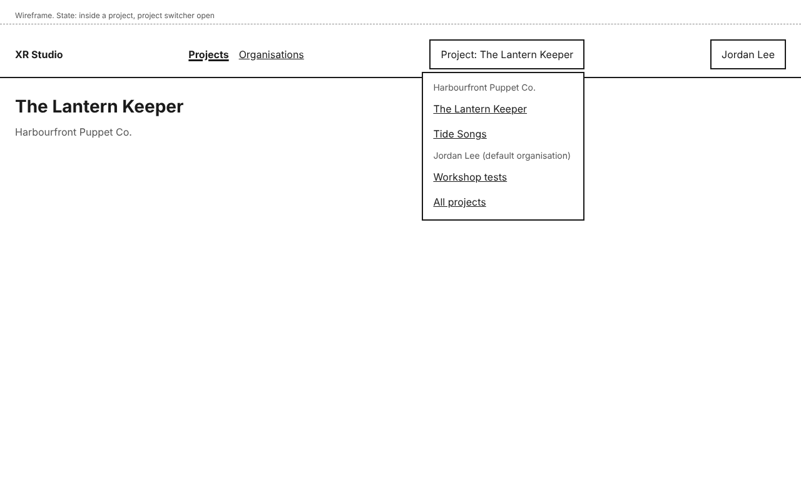
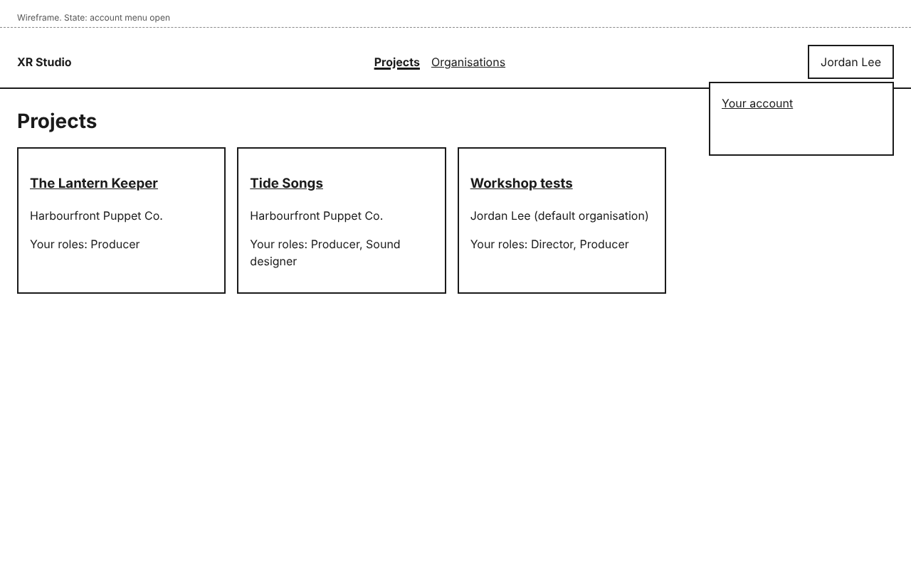

# Dashboard shell design

The frame every signed-in screen sits in: the header, the main navigation, the project switcher, the account menu, and the home page before and after a person has projects. Later slices add project tabs and pages inside this frame, not a new one (decision-navigation-and-urls).

## Personas

- persona-producer: Jordan works on several productions and needs to get from one to another, and to see which projects they are on and in what role (goals: know where every stage stands and who owns it).
- persona-director: Morgan's frustration is that each stage has its own tools and hand-offs. One frame, one list of projects and one switcher keeps the dashboard to a single place.
- persona-artist: the project cards show the person's own roles, so Riley knows what they are on each project before opening it.

## Flow

1. After sign-in, the person lands on **Projects**.
2. With no projects yet, they see "You are not on any projects yet", with **Start a project** and **Create an organisation**.
3. With projects, they see one card per project: its name, its organisation and **Your roles**.
4. Opening a project shows its pages (design-organisations-and-projects) and a header button **Project: <name>**. Choosing it lists the person's other projects, grouped by organisation, and **All projects**.
5. The header button with the person's name opens **Your account** and **Sign out**.

## Mock-ups

| Screen or state | Mock-up | Notes |
|---|---|---|
| Home, no projects yet |  | First sign-in. |
| Home, with projects |  | Phone:  |
| Inside a project, project switcher open |  | |
| Account menu open |  | |

## Layout

- Header, left to right: **XR Studio** (goes to **Projects**), the main navigation (**Projects**, **Organisations**), the project switcher (only inside a project), and the account menu button showing the person's name.
- The current section in the main navigation is marked with `aria-current="page"` and shown bold and underlined.
- At 320 pixels the header wraps: the product name and navigation on one line, the switcher and account button below. Project cards stack in one column.
- Content is at most 960 pixels wide, left-aligned, with 24 pixels of padding (16 at phone width).
- Control names: **Projects**, **Organisations**, **Project: <project name>**, **All projects**, **Your account**, **Sign out**, **Start a project**, **Create an organisation**, and **Your roles** on each card.
- Slice 4 replaces the home page with "What needs you" (story-review-and-status-what-needs-me) for people on projects; the project list stays one click away under **Projects**.

## States and errors

- **No projects:** the empty home page above.
- **Only roles without dashboard access** (venue attendant, performer, collaborator): the person never sees this frame; they see the page in design-people-and-roles ("Your roles do not use the dashboard").
- **A project removed from the person while they are in it:** their next action shows "You no longer have access to this project" with **Go to your projects** (design-people-and-roles).
- **Loading:** pages are rendered on the server; there is no separate loading state in slice 1.

## How it works

- **How does the system know?** The project list and **Your roles** come from the person's role assignments in the record, read on each request, so a role given or removed in another session shows on the next page load. Nothing is cached in the browser beyond the page itself.
- **What enforces each promise?** "Sees only what their role allows" (story-project-record-same-project-state): the list is built from the person's own assignments on the server; a project the person is not on is never sent to the browser. A test signs in as two people on different projects and checks each list.
- **What is published together?** Not applicable.

## Accessibility

- Landmarks: a skip link, `header`, a `nav` labelled "Main", and `main`. Each page has one `h1`.
- The switcher and account menu are buttons with `aria-expanded` and `aria-controls`; the menus open on Enter or Space, close on Escape, and return focus to their button. Menu items are links or buttons, reachable by Tab.
- A menu opened over the page never hides the focused element (WCAG 2.4.11). Targets are at least 44 by 44 pixels.
- No horizontal scrolling at 320 pixels.
- All mock-ups were checked with axe (WCAG 2.2 AA tags) with no violations.
