# Organisation facts design

The company's own facts, recorded once in its organisation and read by every project in it, so that the bio, company history and funder details are never typed again (story-project-record-set-up-organisation). Slice 2 fills the **Organisation facts** section of the organisation page, which slice 1 left empty, and adds the organisation's **Identifier formats** and **Activity**. Agent drafts of organisation facts arrive in slice 7; drafts that read these facts, and the flags on drafts when a fact changes, arrive with the funding stories.

## Personas

- persona-producer: Jordan enters the legal name, bio, company history, an applicant profile for each funder and standard work samples once (goals), and every project's facts page reads them, so descriptions stop drifting between applications (frustrations).
- persona-director: on a solo production, Morgan looks after the organisation and does the same.
- persona-artist: Riley, on one of the organisation's projects, reads the general organisation facts but not the funder profiles.

## Flow

1. The organisation page keeps everything slice 1 gave it (design-organisations-and-projects): the name, **Looked after by**, **Start a project in this organisation**, **Edit organisation**, **Projects** and the note on merging. For people who look after the organisation, a small navigation below the buttons adds **Identifier formats** (design-identifier-filter) and **Activity** (design-activity-log).
2. **Organisation facts** follows, listing in this order: **Legal name**, **Bio**, **Company history**, **Funder applicant profiles** and **Standard work samples**. Each shows its value and "Last changed by <name>, <date and time>", with **Edit** and **Earlier versions** for people who look after the organisation.
3. A line under the heading says that bank details and tax numbers are not organisation facts: they will be kept in the protected store, which comes in a later release; until then, keep them out of XR Studio (story-contracts-and-payment-protect-sensitive-data).
4. **Edit** opens one fact on its own page, as for project facts (design-project-facts). On save the organisation page opens with a notice: "Bio saved. Every project in <organisation> now reads the new bio."
5. **Funder applicant profiles** lists one profile per funder on the program list. Until the program list story arrives, the list is the four funders the business requirements name: Canada Council for the Arts, Canada Media Fund, Creative BC and Epic MegaGrants (approver's decision, 2026-11-12). Each line says whether the profile is recorded and has **Add** (not recorded yet) or **Edit** and **Earlier versions** (recorded), each naming the funder in visually hidden text. A profile is a short form: **Applicant name as registered with the funder**, **Applicant category**, **Funder's applicant profile number (optional)** and **Mandate**, with **Save profile**.
6. **Open standard work samples** opens the same work samples page as a project's (design-project-facts), for the organisation: files with a title, who added each and when, **Remove**, any held uploads, and **Add a work sample**. Text in PDFs is checked against the identifier formats when the upload is registered; scanned PDFs, video, images and audio are not (design-identifier-filter).
7. Every project in the organisation shows the legal name and bio under **From <organisation>** on its Facts tab (design-project-facts).
8. **Earlier versions**, compare, restore and save conflicts work exactly as for project facts, with the same pages and wording (see design-project-facts' mock-ups); restoring an organisation fact also runs the identifier check.

## Who sees and edits which organisation facts

| Fact | Who sees it | Who edits it |
|---|---|---|
| Legal name, Bio, Company history, Standard work samples | People who look after the organisation, and every dashboard role on its projects | People who look after the organisation |
| Funder applicant profiles | People who look after the organisation, and the Director and Producer on its projects (approver's decision, 2026-11-12) | People who look after the organisation |

"A person the organisation names for it" (story-project-record-set-up-organisation) is a person in **Looked after by** (design-organisations-and-projects). **Identifier formats** and **Activity** are only for people who look after the organisation (approver's decision, 2026-11-12); a Director who does not look after it sees the project's own activity, not the organisation's.

## Mock-ups

| Screen or state | Mock-up | Notes |
|---|---|---|
| Organisation page with its facts, as Jordan (looks after it) | 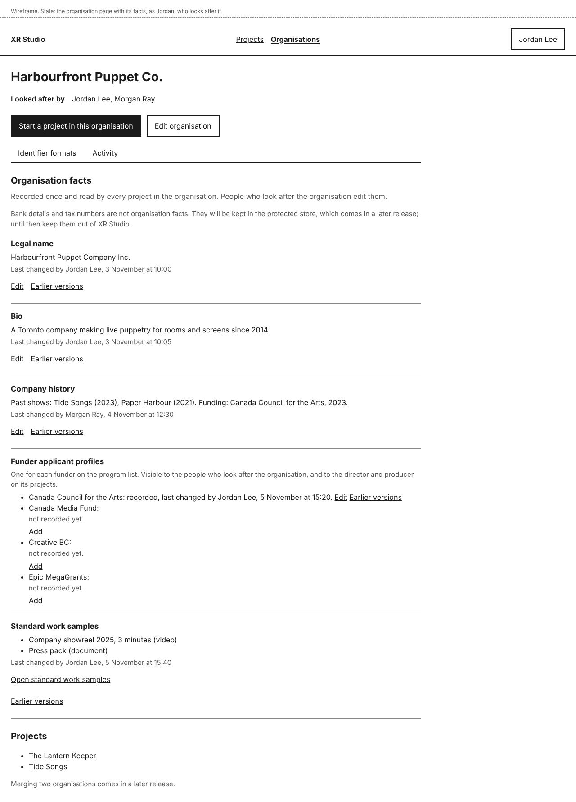 | Phone: 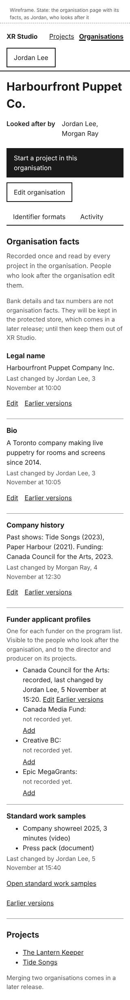. Slice 1 controls kept; **Identifier formats** and **Activity** added. |
| Organisation facts, nothing recorded yet | 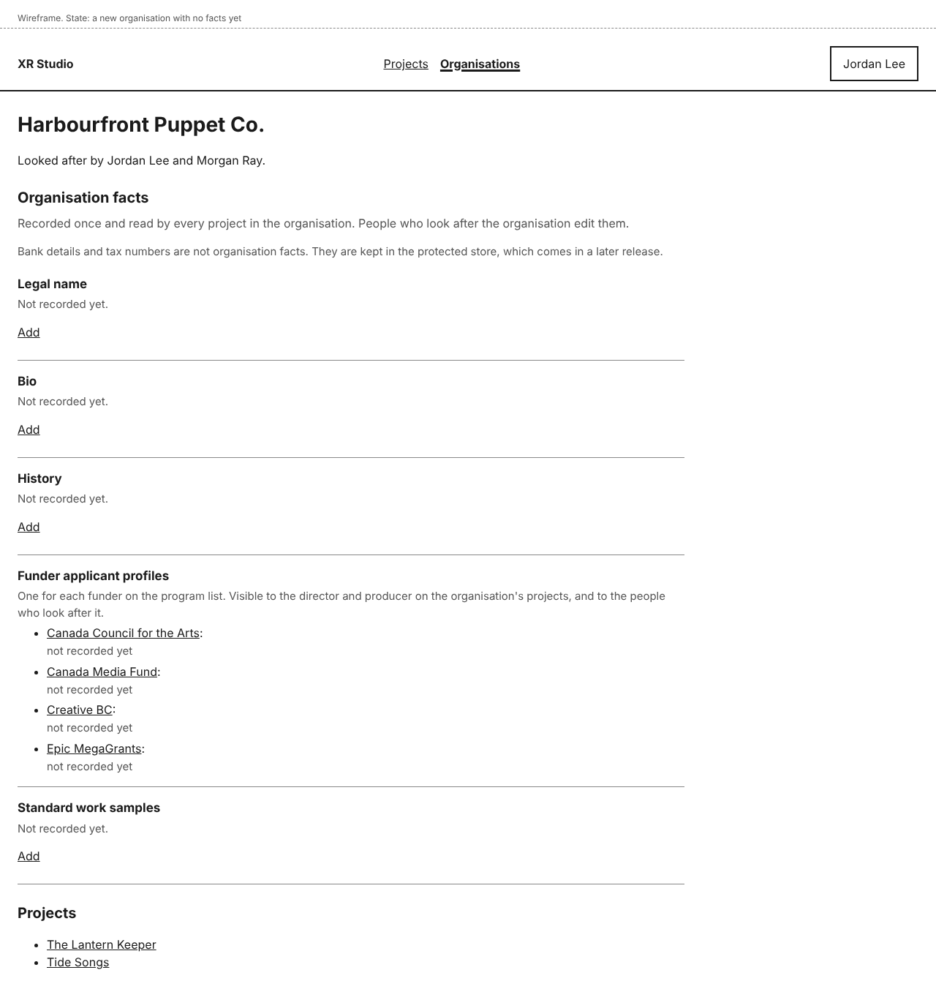 | **Add** beside each. |
| Organisation page, as Riley (on one of its projects) | 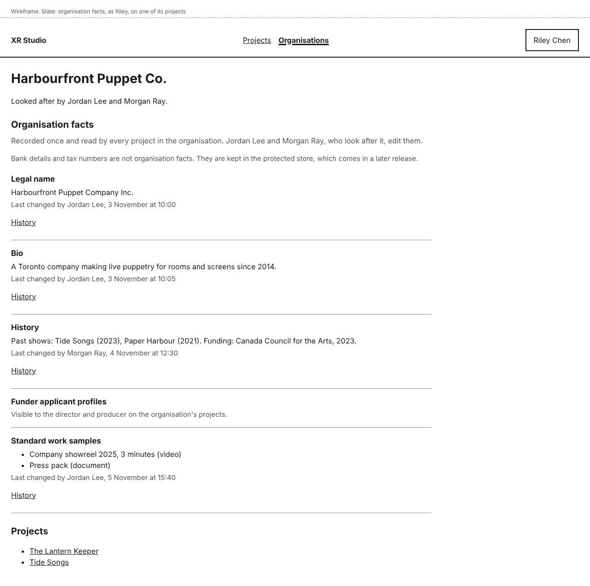 | No **Edit**; funder profiles named but not shown; no **Identifier formats** or **Activity**. |
| After saving the bio | 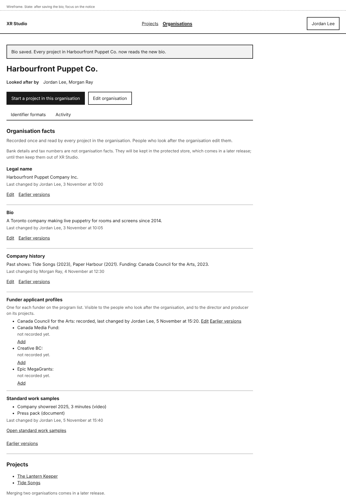 | Focus on the notice. |
| Edit the bio | 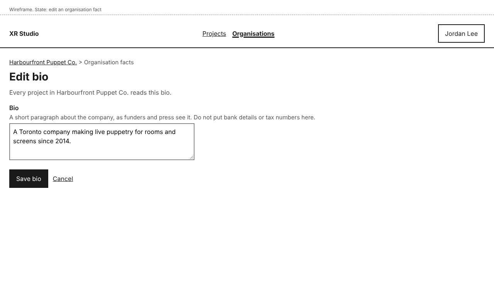 | |
| Edit one funder applicant profile | 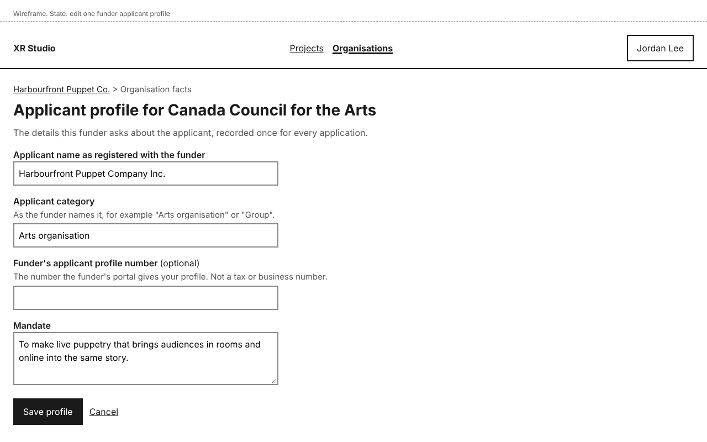 | |
| Standard work samples | 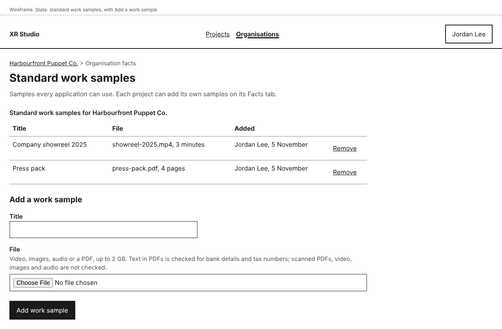 | Phone: 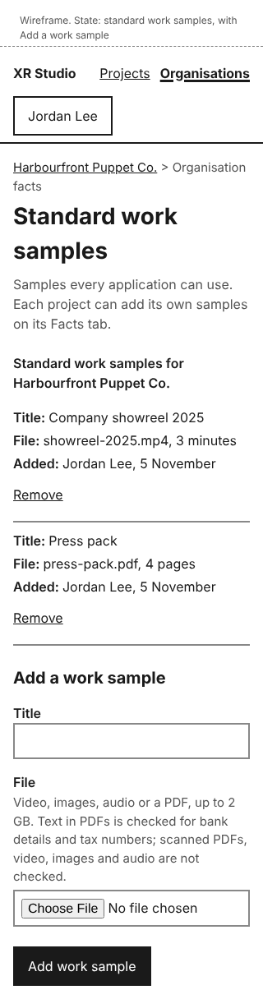 |
| Add a work sample: no title, file too large | 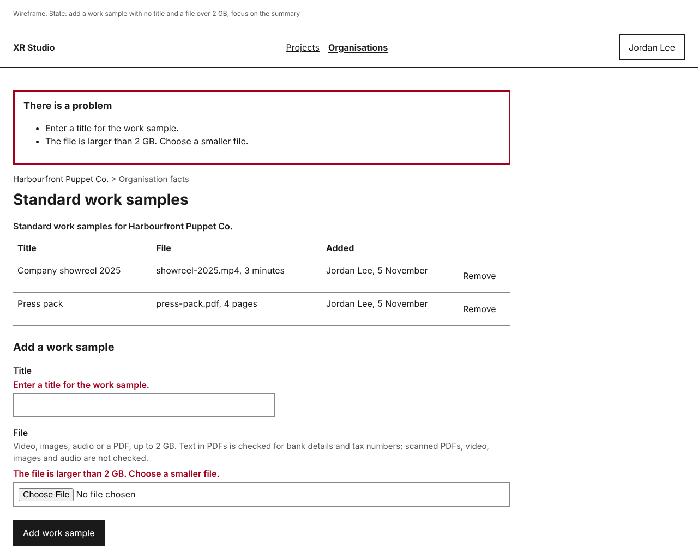 | Focus on the summary; each error linked. |
| Add a work sample: uploading | 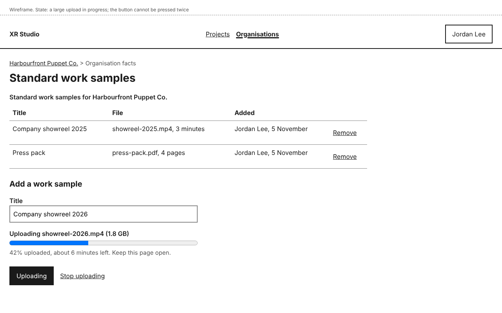 | Progress, button disabled. |
| Add a work sample: upload interrupted | 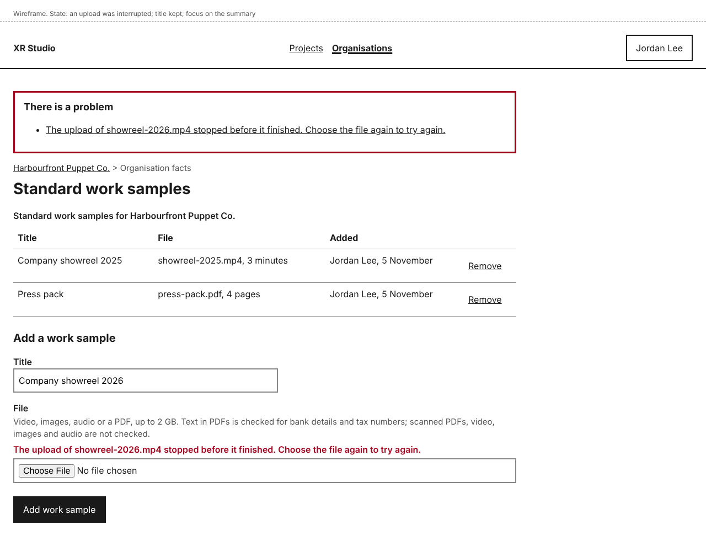 | Title kept. |
| Earlier versions, compare, restore, save conflict | As project facts | Same pages and wording: design-project-facts. |

## Layout

- **Organisation facts** sits on the organisation page after the buttons and the **Identifier formats** and **Activity** navigation, and before **Projects**.
- Control names: **Organisation facts**, **Identifier formats**, **Activity**, **Edit**, **Add**, **Earlier versions**, **Save <fact>**, **Save profile**, **Cancel**, **Open standard work samples**, **Add a work sample**, **Add work sample**, **Uploading**, **Stop uploading**, **Remove**.
- Value types: Legal name is one line; Bio and Company history are text; a funder profile is the four fields above; a work sample is a title and one file (video, images, audio or PDF, up to 2 GB; approver's decision, 2026-11-12).

## States and errors

- **Nothing recorded yet:** "Not recorded yet." with **Add**. On a project's Facts tab: "<organisation> has no facts recorded yet. People who look after it add them on its page."
- **Applicant profile number:** optional. Its hint says it is the funder portal's own number, not a tax or business number; a value matching an identifier format is held (design-identifier-filter).
- **Work sample title missing:** "Enter a title for the work sample." **File missing:** "Choose a file to add." **File too large:** "The file is larger than 2 GB. Choose a smaller file." Each is linked from the summary; values kept.
- **Uploading:** the file goes straight to storage with a progress bar and a polite text update every few seconds ("42% uploaded, about 6 minutes left. Keep this page open."). **Add work sample** is disabled and reads **Uploading** until it ends; **Stop uploading** cancels it.
- **Upload interrupted:** "The upload of <file> stopped before it finished. Choose the file again to try again." The title is kept.
- **Someone else saved while you were editing:** as for project facts.
- **Flags on drafts:** in slice 2 there are no drafts, so nothing is flagged and the notice does not mention it.
- **Agents:** none in slice 2. From slice 7, an agent's drafts of organisation facts are marked as drafts until a person who looks after the organisation accepts them.

## How it works

- **How does the system know?** Organisation facts are versioned working state held on the organisation (decision-project-record-model). Projects read them through the organisation each time, so a change is seen by every project at its next page load, with nothing copied.
- **What enforces each promise?**
  - "Entered once and read by every project": there is one stored value; project pages read it from the organisation. A test with an organisation holding two projects checks both read the same bio after one change.
  - "Only people who look after the organisation edit them": the command layer checks **Looked after by**. A test.
  - "People on a project see only the organisation facts their role allows": funder profiles have their own data class, checked per request. A test signs in as Riley.
  - "Bank details and tax numbers are not organisation facts": the identifier filter checks every save, restore and upload (design-identifier-filter). A test with test identifiers.
  - "A large upload is added once": the upload is registered by one command with a request id, so a repeated submit is ignored. A test.
- **What is published together?** Each fact is saved on its own.

## Accessibility

- As design-project-facts: one heading per fact, actions naming the fact or funder in visually hidden text, notices that take focus, page titles starting with the outcome or "Error:", and dialogs that return focus.
- The work sample file field has a visible label and hint; the size limit and what is checked are written in the hint, not only shown after an error.
- Upload progress uses a native `progress` element with its label, and a polite status line updated every few seconds, not on every change.
- The work samples table has a caption and becomes one block per sample at 320 pixels.
- All mock-ups were checked with axe (WCAG 2.2 AA tags) with no violations, and the phone frames have no horizontal scrolling.

## Open items

- The full funder program list: story-funding-program-list. Until then, the four named funders.
- Agent drafts of organisation facts: slice 7.
- Flags on drafts that used a changed fact: the funding stories.
