# Organisations and projects design

Slice 1 covers creating an organisation and naming who looks after it, starting a project in one, and seeing both. Organisation facts and project facts arrive in slice 2; their sections show an empty state until then. Merging two organisations is deferred to a later slice (approver's decision, 2026-11-12); the organisation page says so.

## Personas

- persona-director: Morgan wants one place that holds a show's brief and work from the start (goals). **Start a project** asks only for a name, an optional brief, an organisation and an owner, and Morgan's own name is already chosen as the owner.
- persona-director, solo production: with no organisation yet, Morgan is not stopped; a default organisation named after the project is made.
- persona-producer: the same project facts are retyped across documents today (frustrations). Every project shows which organisation it reads its company facts from, and Morgan can start projects in Jordan's organisation, so the company is entered once rather than split across default organisations.

## Flow

1. From **Projects** or **Organisations**, the person chooses **Create an organisation**, types the **Organisation name**, and ticks who it is **Looked after by**: themselves (ticked already) and anyone else from the people on their projects (approver's decision, 2026-11-12). They choose **Create organisation**. It opens on its organisation page.
2. From **Projects**, or **Start a project in this organisation** on an organisation page, the person chooses **Start a project**.
3. They give a **Project name** and, if they like, a **Brief (optional)**. They choose the **Organisation**: any organisation they look after or have projects in (approver's decision, 2026-11-12). Then the **Owner**: they are chosen already; the list shows them and people already on that organisation's projects, and it refreshes when the organisation changes. If they are on no organisation, the form says a new organisation named after the project will be made, which they will look after; the **Owner** list then holds only them, with no hint.
4. **When you start it** sums up the roles: the owner gets Director and Producer. If they choose someone else as owner, that person gets Director and Producer and they keep Producer (approver's decision, 2026-11-12).
5. They choose **Start project**. The button cannot be pressed twice while the request is in progress. If the name is missing or already used in that organisation, nothing is created; the error summary names the problem, focus moves to it, and everything typed is kept.
6. The project opens on its **Overview** with the notice "Project started. You own it and have the Director and Producer roles." (or the matching text when someone else owns it). Focus moves to the notice.
7. The project appears on **Projects** with its organisation, the person's roles and the **Owner** tag.
8. On an organisation page, a person who looks after it chooses **Edit organisation** to change its name and who looks after it. People on its projects see the page without that button and can start projects in it.

## Mock-ups

| Screen or state | Mock-up | Notes |
|---|---|---|
| Create an organisation | 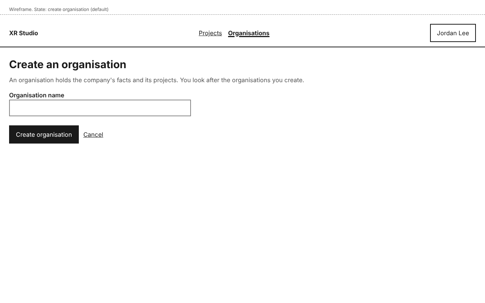 | The creator is ticked under **Looked after by**. |
| Create an organisation, name missing | 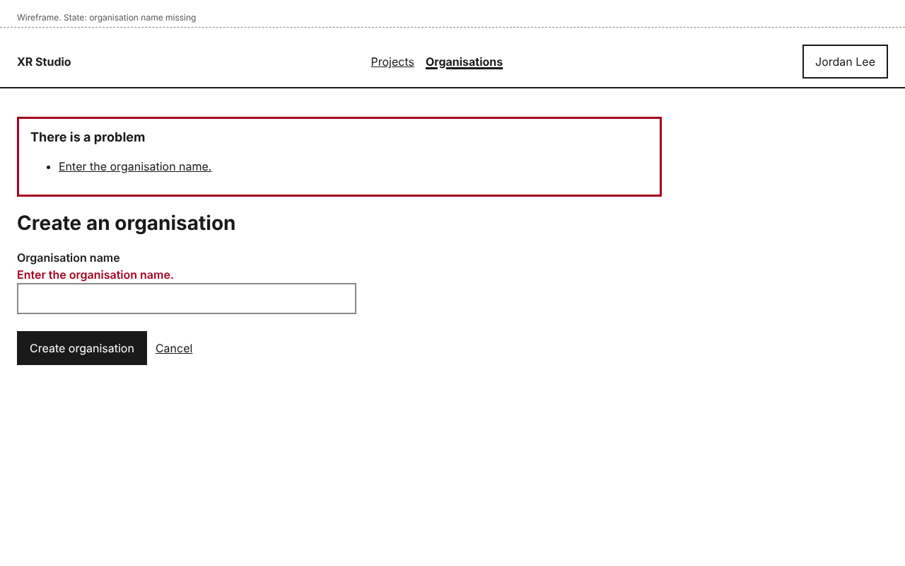 | Phone: 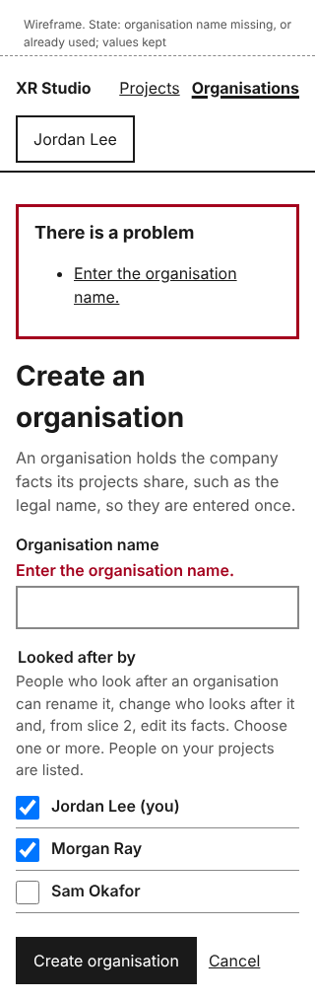. Choices kept. |
| Edit organisation, only person who looks after it | 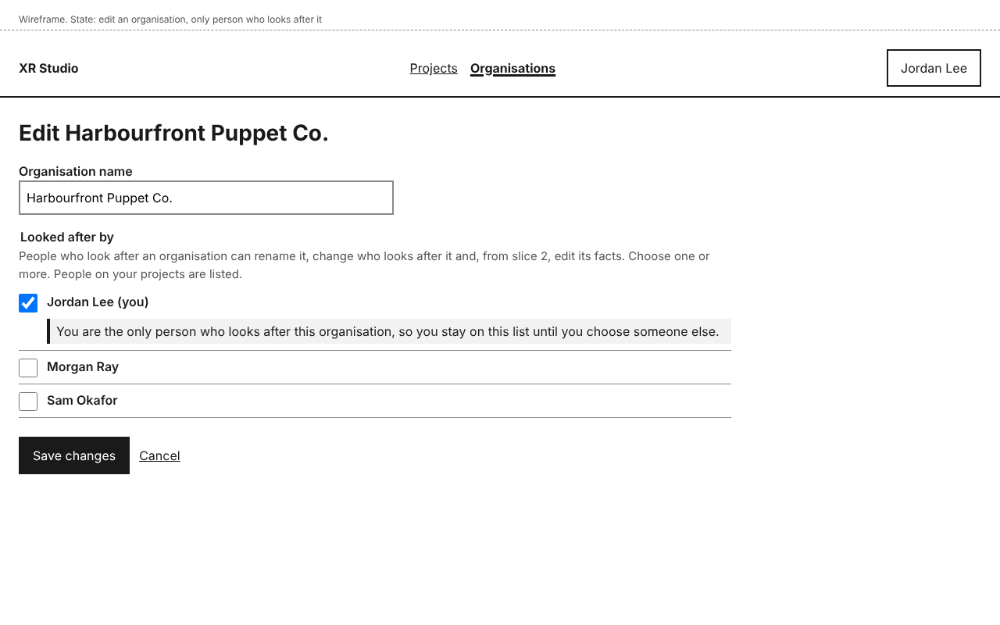 | The note explains why they stay ticked. |
| Start a project |  | Phone: 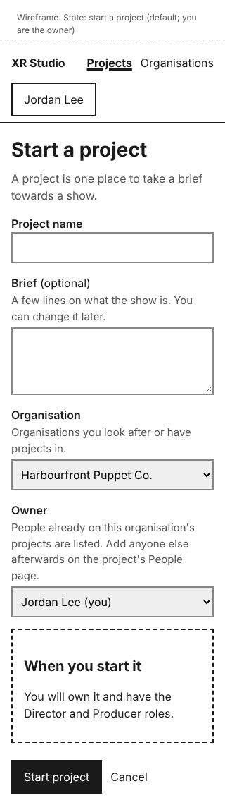 |
| Start a project, someone else as owner | 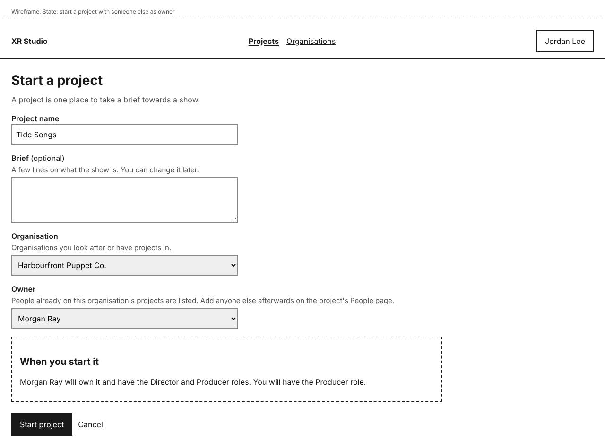 | The summary says the starter keeps Producer. |
| Start a project, name missing | 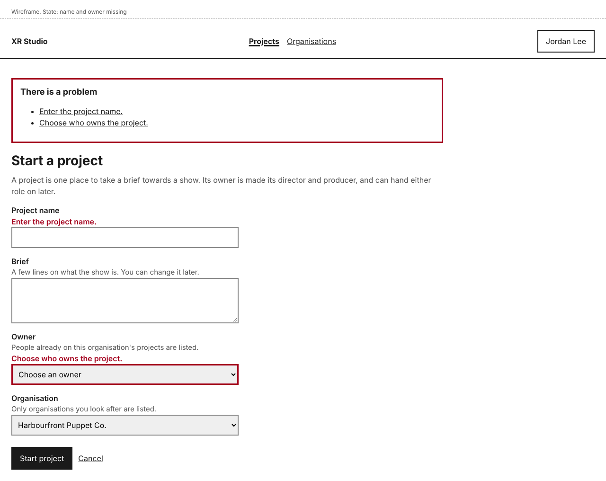 | Phone: 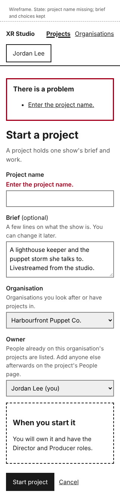. Brief and choices kept. |
| Start a project, no organisation to choose | 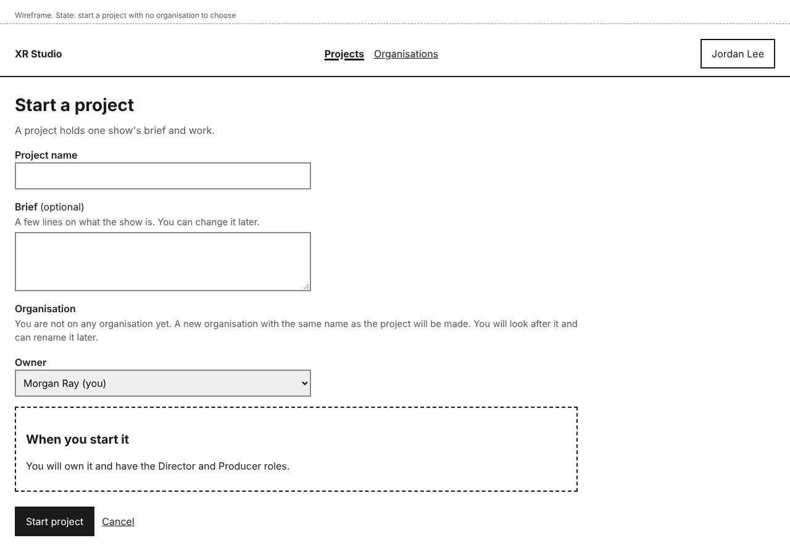 | No owner hint. |
| Project overview, just started | 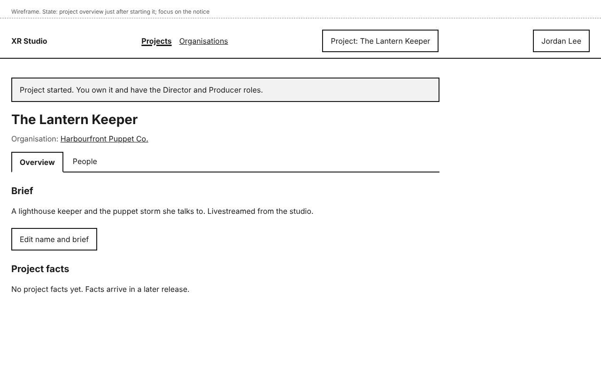 | Focus on the notice. Facts empty until slice 2. |
| Project overview, cannot edit, no brief yet | 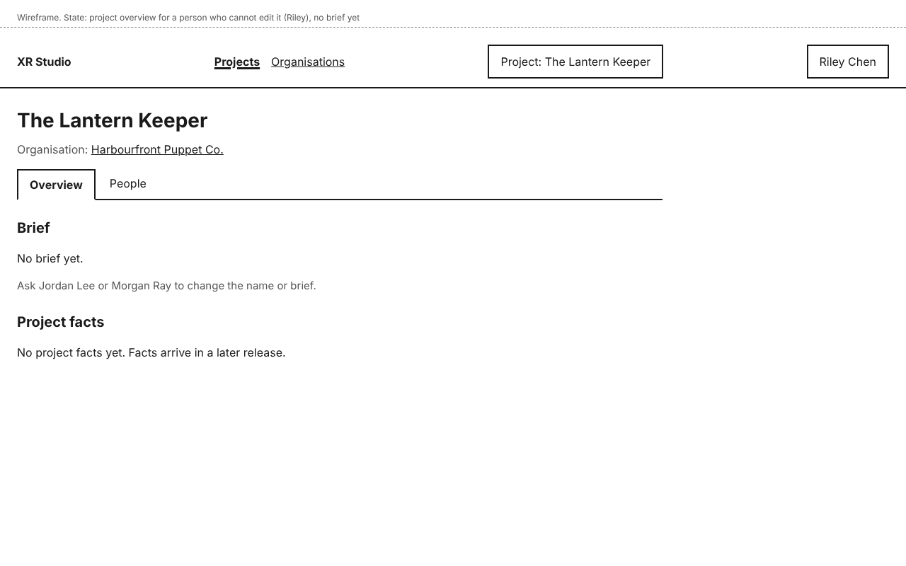 | As Riley: no **Edit name and brief**; names who can. |
| Organisations | 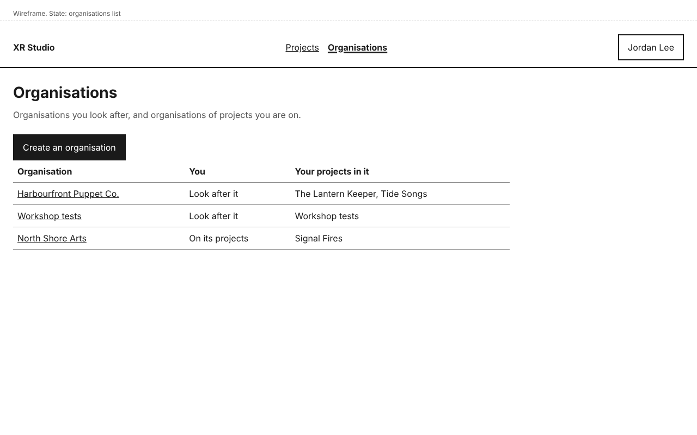 | The **You** column says "Look after it" or "On its projects". |
| Organisation page, looks after it | 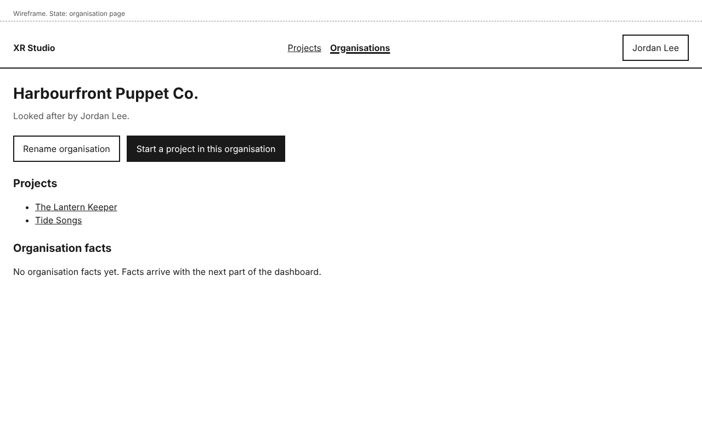 | |
| Organisation page, on its projects | 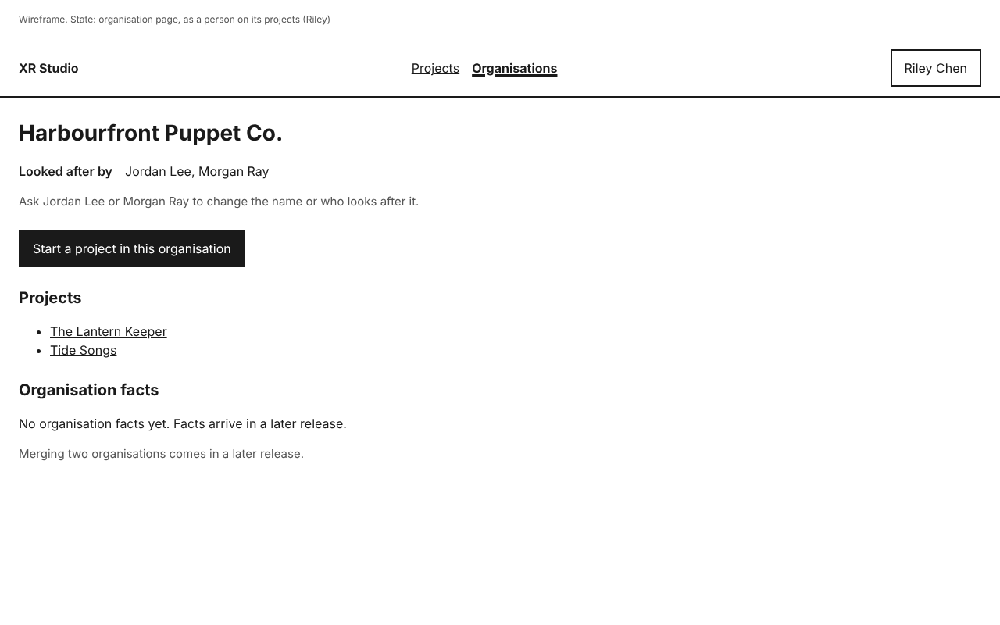 | As Riley: no **Edit organisation**. |

The project list (home) is in design-dashboard-shell.

## Layout

- Forms are one column, fields at most 480 pixels wide, with the label above each field and any hint under the label, outside it.
- **Organisation** comes before **Owner**, because the owner list depends on it.
- The project page has a heading with the project name, "Organisation:" with a link, and tabs: **Overview** and **People** in slice 1. Later slices add tabs to the same row.
- Control names: **Create an organisation**, **Organisation name**, **Looked after by**, **Create organisation**, **Cancel**, **Edit organisation**, **Save changes**, **Start a project**, **Project name**, **Brief**, **Organisation**, **Owner**, **Start project**, **Edit name and brief**, **Start a project in this organisation**, **Overview**, **People**.
- **Edit name and brief** opens the start form's name and brief fields, filled in, with **Save changes**; it is shown only to people allowed to use it.

## States and errors

- **Missing project name:** "Enter the project name."
- **Project name already used in that organisation:** "There is already a project called Tide Songs in Harbourfront Puppet Co. Choose a different name." Names need not be unique across organisations.
- **Missing organisation name:** "Enter the organisation name."
- **Organisation name already used by an organisation you look after:** "You already look after an organisation called Harbourfront Puppet Co. Choose a different name."
- **Nobody left looking after an organisation:** refused; the only person who looks after it stays ticked, with a note saying why, until they tick someone else.
- **Owner no longer allowed** (for example removed from the organisation's projects while the form was open): "The person you chose can no longer own a project here. Choose another owner." The form preselects the person starting the project, so a missing owner cannot be sent from it; the API still refuses a request with no owner (400).
- **Brief left empty:** allowed; the overview says "No brief yet."
- **No organisation to choose:** the hint replaces the list. The default organisation has the same name as the project, and the person looks after it. Its name is a plain name, with no "(default organisation)" label, and can be changed later.
- **Owner list:** the person starting the project, and people already on the chosen organisation's other projects. Owners from outside are added afterwards as people (design-people-and-roles); ownership can be handed on in a later slice.
- **Values on error:** every value typed and every choice made is shown again with the errors.
- **Double submit:** the submit button is disabled while the request is in progress, and the command carries a request id so a repeated request creates nothing new.
- **Not allowed:** organisations the person neither looks after nor has projects in are not listed and their address shows **This page is not available** (design-dashboard-shell). **Edit organisation** and **Edit name and brief** are not shown to people who cannot use them, and each page names who can.
- **Empty facts:** "No project facts yet." and "No organisation facts yet." until slice 2.
- **Merging organisations:** not in slice 1; the organisation page says "Merging two organisations comes in a later release."
- **Success:** a notice on the page that opens; focus moves to it and the page title starts with the outcome.
- **Someone else owns the new project:** the notice is "Project started. Morgan Ray owns it and has the Director and Producer roles. You have the Producer role." (added with the user documentation, 2026-11-12).
- **Owner tag:** marks who owns the project. Today it carries no rights beyond the Director and Producer roles, and the owner cannot be changed after the project starts; handing on ownership comes in a later release (added with the user documentation, 2026-11-12).
- **Editing a project's name or brief:** the same rules as starting one: "Enter the project name." for an empty name, and the same duplicate-name message within the organisation. On success the notice is "Name and brief saved." (added with the user documentation, 2026-11-12).
- **Editing an organisation:** the same rules as creating one: "Enter the organisation name." and the same duplicate-name message; at least one person stays under **Looked after by**. On success the notice is "Organisation saved." (added with the user documentation, 2026-11-12).
- **Organisation page contents:** the organisation's name; **Looked after by** with their names; **Start a project in this organisation**; **Edit organisation** for people who look after it; **Projects**, listing its projects that the viewer is on (or all of them for people who look after it); **Organisation facts**, empty until a later release; and the note on merging (added with the user documentation, 2026-11-12).

## How it works

- **How does the system know?** Organisations, projects and who looks after each come from the record. The roles shown are the person's role assignments, read on each request. The organisation a project belongs to is stored with the project; its facts are read from the organisation, not copied (story-project-record-start-project).
- **What enforces each promise?**
  - "A project cannot be created without a name and an owner": the command layer refuses the command, and the form shows the error; the API returns 400 naming the fields. A test sends the command with each field missing.
  - "Names are unique where it matters": the command layer checks project names within the organisation and organisation names among those the person looks after; tests try each duplicate.
  - "An organisation always has someone looking after it": the command layer refuses a change that leaves nobody. A test.
  - "An agent cannot create an organisation or move a project between organisations": the command layer refuses those commands from an agent session. A test.
  - "The owner is director and producer, and a different starter keeps Producer": the start-project command creates the role assignments in the same transaction. Tests for both cases.
  - "Starting in an organisation needs looking after it or having projects in it": the command layer checks it. A test.
- **What is published together?** Not applicable.

## Accessibility

- On a failed submit, focus moves to the error summary (`role="alert"`), which links to each field; each field's message is tied to it with `aria-describedby` alongside its hint, the field is marked `aria-invalid`, and the page title starts "Error:".
- Hints sit outside labels and legends, tied with `aria-describedby`, so a control's name stays short.
- Optional fields say "(optional)" in their label; the other fields are needed.
- **When you start it** is a polite live region present from page load, so changes to the owner are read out without moving focus.
- The organisation hint for "no organisation" is plain text, not a disabled control.
- The project tabs are a `nav` labelled "Project", with links and `aria-current="page"` on the open tab.
- No horizontal scrolling at 320 pixels; targets at least 44 by 44 pixels.
- All mock-ups were checked with axe (WCAG 2.2 AA tags) with no violations.

## Open items

- Merging organisations, deferred to a later slice (approver's decision, 2026-11-12). The stories set-up-organisation and start-project name it; a later slice's design adds it.
- Handing ownership of a project on, in a later slice.
