# Project facts design

A project's facts recorded once, in one place, so that later drafts (funding documents, contracts, call sheets) are made from the same record (story-project-record-record-facts). Slice 2 covers entering, editing and reading facts by role, who last changed each fact, a fact's history, and comparing or restoring an earlier version with later versions kept. Agent drafts of facts from a document arrive in slice 7; drafting documents from facts arrives with the funding, contracts and schedule stories.

## Personas

- persona-producer: Jordan records the description, plan, budget, credits, collaborators, schedule, work samples and capacity once, and sees who last changed each and when (goals). Figures stop drifting between applications, budgets and reports (frustrations), because every later draft reads this page.
- persona-artist: Riley reads the facts their role allows and is told plainly which ones are hidden and who edits them (story-project-record-add-person).
- persona-director: Morgan edits facts too, and can restore an earlier wording without losing the later one.

## Flow

1. On a project, the **Facts** tab sits between **Overview** and **People**. It lists the project's facts in a fixed order: **Description**, **Plan**, **Budget**, **Credits**, **Collaborators**, **Schedule**, **Work samples**, **Capacity**. Under each: its value, "Last changed by <name>, <date and time>", and **Edit** and **History**.
2. Below them, **From <organisation>** shows the organisation facts this project reads (legal name and bio; design-organisation-facts), with **Open <organisation>'s facts**. They are not edited here.
3. A person who may edit chooses **Edit** beside a fact. One fact is edited at a time, on its own page, with **Save <fact>** and **Cancel**. On save, the **Facts** tab opens with a notice ("Description saved."); focus moves to it.
4. Before saving, the text is checked against the identifier formats (design-identifier-filter). Text that matches is not saved; the person is told why and what to do.
5. **History** beside a fact lists every saved version, newest first, with who saved it and when. **Compare with current** shows an earlier version beside the current one. **Restore** asks for confirmation, then saves that earlier text as a new version; every version stays in the history.
6. Someone whose roles do not allow editing sees the facts without **Edit**, and a line naming who edits them. A fact their roles may not see is listed by name with "The budget is visible to the director and producer." and no value.

## Who sees and edits which facts

Each fact has a data class (decision-identity-and-roles). Slice 2 uses two classes; later slices map new roles' permissions onto them.

| Fact | Class | Who sees it | Who edits it |
|---|---|---|---|
| Description, Plan, Credits, Collaborators, Schedule, Work samples, Capacity | General | Every role that uses the dashboard | Director, Producer |
| Budget | Budget | Director, Producer | Director, Producer |

Organisation facts read into a project follow design-organisation-facts. No fact is ever visible to venue attendants, performers or collaborators, who do not use the dashboard.

## Mock-ups

| Screen or state | Mock-up | Notes |
|---|---|---|
| Facts, as Jordan (can edit) | 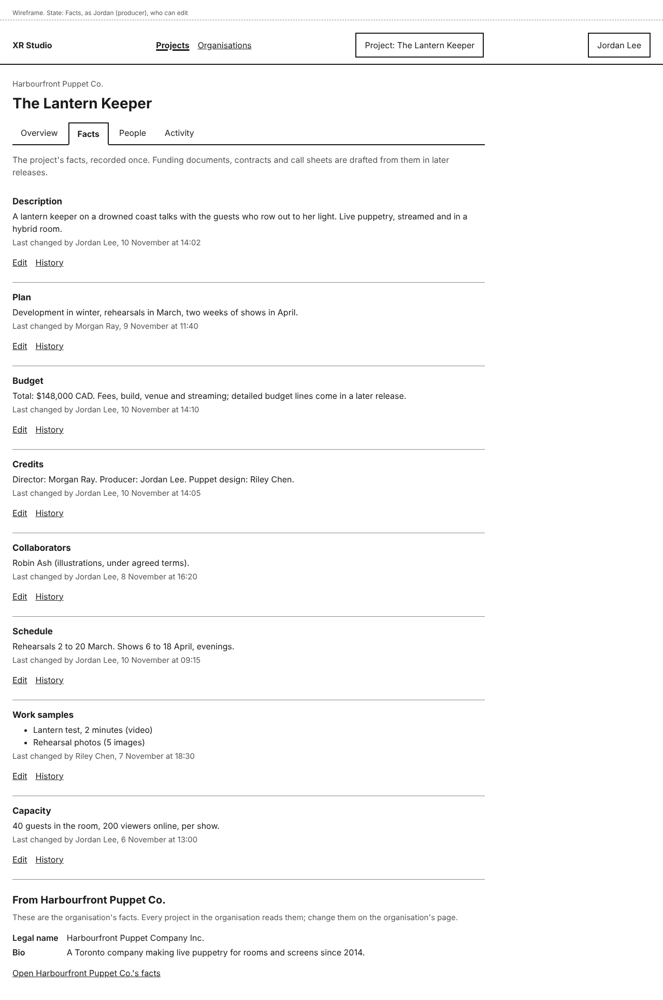 | Phone: 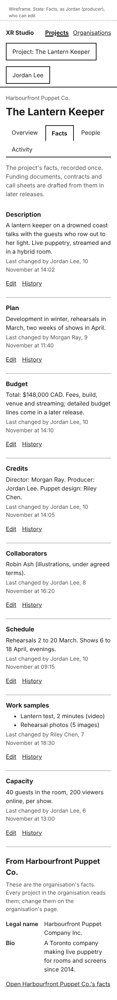 |
| Facts, after saving | 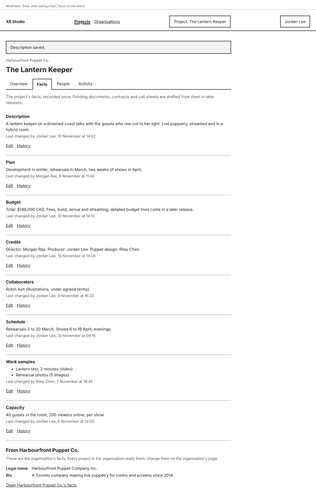 | Focus on the notice. |
| Facts, as Riley (read only, budget hidden) | 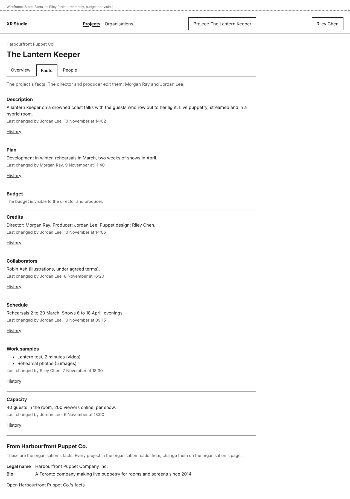 | Phone: 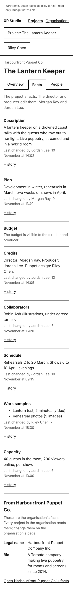. No Activity tab for this role. |
| Facts, nothing recorded yet | 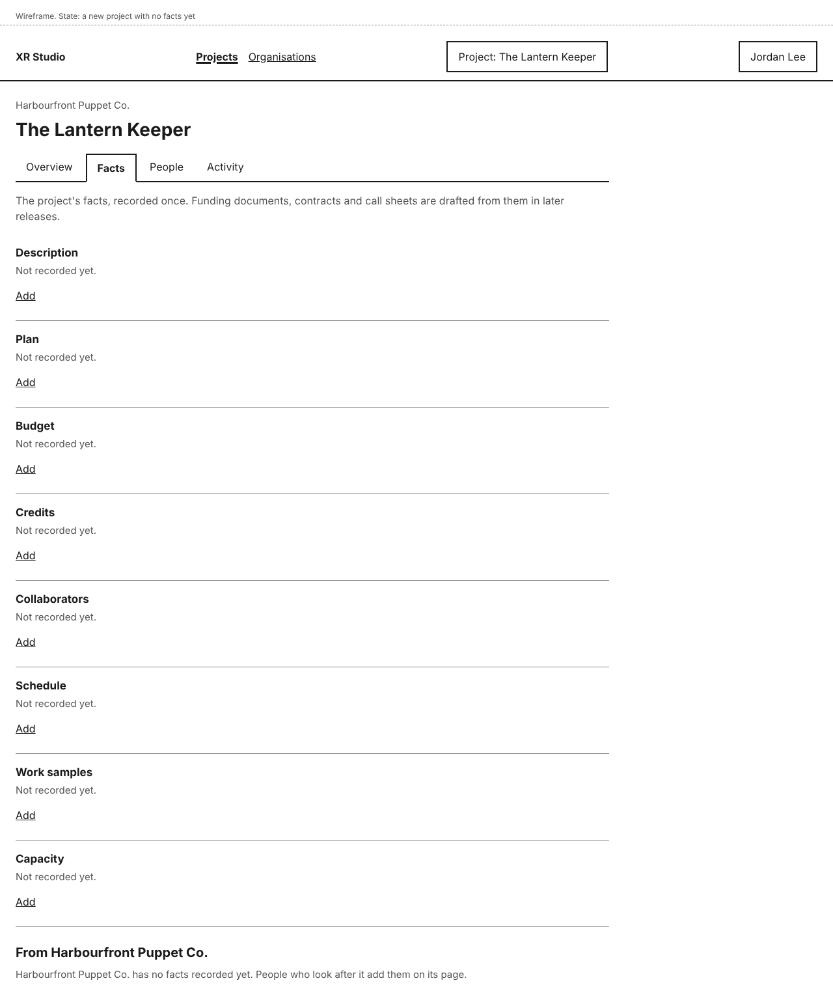 | **Add** instead of **Edit**. |
| Edit a text fact | 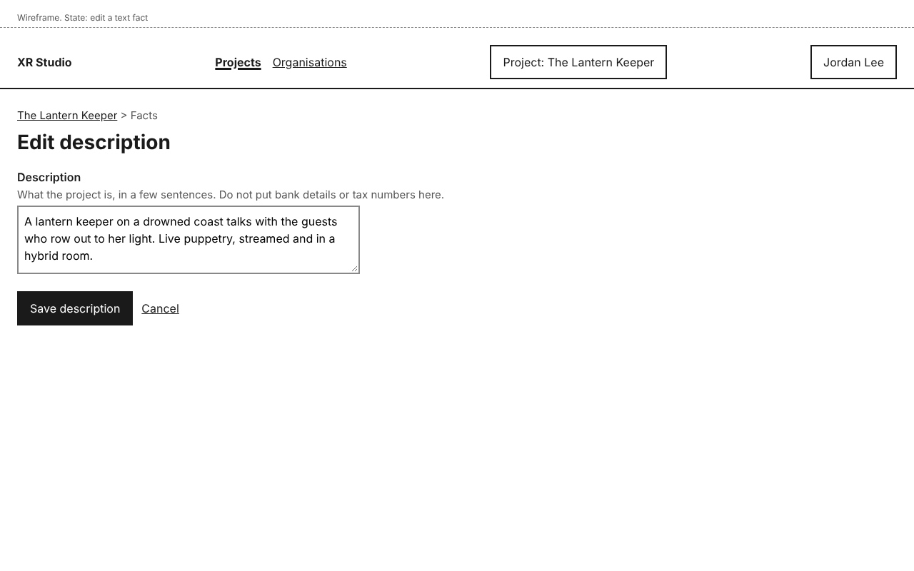 | Phone: 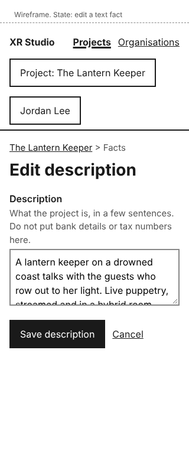 |
| Edit a number fact, not a whole number | 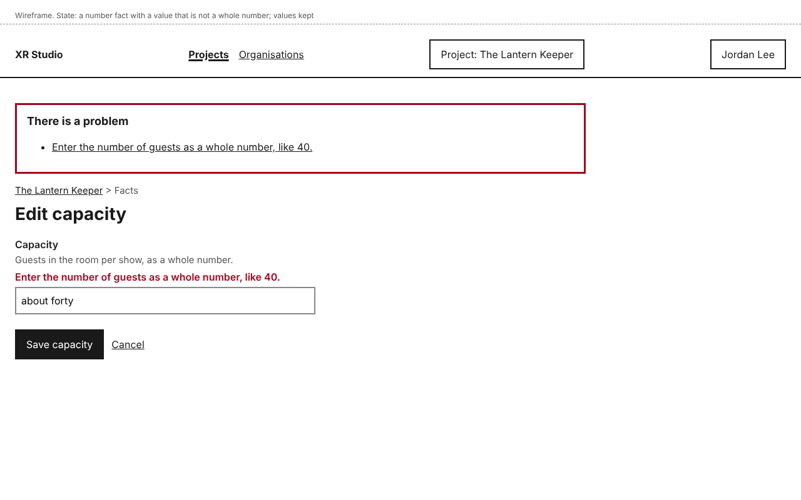 | Value kept. |
| Someone else saved while you were editing | 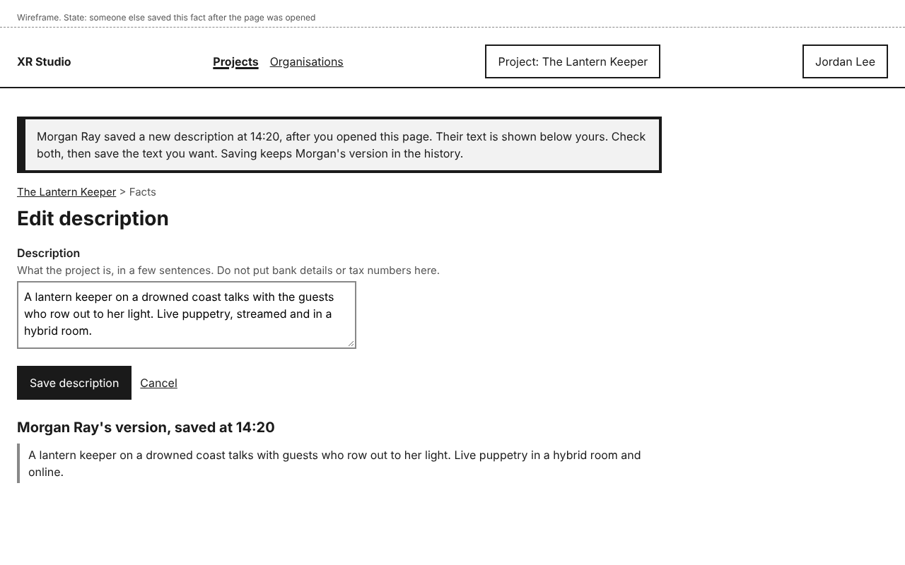 | Both texts shown; nothing lost. |
| History of one fact | 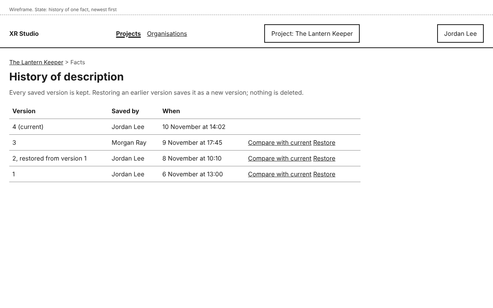 | Phone: 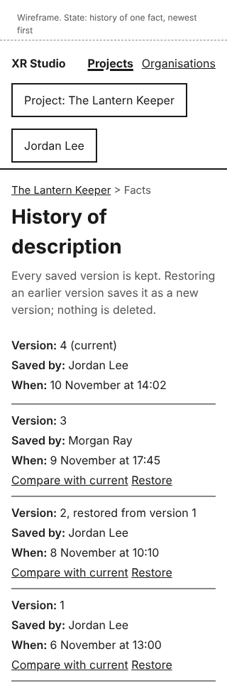 |
| Compare an earlier version with the current one | 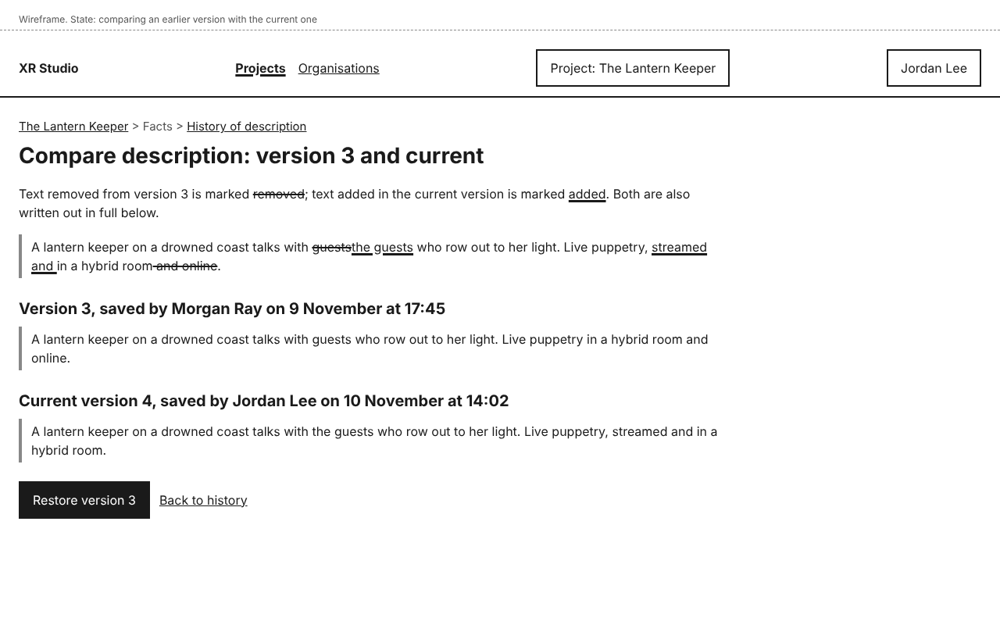 | Changes marked and both versions written out. |
| Restore, confirmation | 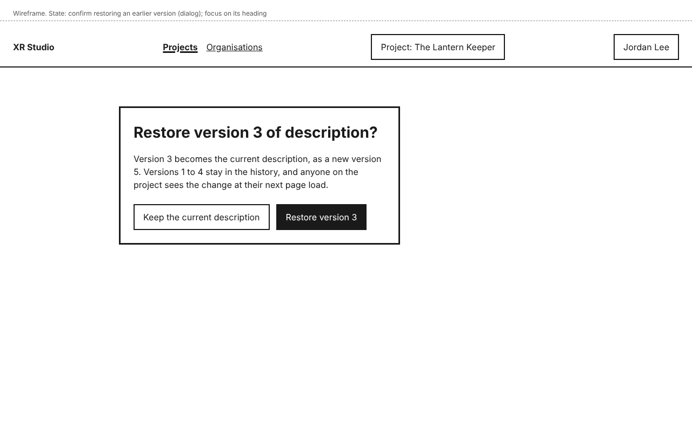 | Dialog; focus on its heading. |

## Layout

- The project tabs are **Overview**, **Facts**, **People** and, for roles that may read it, **Activity** (design-activity-log).
- Each fact is a block with a heading (the fact's name), its value, the last-changed line and its actions. At 320 pixels the blocks stack with no change.
- Control names: **Facts**, **Edit** (with the fact's name in visually hidden text), **Add**, **History**, **Save <fact>**, **Cancel**, **Compare with current**, **Restore**, **Restore version <n>**, **Keep the current <fact>**, **Back to history**, **Open <organisation>'s facts**.
- Value types: Description, Plan, Credits, Collaborators and Schedule are text; Budget is a total in CAD plus a note; Capacity is guests in the room and viewers online, as whole numbers; Work samples are files with a title (the organisation's standard samples are in design-organisation-facts). Detailed budget lines and actual cost come with the budgets stories.

## States and errors

- **No facts yet:** each fact shows "Not recorded yet." with **Add**.
- **Number not valid:** "Enter the number of guests as a whole number, like 40." Values typed are kept.
- **Someone else saved after you opened the page:** nothing is overwritten. The page says who saved and when, shows their version below yours, and keeps your text in the box; saving then makes yours the newest version and theirs stays in the history.
- **Text matches an identifier format:** not saved; see design-identifier-filter.
- **Restore:** "Restore version 3 of description?" with **Keep the current description** first and **Restore version 3**. After it: "Description restored to version 3, saved as version 5. Earlier versions are kept."
- **Fact a role may not see:** named, with who can see it, and no value. Its history and the API answer the same way: not available.
- **Agents:** in slice 2 no agent can read or write facts. From slice 7, an agent's suggested facts are marked as drafts until a person accepts them (story-project-record-record-facts).

## How it works

- **How does the system know?** Each fact is versioned working state in the record (decision-project-record-model): every save writes a new version with who and when, and the current value is the newest version. "Last changed by" is read from that version. Organisation facts are read from the organisation each time, not copied.
- **What enforces each promise?**
  - "A saved change is visible to anyone on the project whose role allows it": pages read the current version on each request, and the command layer and API check the fact's data class against the person's roles. A test signs in with each role.
  - "Who last changed each fact, and when": the version row records the person and time inside the command that saved it. A test.
  - "Earlier versions kept; restoring keeps later ones": restore is a new version equal to the earlier one; no version is deleted or changed. A test restores and checks every version is still listed.
  - "Nothing is overwritten by someone else's save": the edit form carries the version it started from; the command refuses a save whose starting version is no longer current and the page shows both texts. A test.
  - "Every change is in the activity log": the same transaction writes the log entry (design-activity-log). A test.
- **What is published together?** Each fact is saved on its own; there is no multi-fact publish.

## Accessibility

- Each fact is a heading followed by its value, so screen reader users can move fact to fact. **Edit** and **History** carry the fact's name in visually hidden text.
- Changes in **Compare** use `del` and `ins` with strike-through and a thick underline, and the page also writes out both versions in full, so the change is not shown by colour or markup alone.
- Notices after an action take focus, and the page title starts with the outcome. The restore dialog starts focus on its heading, with **Keep** first and Escape as **Keep**.
- The history table becomes one block per version at 320 pixels, with each value labelled.
- All mock-ups were checked with axe (WCAG 2.2 AA tags) with no violations, and the phone frames have no horizontal scrolling.

## Open items

- Agent drafts of facts from a document: slice 7.
- Detailed budget lines and actual cost: the budgets stories.
- Drafts that read facts and are flagged when a fact changes: the funding stories.
