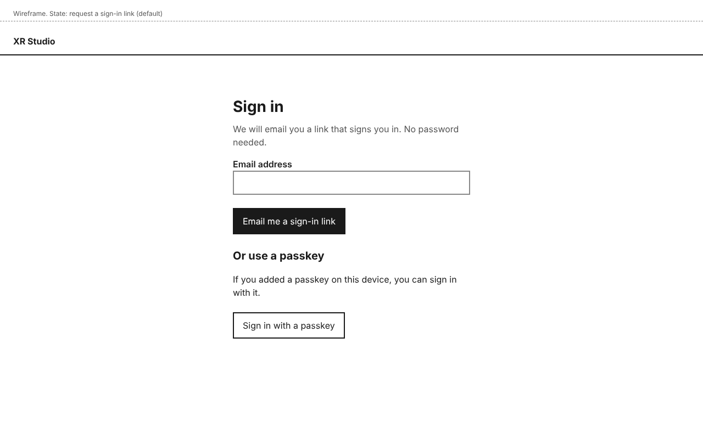
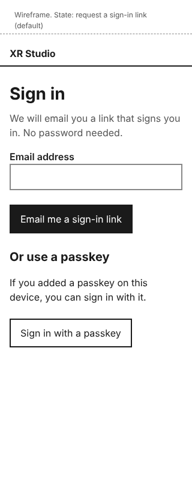
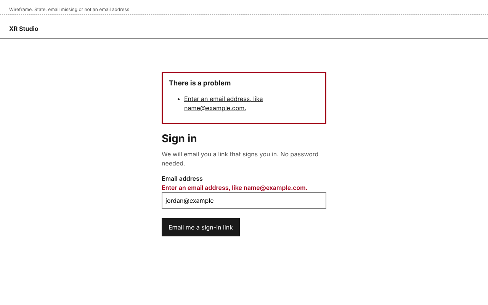
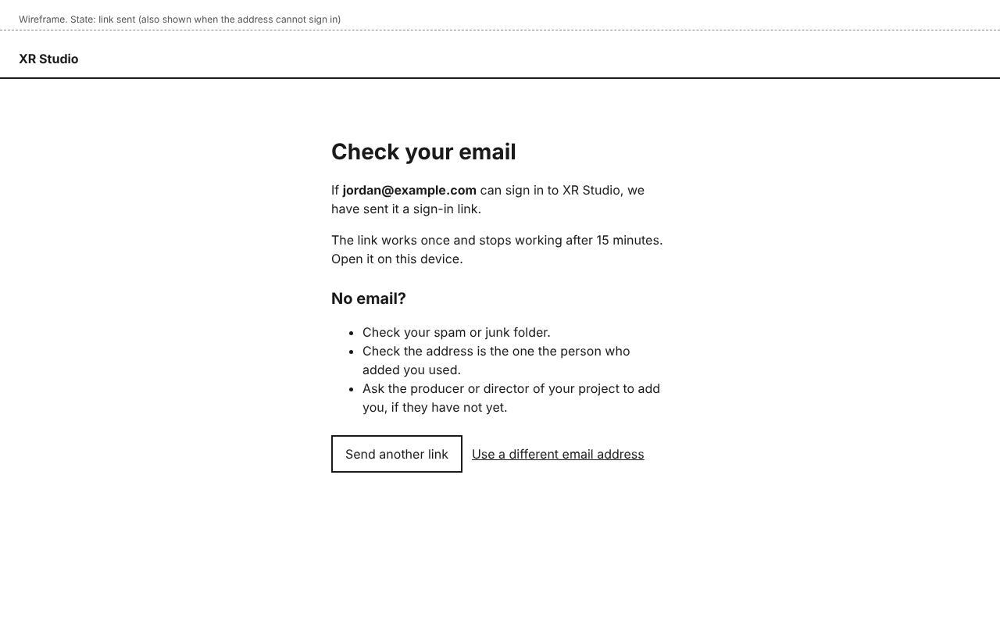
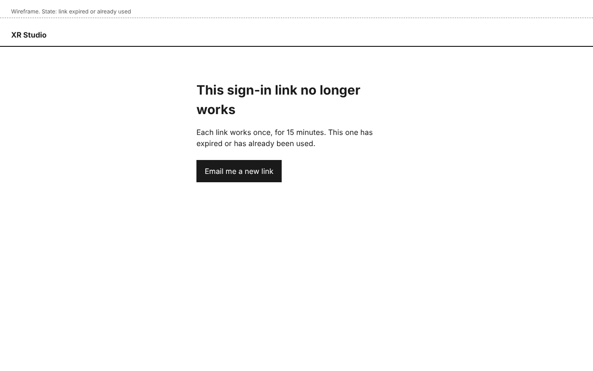
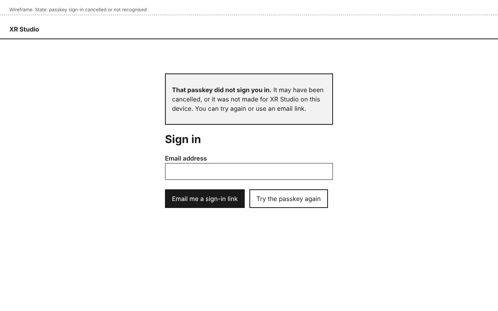
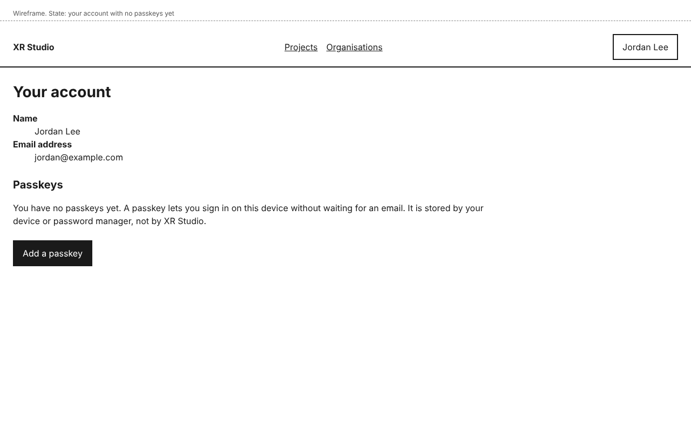
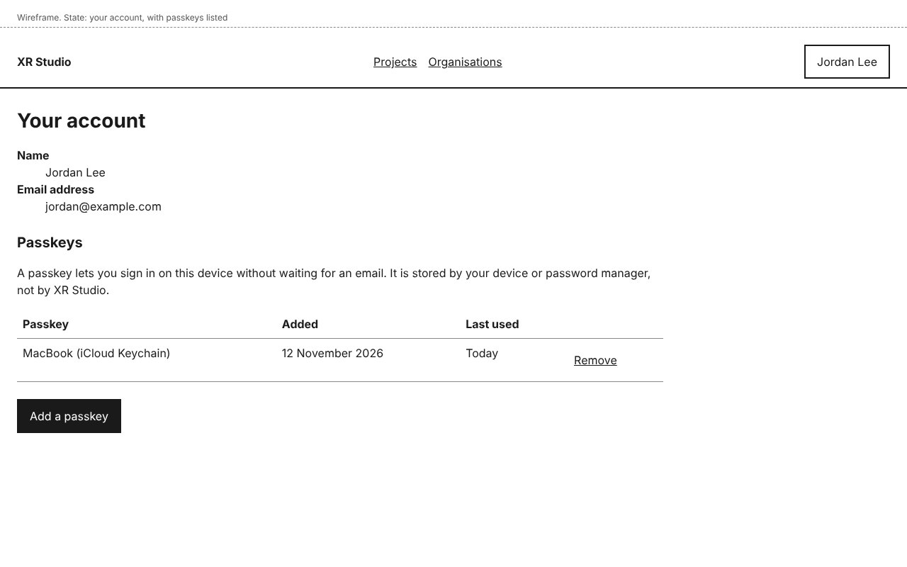
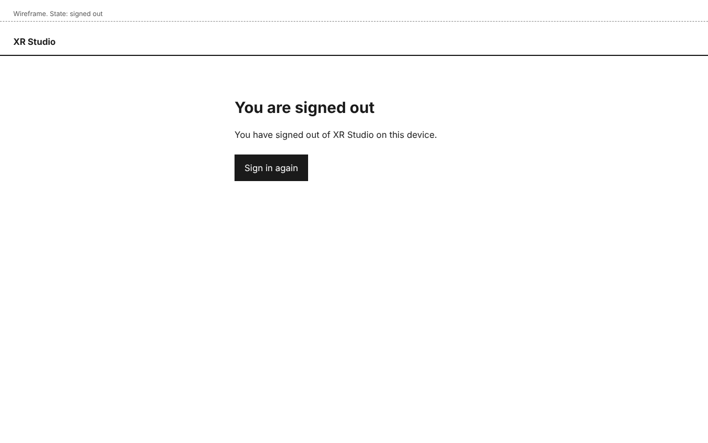

# Sign-in design

## Personas

- persona-producer: Jordan brings new people onto a production quickly with no technical help (goals). The person Jordan adds gets an email link and is in; there is no password to set or forget.
- persona-director: on a solo production Morgan is the first person in, through the address list in the deployment's settings, and can then start a project at once.
- persona-artist: Riley may be new to the pipeline. The screens say what to do next in plain words, including when a link has expired.

## Flow

1. The person opens XR Studio and sees **Sign in**. They type their **Email address** and choose **Email me a sign-in link**.
2. They see **Check your email**. The same page appears whether or not the address may sign in, so the page never reveals who is on a project. An address may sign in if a project has added it, or if it is on the deployment's list of first addresses.
3. They open the link in the email. It works once, for 15 minutes. They land on **Projects**.
4. If the link has expired or was already used, they see **This sign-in link no longer works** and choose **Email me a new link**.
5. Later, from **Your account**, they choose **Add a passkey**. The browser or password manager asks them to confirm. The passkey appears in the **Passkeys** list.
6. Next time, on **Sign in**, they choose **Sign in with a passkey**, or pick the passkey their browser offers in the **Email address** field. If the passkey does not work, they see a notice and can try again or use an email link.
7. **Sign out** is in the account menu (design-dashboard-shell). Afterwards they see **You are signed out**.

## Mock-ups

Wireframes. Each HTML file beside its image is the editable source.

| Screen or state | Mock-up | Notes |
|---|---|---|
| Sign in, default |  | Phone:  |
| Sign in, email missing or not an email address |  | Error summary at the top links to the field; focus moves to the summary. |
| Check your email |  | Same page when the address cannot sign in. |
| Link expired or already used |  | |
| Passkey sign-in did not work |  | Shown after the browser's own passkey prompt is cancelled or fails. |
| Your account, no passkeys |  | |
| Your account, with a passkey |  | **Remove** on each passkey. |
| Signed out |  | |

The passkey prompt itself is drawn by the browser or the password manager, not by XR Studio, so it has no mock-up. The design assumes the passkey plugin of the chosen auth library (Better Auth, decision-identity-and-roles) offers sign-in from a button and from the browser's autofill list (`autocomplete="username webauthn"`) `[assumed]`; the spec checks this against the installed version.

## Layout

- Sign-in pages have no navigation, only the product name, and a single column no wider than 480 pixels, centred. At 320 pixels the column fills the screen with 16 pixels at each side.
- Control names, exactly as the user documentation uses them: **Email address**, **Email me a sign-in link**, **Sign in with a passkey**, **Send another link**, **Use a different email address**, **Email me a new link**, **Try the passkey again**, **Add a passkey**, **Remove**, **Sign in again**.
- **Your account** is reached from the account menu in the header (design-dashboard-shell).

## States and errors

- **Empty or malformed email:** "Enter an email address, like name@example.com." in the error summary and beside the field.
- **Address cannot sign in:** no error. **Check your email** says "If jordan@example.com can sign in to XR Studio, we have sent it a sign-in link", and lists what to check, including asking the producer or director to add them.
- **Link expired or used:** its own page, with one action.
- **Passkey cancelled or not recognised:** a notice above the form, with both ways forward.
- **Too many requests from one address:** the same **Check your email** page; no extra emails are sent within one minute of the last one. The page does not say this, so it gives nothing away.
- **Signed in already:** opening **Sign in** goes to **Projects**.

## How it works

- **How does the system know?** Whether an address may sign in comes from the record: people added to a project (design-people-and-roles) and the list of first addresses in the deployment's settings. Sessions hold who the person is, not their roles; roles are read on every request (decision-identity-and-roles), so a role change applies at the next request.
- **What enforces each promise?**
  - "Works once, for 15 minutes": the auth library stores the link token and deletes it on use; a test opens a link twice and after the expiry time.
  - "The page never reveals who can sign in": the same response and timing for both cases; a test compares the two responses.
  - "No open sign-up": an account is created only for an address on a project or on the settings list; a test signs in with another address and checks no account exists afterwards.
- **What is published together?** Not applicable.

## Accessibility

- The email field accepts paste and password-manager filling, and nothing asks the person to solve a puzzle (WCAG 3.3.8, WEB-002).
- The error summary is announced (`role="alert"`) and links to each field; each field's error is tied to it with `aria-describedby`.
- Every control is a native element, at least 44 by 44 pixels, with a visible focus outline. A skip link leads to the main content.
- Text contrast is at least 4.5:1. Errors use text and a thicker border, not colour alone.
- All mock-ups were checked with axe (WCAG 2.2 AA tags) with no violations.
