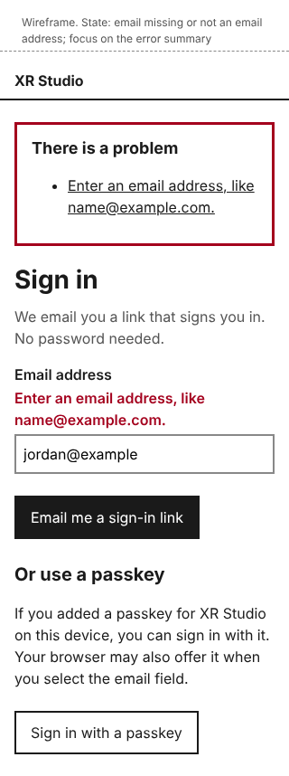
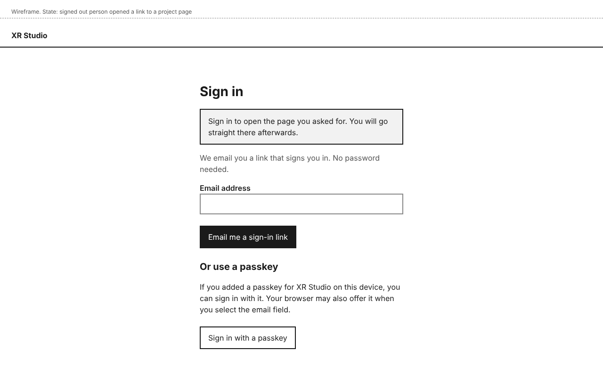
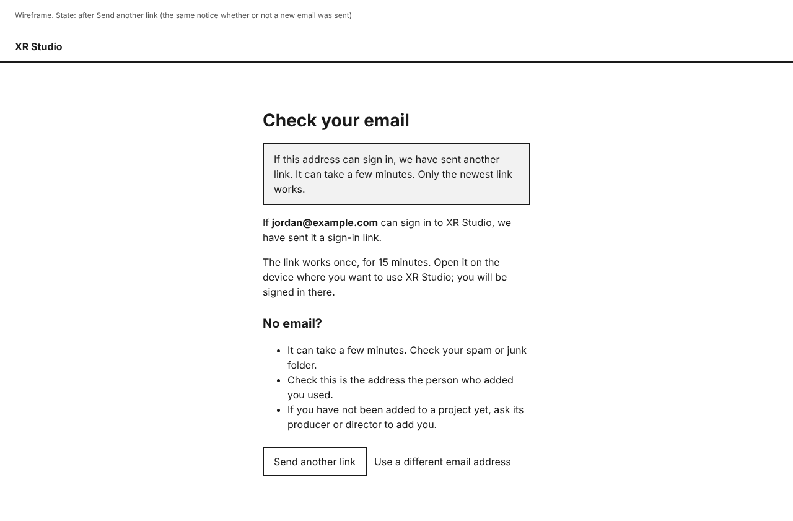

# Sign-in design

## Personas

- persona-producer: Jordan brings new people onto a production quickly with no technical help (goals). The person Jordan adds gets an invitation link that lasts 7 days and is in; there is no password to set or forget.
- persona-director: on a solo production Morgan is the first person in, through the address list in the deployment's settings, and can then start a project at once.
- persona-artist: Riley may be new to the pipeline. The screens say what to do next in plain words, including when a link has expired, and a link sent by a colleague opens the page it points at after sign-in.

## Flow

1. The person opens XR Studio and sees **Sign in**. They type their **Email address** and choose **Email me a sign-in link**.
2. They see **Check your email**. The same page appears whether or not the address may sign in, so the page never reveals who is on a project. An address may sign in if a project has added it with a role that opens the dashboard, or if it is on the deployment's list of first addresses.
3. They open the link in the email on the device where they want to use XR Studio. A sign-in link works once, for 15 minutes; an invitation link (the first email after someone adds them) works once, for 7 days (approver's decision, 2026-11-12). They are signed in on the device that opens the link.
4. They land on the page they asked for, if they followed a link to a page in XR Studio while signed out; otherwise on **Projects**. Only addresses inside XR Studio are followed; any other return address is ignored.
5. If they choose **Send another link** on **Check your email**, a notice says "If this address can sign in, we have sent another link." The notice is the same whether or not a new email was sent.
6. If the link has expired or was already used, they see **This sign-in link no longer works** and choose **Send another link**, which sends a new link to the address the old one went to and opens **Check your email**; or **Use a different email address**.
7. Later, from **Your account**, they choose **Add a passkey**. The browser or password manager asks them to confirm. The passkey appears in the **Passkeys** list, with a notice.
8. Next time, on **Sign in**, they choose **Sign in with a passkey**, or pick the passkey their browser offers in the **Email address** field. If the passkey does not work, they see a notice and can choose **Try the passkey again** or get an email link.
9. **Sign out** is in the account menu (design-dashboard-shell). Afterwards they see **You are signed out**.

## Mock-ups

Wireframes. Each HTML file beside its image is the editable source.

| Screen or state | Mock-up | Notes |
|---|---|---|
| Sign in, default |  | Phone:  |
| Sign in, email missing or not an email address |  | Phone: . Focus moves to the error summary; the page title starts "Error:". |
| Sign in, after following a link to a page |  | The page asked for opens after sign-in. |
| Check your email |  | Same page when the address cannot sign in. |
| Check your email, after Send another link |  | Focus moves to the notice. |
| Link expired or already used |  | Same page for sign-in links and invitation links. |
| Passkey sign-in did not work |  | Shown after the browser's own passkey prompt is cancelled or finds no passkey. |
| Your account, no passkeys |  | |
| Your account, after adding a passkey |  | **Remove** on each passkey. |
| Signed out |  | |

The passkey prompt itself is drawn by the browser or the password manager, not by XR Studio, so it has no mock-up. The design assumes the passkey plugin of the chosen auth library (Better Auth, decision-identity-and-roles) offers sign-in from a button and from the browser's autofill list (`autocomplete="username webauthn"`) `[assumed]`; the spec checks this against the installed version.

## Layout

- Sign-in pages have no navigation, only the product name **XR Studio** (approver's decision, 2026-11-12), and a single column no wider than 480 pixels, centred. At 320 pixels the column fills the screen with 16 pixels at each side.
- Each hint sits under its label, outside it, and is tied to its field with `aria-describedby`.
- Control names, exactly as the user documentation uses them: **Email address**, **Email me a sign-in link**, **Sign in with a passkey**, **Send another link** (the one name for asking for a new link, on every page), **Use a different email address**, **Try the passkey again**, **Add a passkey**, **Remove**, **Sign in again**.
- **Your account** is reached from the account menu in the header (design-dashboard-shell).

## States and errors

- **Empty or malformed email:** "Enter an email address, like name@example.com." in the error summary and under the label.
- **Address cannot sign in:** no error. **Check your email** says "If jordan@example.com can sign in to XR Studio, we have sent it a sign-in link", and lists what to check, including asking the producer or director to add them.
- **Send another link pressed:** the same page with the neutral notice. At most one email a minute goes to an address (approver's decision, 2026-11-12); within that minute nothing is sent and the notice does not say so, so it gives nothing away.
- **Link expired or used:** its own page. **Send another link** uses the address the old link was sent to, which the record keeps with the spent link; it is rate limited like any other request, and its result is **Check your email** with the neutral notice.
- **Only the newest link works:** asking for a new link makes earlier unused links stop working.
- **Opened on another device:** the link signs in whichever device opens it. The page tells people to open it on the device they want to use.
- **Passkey cancelled or not found:** a notice above the form, announced as an alert, with both ways forward.
- **Signed in already:** opening **Sign in** goes to **Projects**.

## How it works

- **How does the system know?** Whether an address may sign in comes from the record: people added to a project with a role that opens the dashboard (design-people-and-roles), and the list of first addresses in the deployment's settings. People added only with roles that do not open the dashboard get no account (approver's decision, 2026-11-12). Sessions hold who the person is, not their roles; roles are read on every request (decision-identity-and-roles), so a role change applies at the next request.
- **What enforces each promise?**
  - "Works once, for 15 minutes" and "an invitation works once, for 7 days": the auth library stores each link token with its expiry and deletes it on use; tests open each kind twice and after its expiry.
  - "The page never reveals who can sign in": the same response, notice and timing for both cases; a test compares the two responses.
  - "No open sign-up": an account is created only for an address with a dashboard role on a project or on the settings list; a test signs in with another address and checks no account exists afterwards.
  - "At most one email a minute per address": a per-address limit in the send step; a test asks twice within a minute and counts the emails captured.
  - "Return only to pages inside XR Studio": the return address is accepted only if it is a path on the same site; a test tries an outside address and lands on **Projects**.
- **What is published together?** Not applicable.

## Accessibility

- The email field accepts paste and password-manager filling, and nothing asks the person to solve a puzzle (WCAG 3.3.8, WEB-002).
- The error summary is announced (`role="alert"`), takes focus, and links to each field; each field's message is tied to it with `aria-describedby`, and the page title starts "Error:".
- Notices shown after an action take focus when the page loads, and the page title starts with the same outcome, so screen readers announce it.
- Every control is a native element, at least 44 by 44 pixels, with a visible focus outline. A skip link leads to the main content.
- Text contrast is at least 4.5:1. Errors use text and a thicker border, not colour alone.
- All mock-ups were checked with axe (WCAG 2.2 AA tags) with no violations, and the phone frames have no horizontal scrolling at 320 pixels.

## Open items

- Passkey sign-in from the browser's autofill list `[assumed]`, to check in the spec.
- Whether Better Auth's magic-link plugin supports a separate 7-day lifetime for invitation links, or the invitation needs its own token `[assumed]`, to check in the spec.
