# Trying the product design

A trial copy is XR Studio with made-up people and data, for following the tutorials. This design covers how to get one (one command, or a pull request's preview), how a person signs in to it as the people the tutorials name, what stands in for each outside service, the tutorials as they will be, and the **Help** link that opens them in the product.

## Personas

- persona-director: Morgan decides what is good, and wants to approve quickly (goals). Morgan opens a link, chooses a tutorial, signs in as its person with one selection, and follows it. Nothing is installed, and no mailbox is needed.
- persona-sound-designer: Drew does not use code or the command line (skills and tools). The tutorials name pages and controls only, and **Help** opens the page for the screen Drew is on.
- persona-producer: Jordan brings new people on quickly (goals), and can send a new person the link to a tutorial.

## Flow

### Morgan tries a change from a link

1. The pull request's description has a "Try it" section, written by the workflow: the preview's link and the tutorials the change adds or touches. Morgan opens the link. A preview is protected, so Morgan is signed in to Vercel as a member of the team; nothing is installed. **Sign in** opens, with the trial line above it and a link, **Try XR Studio**.
2. **Try XR Studio** lists the tutorials. Morgan selects **Start** beside one. A dialog says what the trial copy will hold and that what is there now is replaced. Morgan selects **Start**.
3. The page shows a notice naming the starting point, and **Open the tutorial**. Under **Sign in as a person**, Morgan selects **Sign in as Jordan**. Jordan is signed in, on the page Jordan would land on.
4. Morgan follows the tutorial. Where a step is done by another person, Morgan opens a private window, opens **Try XR Studio** there and selects that person.
5. Where a step reads an email, Morgan opens **Email sent by this copy** from **Try XR Studio**, opens the message and follows its link.
6. To do a tutorial again, or another one, Morgan goes back to **Try XR Studio** and selects **Start** again.

### A person on the team starts a trial copy on their own machine

1. In the repository, they run `pnpm run try`.
2. The command starts a database, loads the made-up data, starts XR Studio and prints the address of **Try XR Studio**.
3. They follow the same steps as Morgan. Stopping the command deletes the trial copy.

### Drew follows a tutorial in the deployed product

1. On any page, Drew selects **Help** in the header. The help page for that screen opens.
2. Under the task, Drew selects the **Try it** link. The tutorial opens.
3. Drew follows it with Drew's own account. A step done by someone else names their role, and Drew asks that person.

## Mock-ups

Wireframes. Each HTML file beside its image is the editable source.

| Screen or state | Mock-up | Notes |
|---|---|---|
| Sign in, in a trial copy | 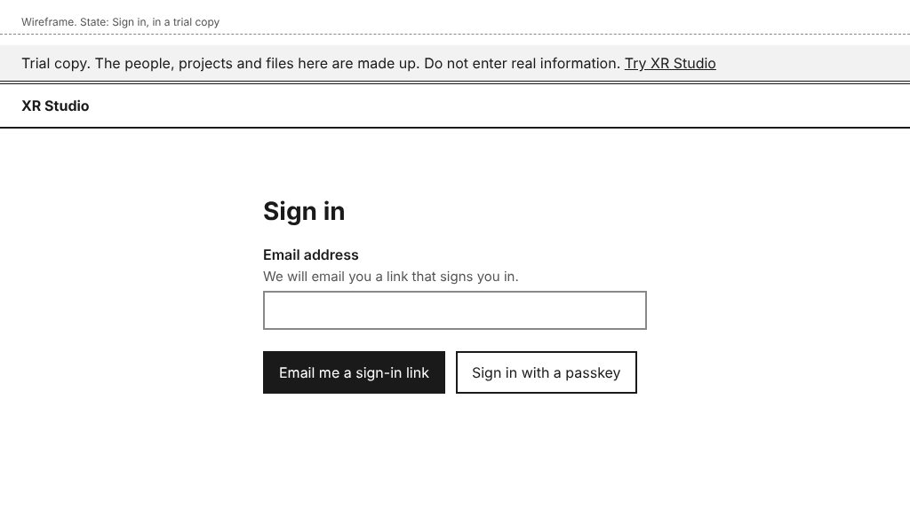 | The trial line and **Try XR Studio** are the only additions to the approved page (design-sign-in). |
| Try XR Studio, nobody signed in | 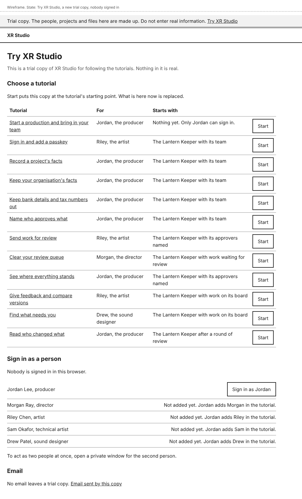 | Phone: 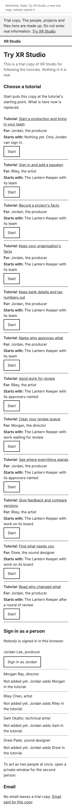. A new trial copy is at the first tutorial's starting point, so only Jordan can sign in. |
| Start a tutorial, the dialog | 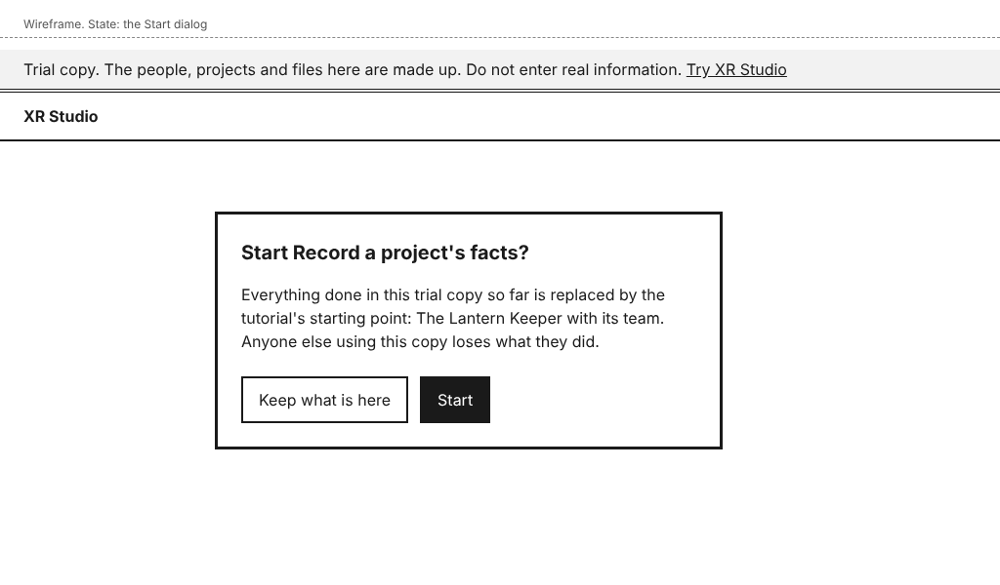 | **Keep what is here** is first and has focus. |
| Try XR Studio, after Start | 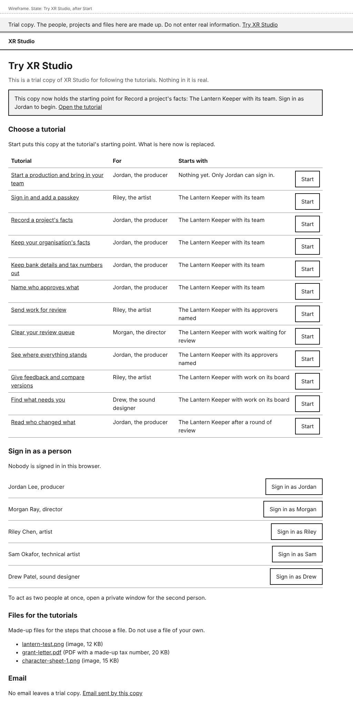 | Focus moves to the notice. All five people can sign in at this starting point. |
| Email sent by this copy | 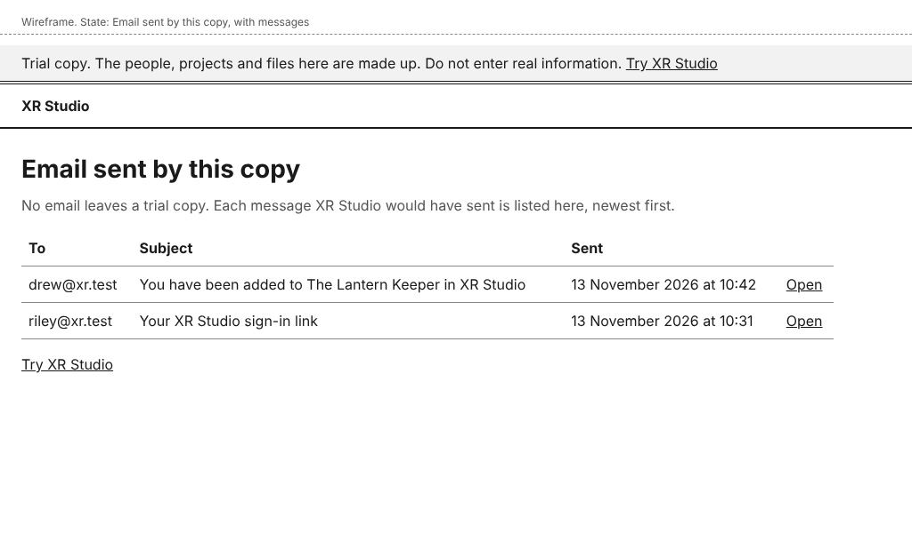 | Newest first. |
| Email sent by this copy, none yet | 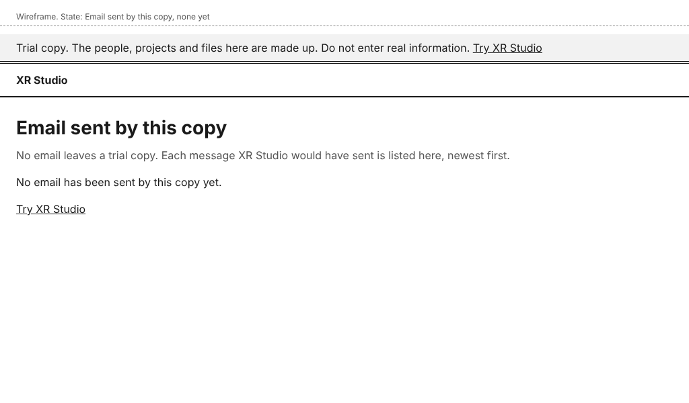 | |
| One email | 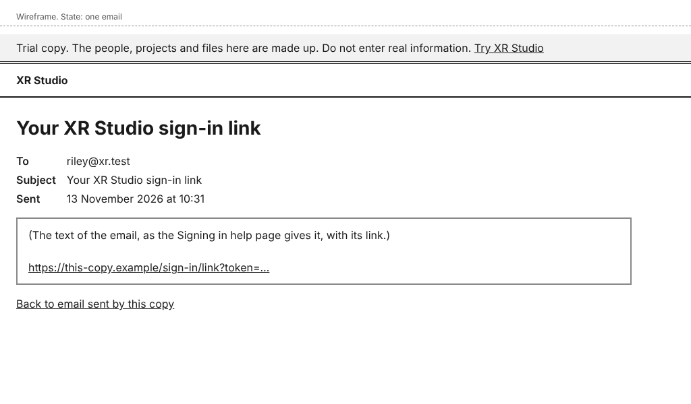 | The link in the message can be followed. |
| A dashboard page in a trial copy, with Help | 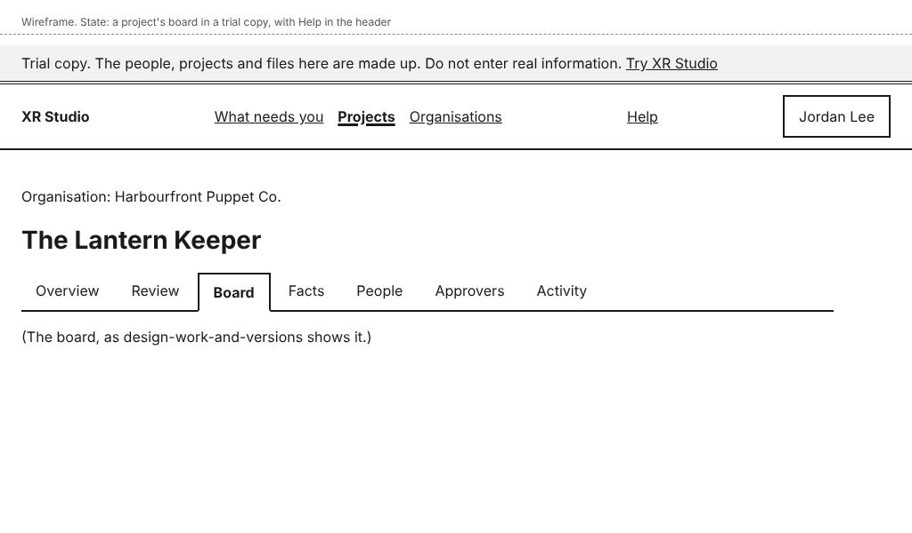 | Phone: 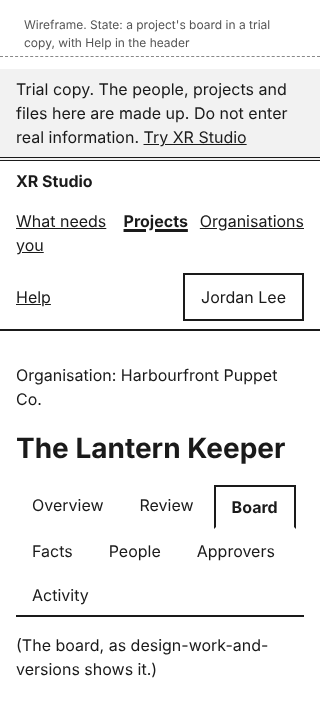. The trial line sits above the header on every page. In the deployed product the page is the same without the line. |
| Help for a page | 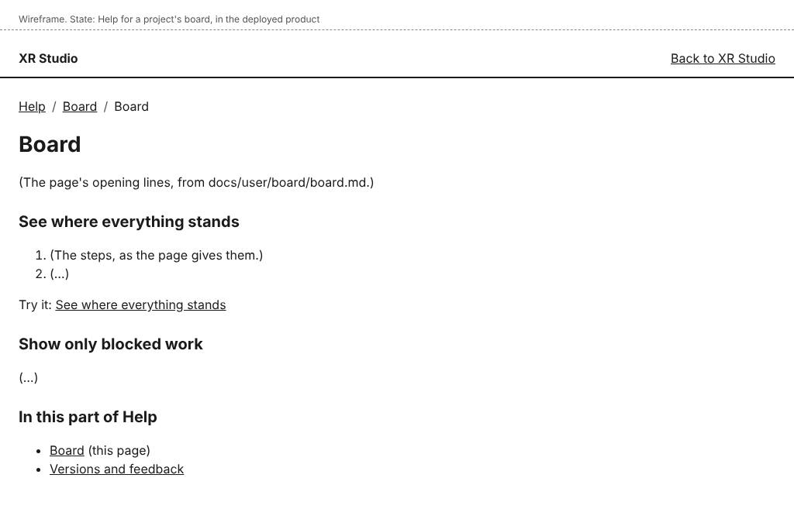 | Phone: 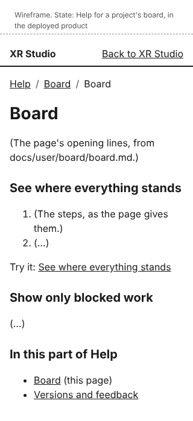. Opened by **Help** on a project's board. |
| Sign in as a person who is not added yet | 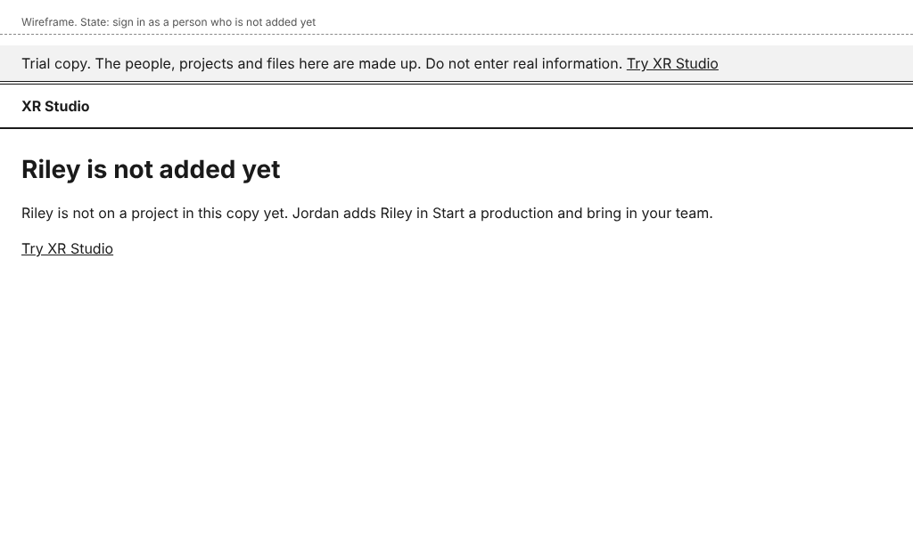 | Reached only by typing the address. |
| Help, the first page | 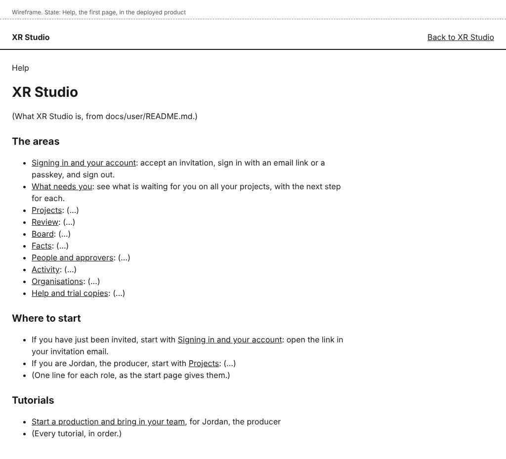 | The start page of the user documentation. An area's overview has the same layout, with its pages listed. |
| A tutorial in Help | 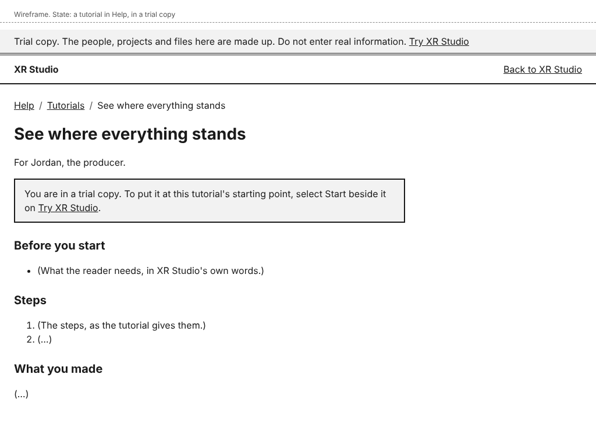 | In a trial copy, a notice above the steps links to **Try XR Studio**. In the deployed product the page is the same without the notice. |

The pages of **Try XR Studio** do not exist outside a trial copy. Opening their addresses there shows **This page is not available**, the page design-dashboard-shell already has, so it has no new mock-up. A help address that does not exist shows the same page, with **Back to XR Studio** in place of its link to Projects.

## Layout

- **The trial line.** In a trial copy, every page has one line above the header: "Trial copy. The people, projects and files here are made up. Do not enter real information." followed by the link **Try XR Studio**. It is text on a bordered band, not colour alone, and it is in the page before the skip link's target, so a screen reader reads it once at the top.
- **Try XR Studio** (`/try`) has no project navigation. It has three parts, in this order:
  - **Choose a tutorial**: a table with the columns **Tutorial**, **For**, **Starts with**, and a **Start** button for each row. Each button's accessible name includes the tutorial, for example "Start: Record a project's facts". The tutorial's title links to it in Help.
  - **Sign in as a person**: a line saying who is signed in in this browser ("Nobody is signed in in this browser." or "Signed in as Jordan Lee."), then one row for each of the five people with their role and a link styled as a button: **Sign in as Jordan**, **Sign in as Morgan**, **Sign in as Riley**, **Sign in as Sam**, **Sign in as Drew**. A person who is not on a project yet at this starting point has no button and the text "Not added yet. Jordan adds Riley in the tutorial." Below: "To act as two people at once, open a private window for the second person."
  - **Email**: the link **Email sent by this copy**, and the sentence "No email leaves a trial copy."
- **The Start dialog** has the heading "Start <tutorial>?", the text "Everything done in this trial copy so far is replaced by the tutorial's starting point: <starting point>. Anyone else using this copy loses what they did.", and the buttons **Keep what is here** and **Start**, in that order.
- **Email sent by this copy** (`/try/mail`) is a table with **To**, **Subject**, **Sent** and a link **Open** for each message. A message's page shows the same three facts and the text, with its link live, and **Back to email sent by this copy**.
- **Help** is a link in the header, after the main navigation and before the person's name, on every signed-in page. design-dashboard-shell and decision-navigation-and-urls are not edited in this packet, to keep its revision small: this design adds the link to the header, and sets the addresses under `/try` and `/help`. Both documents take them in at their next revision. Sign-in pages keep no navigation (approver's decision, 2026-11-12, design-sign-in).
- **Help pages** (`/help`, `/help/<area>`, `/help/<area>/<page>`, `/help/tutorials/<tutorial>`) have the product name, a link **Back to XR Studio**, a trail ("Help", the area, the page), and the page's text in one column no wider than 720 pixels. Images in the pages are the approved mock-ups, as today. At 320 pixels the trail wraps and nothing scrolls sideways.
- Control names, exactly as the user documentation uses them: **Try XR Studio**, **Start**, **Keep what is here**, **Open the tutorial**, **Sign in as Jordan** (and the other four), **Email sent by this copy**, **Open**, **Back to email sent by this copy**, **Help**, **Back to XR Studio**, **Try it**.

## States and errors

- **A new trial copy:** it is at the starting point of the first tutorial: nothing exists, and only Jordan can sign in.
- **After Start:** everyone is signed out of the copy, in every browser. A notice, which takes focus: "This copy now holds the starting point for <tutorial>: <starting point>. Sign in as <first person> to begin." with **Open the tutorial**.
- **Start while someone else is using the copy:** a preview is one copy for everyone with its link. The dialog says so. There is no lock.
- **Sign in as a person who is not added yet** (by typing the address): the page says "Riley is not on a project in this copy yet. Jordan adds Riley in Start a production and bring in your team." with a link back to **Try XR Studio**.
- **Sign in as a person with an open invitation:** it accepts the invitation, as the link in their email would, and lands where that link lands.
- **Any other name in the address:** **This page is not available**.
- **No email yet:** "No email has been sent by this copy yet."
- **A file over 4 MB in a preview:** the upload is refused with "In a trial copy on the web, a file can be 4 MB at most. This limit is not in XR Studio itself." A local trial copy has no such limit.
- **Help for a page with no help of its own:** **Help** opens the overview of the area the address is in, or else the start page. It never shows an error.
- **A help address that does not exist:** **This page is not available**, with **Back to XR Studio**.
- **The local command cannot start:** it says which of these is wrong, and how to put it right: Docker is not running and no database address was given; the port is in use; the build failed. It leaves nothing behind.
- **Loading:** pages are rendered on the server. **Start** in the dialog reads "Starting" and cannot be selected again until the page reloads; it has no other change, so it has no mock-up of its own.

## How it works

### The one command

`pnpm run try`, at the repository root, runs `web/scripts/try.mjs`, written like `web/scripts/run-e2e.mjs`. In order, it:

1. Starts PostgreSQL 18 in a Docker container on a free port. A person with no Docker gives it an empty database of their own in `TRY_DATABASE_URL`.
2. Makes a temporary folder for uploaded files and fresh secrets for this run.
3. Applies the migrations.
4. Builds the app with the trying setting on, `XR_TRY=1`.
5. Loads the first tutorial's starting point.
6. Starts the app and prints three lines: that the trial copy is running, the address of **Try XR Studio**, and that Ctrl+C stops and deletes it.
7. On exit, stops the app, removes the container and deletes the folder.

It refuses a database that holds anything and is not marked as a trial copy (see the third guard below), so it cannot be pointed at real data by mistake.

The `try:` block for `docs/product/process.yml`:

```yaml
try:
  local: pnpm run try                  # starts a local trial copy and prints its address
  preview: true                        # each pull request gets a preview
  sign-in: /try/sign-in?as={name}      # trial copies only
```

It has no `url`, because XR Studio is not deployed yet; no `staging` and no `provides`, because no tutorial has a `needs:` line (design-architecture, "Trying the product"); and no `state`, because the tutorial runner does not use it yet and people use **Start**. The block is added by the delivery, in the pull request that adds the `try` script: the process check refuses a `local` command whose script does not exist.

### Previews, and where their data lives

The lead decided on 2026-11-13 that a preview holding only made-up data may be hosted outside Canada, and that real data never goes in a preview (design-architecture, "Amendment (2026-11-13)").

- **What a preview is.** A Vercel preview deployment of `web/` for each pull request, built with `XR_TRY=1`. Vercel's own protection for previews stays on, so only people on the team can open one.
- **Its database.** A Postgres database made for that pull request alone and removed when it closes: a Neon database branch, through Neon's integration in the Vercel marketplace, in a United States region `[assumed]`. The integration gives each preview its own `DATABASE_URL` and `DATABASE_URL_UNPOOLED`, the names the app already reads.
- **Its files and email.** Kept in that same database (design-architecture, "Trying the product"), so a preview has one place that holds data, and removing the database removes everything.
- **Fresh at each deployment.** The preview's build step empties the database, applies the migrations and loads the first starting point. Every push to the pull request therefore starts the preview again. **Start** does the same for one tutorial at any time.
- **How "real data never goes in a preview" is kept:**
  - The preview environment has no production setting, secret or connection. Its only database is its own.
  - Nothing leaves it: email is kept, not sent, so nobody outside can be invited into one.
  - The only accounts that can be signed in to are the five made-up people, plus anyone they add, who can never receive the invitation.
  - The trial line on every page says not to enter real information.
  - It is deleted with its pull request.
  - What this cannot stop: a team member who types real information into a made-up project. The trial line is the guard for that, and the lead accepts it with this design.

### Signing in as a tutorial's person

The five people are Jordan Lee (producer), Morgan Ray (director), Riley Chen (artist), Sam Okafor (technical artist) and Drew Patel (sound designer), with addresses at `xr.test`, a domain that can never receive mail. They are one list in one file, `web/src/try/people.ts`.

`/try/sign-in?as={name}` takes one of the five first names. It mints a one-time sign-in link for that person inside the app, as the invitation route already does, and follows it at once. So the session is an ordinary session, made by the ordinary sign-in code, and roles are read on every request as always.

The guide's four conditions, and how each is met:

1. **It exists only in a build started for trying.** Three guards, each enough alone:
   - *The build.* The pages and routes under `/try` are in files with their own extension, which `next.config.ts` includes only when `XR_TRY=1` at build time `[assumed]`. A build without the setting has no such routes.
   - *The setting at run time.* One function, `tryMode()`, is asked by every try page, route and transport before anything else. Without `XR_TRY=1` it answers no, and the page answers 404.
   - *The database.* Loading a starting point marks the database as a trial copy, in `app_meta`. Sign-in as a person, **Start** and the loader refuse a database without the mark, and the loader refuses to mark a database that already holds anything.
2. **It is refused when the production setting is on, whatever else is set.** The production setting is `XR_PRODUCTION=1`, set in the production environment, or `VERCEL_ENV=production`, which Vercel sets itself. `tryMode()` checks these first and answers no, even with `XR_TRY=1`. The app also writes an error to its log at start-up when both are set.
3. **It lists only those people, with fixture data.** The path accepts only the five first names in the list, never an address or an id. It signs in only an account whose address is that person's in the list. A person added to a trial copy under any other address cannot be signed in to this way.
4. **A test proves the path answers 404 without the setting.** The ordinary end-to-end suite runs against a build without `XR_TRY`. It asks for `/try`, `/try/sign-in?as=Jordan`, `/try/mail` and the **Start** action, and expects **This page is not available** with status 404 for each. Unit tests cover `tryMode()` for every combination of the three settings, and one test reads the ordinary build's list of routes and fails if any begins `/try`.

The path signs a browser in from a link, with no form. That is accepted in a trial copy because the people are made up. The change that adds it gets a security review against these four points.

### What stands in for each outside service

The table is in design-architecture, "Trying the product", where the lead approves it with the architecture: the database, the web functions, object storage, email, scheduled jobs and passkeys, with what each stand-in hides. In short: no email leaves a trial copy; a preview keeps files in its database, 4 MB at most; scheduled jobs do not run; a passkey belongs to the one copy it was made in.

### Starting points

A starting point is the result of a tutorial that others start from. The loader builds each one by running the record's own commands as the made-up people, never by writing rows, so a starting point is a state a real team can reach, with its activity log. A test for each starting point runs the tutorial that makes it, then loads the starting point in a second database, and compares what the pages show.

### Help

- The help is built from `docs/user/` and `docs/tutorials/` at each build, with the map from `checks/docs-map.mjs --json`, and served under `/help`. Approved pages only.
- **Help** opens the page whose `covers:` matches the current address, or else the overview of the area whose pages cover the nearest address above it, or else the start page.
- Help pages hold no project data, so they open signed in or signed out. A link to a tutorial that Jordan sends therefore opens for a new person at once.
- **How does the system know?** Nothing is stored: the help is the files, and the match is made from the address.
- **What enforces each promise?**
  - "Every page has help": a test walks every address in decision-navigation-and-urls and checks that **Help** opens a page, never an error.
  - "The tutorial Drew reads is the one Morgan tried": there is one file, and the process check fails an approved tutorial that no user documentation page links to.
  - "No email leaves a trial copy": in try mode the only mail transport is the one that keeps messages; a test sends each kind of email in a trial copy and checks that the sending transport was never called.
- **What is published together?** The help is built with the app, so a deployment's help always matches its pages.

## The tutorials after the delivery

One for each task a person does. Each is `runner: web`, is named for the task, and is linked from its user documentation page with **Try it**. The four existing tutorials and their three Playwright scripts are removed when these pass. Tutorial 1 adds Morgan, Riley, Sam and Drew to the project, so every later starting point has all five people. The runner needs a step done by another person to begin with their name (`As **Riley**:`). "Before you start" gives each name its role ("Riley is an artist on your project"), so a reader in the deployed product knows whom to ask. A step that reads an email is written for the reader's mailbox ("Open the link in the email"); in a trial copy, the notice above the tutorial's steps in Help adds that the email is under **Email sent by this copy**.

| # | Title (file in `docs/tutorials/`) | For | Takes over | `starts-from` | People |
|---|---|---|---|---|---|
| 1 | Start a production and bring in your team (`start-a-production-and-bring-in-your-team.md`) | Jordan, the producer | organisations-projects-people steps 4 to 17; step 1 of the other three | none: a new installation where Jordan can sign in | Jordan, Riley |
| 2 | Sign in and add a passkey (`sign-in-and-add-a-passkey.md`) | Riley, the artist, as anyone who has been added | organisations-projects-people steps 1 to 3 and its passkey and sign-out steps | 1 | Riley |
| 3 | Record a project's facts (`record-a-projects-facts.md`) | Jordan, the producer | layer1-facts-identifiers-activity steps 2 to 6, 8 (first half), 9 and 15 | 1 | Jordan, Riley |
| 4 | Keep your organisation's facts (`keep-your-organisations-facts.md`) | Jordan, the producer | layer1-facts-identifiers-activity steps 10 and 11 | 1 | Jordan |
| 5 | Keep bank details and tax numbers out (`keep-bank-details-and-tax-numbers-out.md`) | Jordan, the producer | layer1-facts-identifiers-activity steps 7, 8 (the held document) and 12; layer1-gates-and-queue step 8 | 1 | Jordan |
| 6 | Name who approves what (`name-who-approves-what.md`) | Jordan, the producer | layer1-gates-and-queue steps 2 to 5 and 17 | 1 | Jordan |
| 7 | Send work for review (`send-work-for-review.md`) | Riley, the artist | layer1-gates-and-queue steps 6, 7 and 16 | 6 | Riley, Jordan |
| 8 | Clear your review queue (`clear-your-review-queue.md`) | Morgan, the director | layer1-gates-and-queue steps 9 to 13 and 15, and the first half of 14 (Riley reads the decisions) | 7 | Morgan, Sam, Riley |
| 9 | See where everything stands (`see-where-everything-stands.md`) | Jordan, the producer | layer1-versions-board-first-view steps 2, 3, 5, 6, 9 and 14 | 6 | Jordan, Riley, Morgan |
| 10 | Give feedback and compare versions (`give-feedback-and-compare-versions.md`) | Riley, the artist | layer1-versions-board-first-view steps 7 and 10 to 13; the second half of layer1-gates-and-queue step 14 | 9 | Riley, Sam, Morgan |
| 11 | Find what needs you (`find-what-needs-you.md`) | Drew, the sound designer | layer1-versions-board-first-view steps 4 and 8 | 9 | Drew, Morgan |
| 12 | Read who changed what (`read-who-changed-what.md`) | Jordan, the producer | layer1-facts-identifiers-activity steps 13 and 14; layer1-gates-and-queue step 18; layer1-versions-board-first-view step 15 | 10 | Jordan |

Slice 2 is validated with tutorials 3, 4, 5 and 12; slice 3 with 6, 7 and 8; slice 4 with 9, 10 and 11.

Steps the runner cannot do are written as manual steps, last in their tutorial, so the steps before them still run: opening the link in an email (tutorial 2), and adding and using a passkey (tutorial 2).

## Accessibility

- The trial line is the first thing in the page and is plain text with a link. It is not an alert, so it is not read again on every page change by a live region.
- **Sign in as** links are links, since they go to an address; **Start** is a button. Each has a name that says who or what, so a list of links or buttons read out of context makes sense.
- The Start dialog is a native dialog. Focus moves to **Keep what is here**, Escape closes it, and focus returns to the **Start** that opened it.
- The notice after **Start** takes focus, and the page title starts with the outcome.
- The tutorials table has a caption and column headers; at 320 pixels each row becomes a block with its labels, as the people table does.
- Help pages have one `h1`, headings in order, a skip link, and link text that says where it goes. Images keep the text alternatives the pages give them.
- The mock-ups were not checked with axe in this packet; the delivery's accessibility tests cover the built pages.

## Notes for delivery

Build in this order. Each step ends with something that runs.

1. **The try command and sign-in.** `tryMode()` and its tests first, then the three guards, the mail and file stand-ins, the starting-point loader for the first starting point, **Try XR Studio**, `pnpm run try`, and the `try:` block in `process.yml` in the same pull request. The pull request touches `docs/product/`, so it waits for the lead's review. It gets a security review against the four conditions (rfr-core's `security-reviewer`).
2. **Previews.** The Vercel project and its preview database are the lead's to connect; see the checks below. Then copy `rfr-tutorials-preview.yml` from the rfr-process templates, so the tutorials run on each preview and the recording is kept.
3. **The tutorials.** Write the twelve as `runner: web`, each with its starting point in the loader, and run them with `tutorial-run` against the try command's product. Add **Try it** to each user documentation page, linking its tutorial: sign-in to 2; your-projects, organisations-and-projects and people-and-roles to 1; project-facts to 3; organisation-facts to 4; identifier-formats to 5; approvers to 6; review to 7 and 8; board to 9; versions-and-feedback to 10; what-needs-you to 11; activity to 12.
4. **Remove what they replace.** `web/e2e/tutorial-board.spec.ts`, `tutorial-facts.spec.ts` and `tutorial-review.spec.ts`, and the four old tutorials, in the pull request where the new ones pass.
5. **Turn the rules on.** Set `lasting-tutorials: fail` in the `with:` of `.github/workflows/rfr-process.yml` once the tutorials pass the rules.
6. **Help.** The `/help` pages and the **Help** link. This step can follow the lead's validation of slices 2 to 4: until it is built, the pull request's "Try it" section links each tutorial's file in the repository, the titles on **Try XR Studio** link to those files, and the lead reads them there. **Try it** is added to the pages in step 3 as a link to the tutorial's file, which is what Help serves.

What the delivery must know:

- **The runner cannot choose a file.** Its sentences have none for a file field (checked in rules-for-robots at 44a1445). Tutorials 3, 5, 7, 9 and 10 choose a file, and the steps after depend on it. The runner needs a sentence for it before those five can pass; the lead maintains rules-for-robots, so this is raised with the lead when the packet is reported. Until then those five are written, and run by hand.
- **The runner signs in by first name.** `Sign in as **Jordan**.` opens `/try/sign-in?as=Jordan`.
- **Moving `docs/user/sign-in.md` changed one test's path** (`web/test/emails.test.ts` reads the page). No assertion changed.
- **Four user documentation pages end with stray lines** (`</content>`, and `</invoke>` in people-and-roles). They were there before this packet and will show in Help. Remove them in step 6, as a revision.
- `[assumed]` items are checked against the installed versions and the vendors' documentation when the spec is written. If the build guard cannot be made with `pageExtensions`, the other two guards stand and the spec says so.

Checks only a person can do, for the lead's validation list:

- Connect the repository to a Vercel project if it is not connected, add the Neon integration with a database branch for each preview, and set `XR_TRY=1` and the trial secrets for the Preview environment only. An agent may do this through the Vercel tools only after the lead says so (NODE-002).
- Save the preview bypass token as the `RFR_PREVIEW_BYPASS` repository secret.
- Open the production environment's settings and confirm `XR_TRY` is absent and `XR_PRODUCTION=1` is set, before the first production deployment.
- Follow tutorials 3 to 12 on a preview, to validate slices 2, 3 and 4.
- The first-task test with a person new to the pipeline (design-what-needs-you) is still owed. It moves out of the tutorial and stays on this list.
- A manual pass of **Try XR Studio** and one help page with a screen reader.

## Open items

- A Neon database branch for each preview, through the Vercel marketplace, with both connection variables `[assumed]`.
- The app's `SET ROLE xr_app` holds on the preview database's connections. If the pooled address does not keep it, the preview uses the direct address for both variables `[assumed]`.
- `pageExtensions` in the installed Next.js can leave the `/try` files out of a build `[assumed]`.
- Vercel runs scheduled jobs for production deployments only `[assumed]`.
