# What needs you design

The first view after sign-in: what needs this person on all their projects, and the next step for each (story-review-and-status-what-needs-me). It is built from the review queue (design-review-queue) and the board (design-work-and-versions) and adds no record of its own. The same page serves every role.

## Personas

- persona-artist: Riley signs in and sees what came back with the reviewer's feedback, what is assigned, and what is waiting and at which gate (goals: know what is waiting for review, and what the reviewer said; context: may be new to the pipeline, starts without training, looks at what needs doing next, makes it and hands it to a gate).
- persona-sound-designer: Drew joins one project and, on the first sign-in, finds the first task and the gate it goes to without asking anyone.
- persona-director: Morgan sees every item waiting for their decision on all projects in one list, blocking items first, and opens each to decide.
- persona-producer: Jordan sees the same page; when nothing needs them, it points to each project's **Board**.

## Choices this design makes

The story and the architecture leave these open. Each is the designer's choice, for the lead to judge in review.

1. **Name and place.** The page is called **What needs you**, after the story. It is the first item in the main navigation, and the page people land on after sign-in when they are on at least one project (design-dashboard-shell said slice 4 would do this). A person on no projects still lands on **Projects**, which says what to do. Accepting an invitation to a project (design-people-and-roles) also lands on **What needs you**, not on the project, so a newcomer's first screen is the one that shows their first task. Its address is `/what-needs-you`; `/` and the **XR Studio** name in the header go to it, or to **Projects** for a person on no projects, by the same rule.
2. **Across all projects.** Roles are per project (decision-navigation-and-urls), so each group names its project as well as its gate. A person on one project sees the same page with one project.
3. **Four sections, by what the person does next**, then grouped by gate inside each: **For your decision** (items waiting at a gate the person decides), **Returned to you** (work whose latest version came back with a revision request or a rejection), **Assigned to you** (work the person owns that is not waiting for review: not sent yet, or withdrawn by its sender), and **Waiting for others** (versions the person sent that wait at a gate). The story asks for groups by gate; putting the next step first means a newcomer reads "what do I do" before "where is it". Sections with nothing in them are left out, and the line at the top counts all four.
4. **Who an item belongs to.** Returned and waiting items are the person's when they sent the latest version or own the work. Assigned work is the person's when they own it. Decision items are the person's review queue items (design-review-queue), with one difference: an item handed to a delegate is listed here for the delegate only, not for the approver, since the approver handed it on to take it off their own list. The approver still sees it in **Review**, marked **Handed to <name>**, and can still decide it.
5. **Order.** Inside a section, groups with a blocking item come first, by their oldest blocking item, then the others by their oldest item, as in the queue. Inside a group, blocking items first, then oldest first. "Oldest" is when the item reached the person: when it was sent (decisions and waiting), returned, or assigned.
6. **Next steps are fixed sentences per section**, so they read the same everywhere:
   - For your decision: "Decide: accept, request a revision or reject."
   - Returned, revision requested: "Change it as the feedback asks, then select Send a revised version on its page." (with "To go back to an earlier version, restore it there." when there is more than one version).
   - Returned, rejected: "It does not move on. Read the feedback; if you change it, send it again from its page."
   - Assigned: "Make it, then send it for review from its page. <deciders> decides it." (with "at <stage>" for a person new to the project).
   - Assigned, withdrawn: "You withdrew version <n>. Send it again from its page when it is ready."
   - Assigned and blocked: "You can work on it now. It cannot pass <stage> until <blocking item> is decided."
   - Waiting for others: "Nothing to do. It waits for <deciders>."
7. **"Your stages" for every person, open for newcomers.** Under the lists, **Your stages** has one **How work moves on <project>** panel per project: the person's roles, the stages those roles work in, and who decides each. It is open while the person has sent nothing on that project, and closed (one click to open) after that. "New to the project" therefore needs no setting and ends by itself.
8. **Which stages a role works in.** No story defines this, so this design proposes a table, kept in `contracts/` beside the permission table and versioned with it `[proposed]`:

   | Role | Stages it works in |
   |---|---|
   | Director | Every Creative and Performance and behaviour stage |
   | Producer | Every Business stage |
   | Technical artist | Mesh and rig, Visual effects, Motion and performance quality, and the three Builds and operations stages |
   | Artist | Look and concept art, Character design, Mesh and rig, Environments, Visual effects |
   | Sound designer | Sound and music |
   | Interaction designer | Interaction design; AI behaviour, voice and dialogue; Audience-facing safety and consent |
   | Capture crew | Motion and performance quality |
   | Show operator | Cue list, Changes during a live run |

   Venue attendants, performers and collaborators do not use the dashboard. A person with several roles sees the union. This table only guides; anyone may send work at any stage, as in slice 3.
9. **Updates without a reload** work as on the board: the page asks for changes every 15 seconds while visible. A new item is added in its place with a **New** tag. An item that no longer needs the person is not removed while the page is open: its row is replaced in place by one line, such as "Lantern Keeper character sheet: accepted by Morgan Ray at 14:22. It no longer needs you.", so nothing jumps under the reader and focus is never lost. A polite status line sums up: "Updated 14:23: 1 new item returned to you. 1 item accepted." The next load tidies the page.
10. **The first-task test.** The story asks for a test in which a person new to the pipeline finds their first task and its gate without help, and that person sets the bar. The delivery runs it with Drew's case: a new account with the Sound designer role, one piece of work assigned with **Add work**, and the task "Find the first piece of work you need to do, and say who must approve it." The bar is that they name **Harbour ambience** and Morgan Ray (or Sam Okafor) within two minutes of signing in, with no hints, and say what they would select to hand it in. The test is run a second time with nothing assigned: the bar is that the person says they would ask the producer or director for work, and names the stage they work in. If they cannot, the wording here changes before the story is accepted.

## Flow

1. The person signs in and lands on **What needs you** (unless they followed a link to another page).
2. The line at the top counts: "3 things need you: 2 returned to you, 1 assigned to you. 5 things you sent are waiting for others." For an approver: "5 things need you: 5 for your decision, 1 blocking."
3. Each section has a heading and a one-line explanation. Each group is headed "<gate>, <project>" with a count ("2 items, 1 blocking."). Each item shows its title (a link), a line saying where it is ("Version 2: revision requested by Morgan Ray, 11 November, 16:40." or "Version 1, sent 12 November, 11:30."), any feedback from the decision, quoted with the reviewer's name, the **Blocking** tag with "<stage> waits on this decision." where it applies, and **Next step:** with the sentence above.
4. Links open the item: decision and waiting items open the review item page; returned and assigned work opens the work's page, where **Send a revised version**, **Send for review** and **Restore** are.
5. **Your stages** follows, with a **How work moves on <project>** panel per project.
6. When something changes elsewhere, the page updates as described in choice 9.

## Mock-ups

| Screen or state | Mock-up | Notes |
|---|---|---|
| As Riley, artist on two projects | 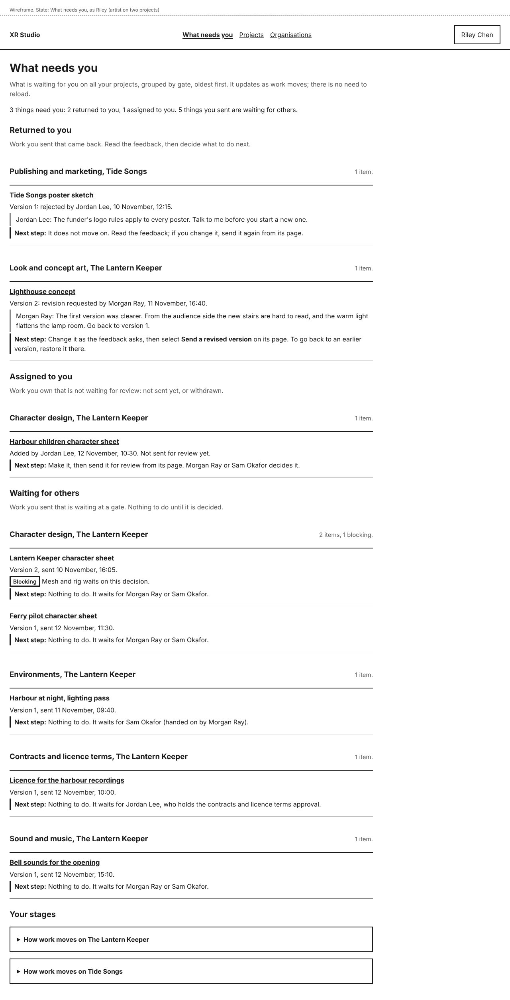 | Phone: 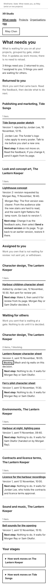. Returned with feedback, assigned, waiting with one blocking item. |
| As Drew, new to the project | 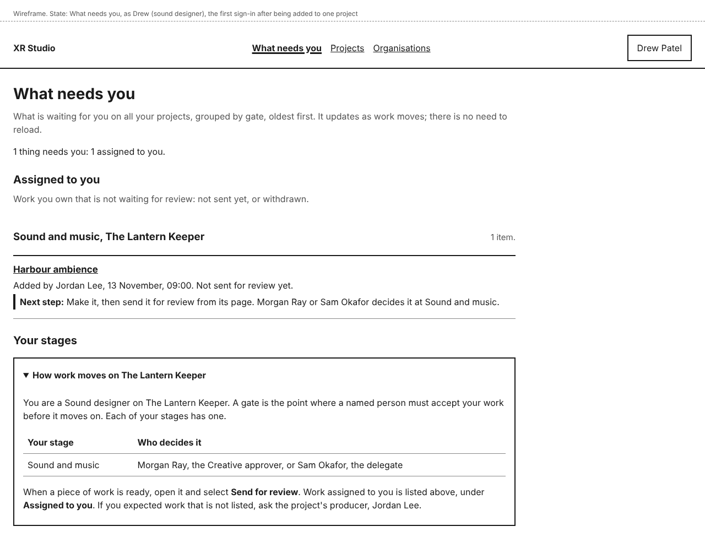 | Phone: 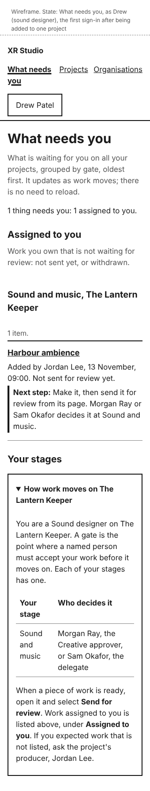. **How work moves on The Lantern Keeper** open. |
| As Morgan, an approver | 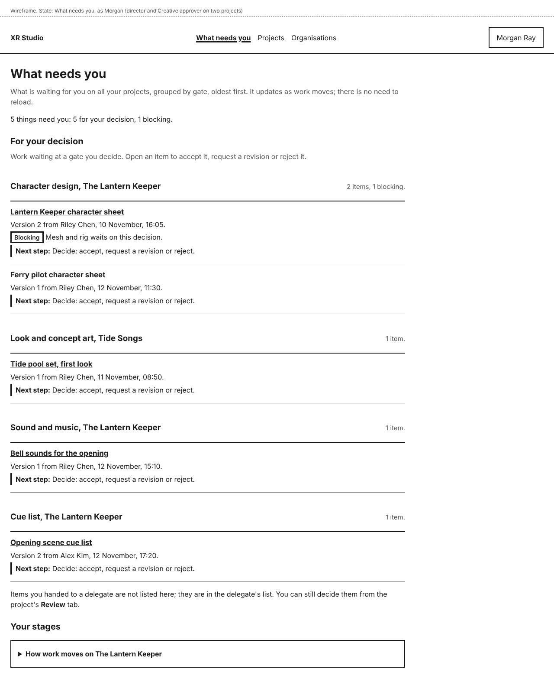 | Items for their decision across two projects. |
| New to a project, nothing assigned yet | 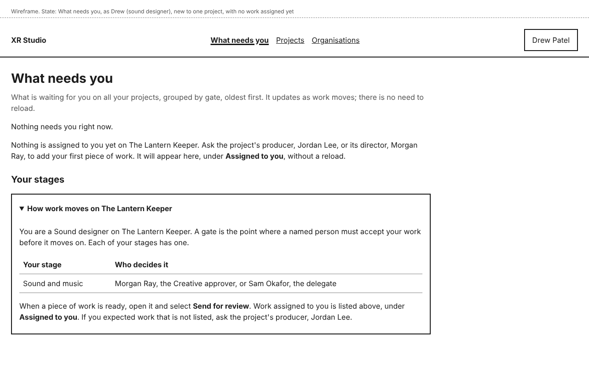 | Phone: 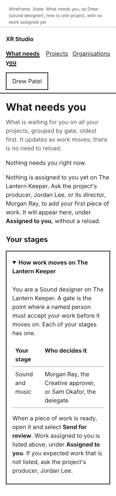. Says whom to ask. |
| Nothing needs you | 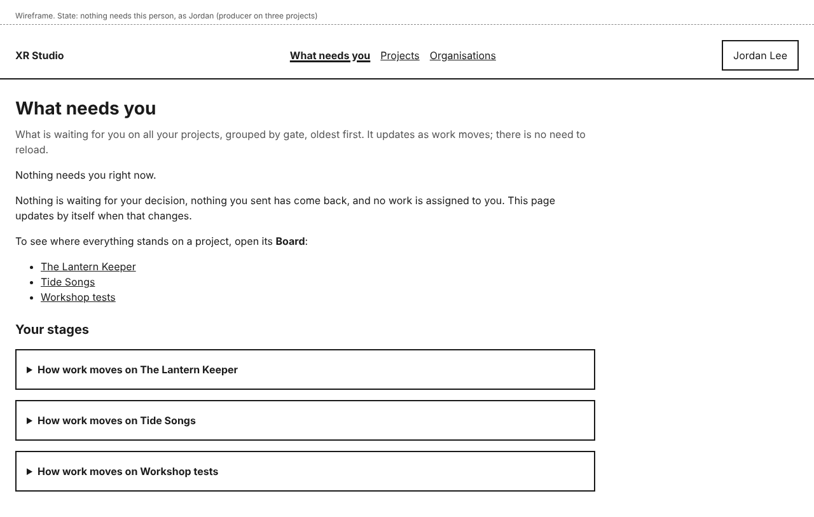 | As Jordan, on three projects. Links to each project's **Board**. |
| After changes elsewhere | 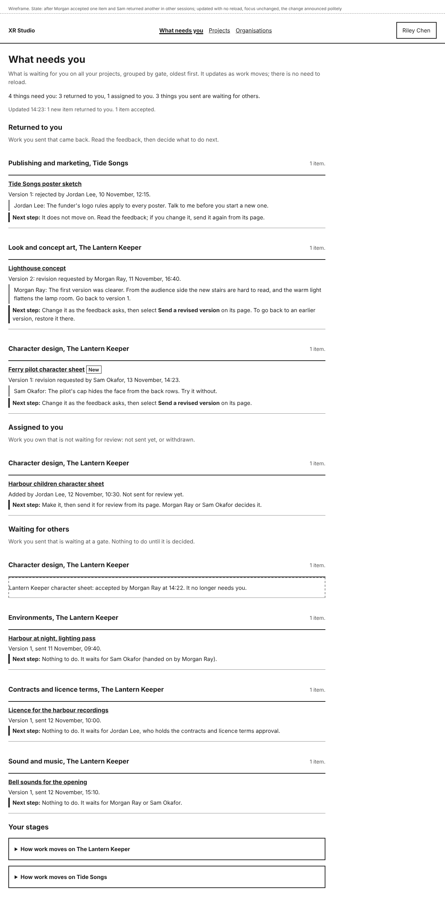 | A **New** item, a replaced row, the status line. |
| Could not check for updates | 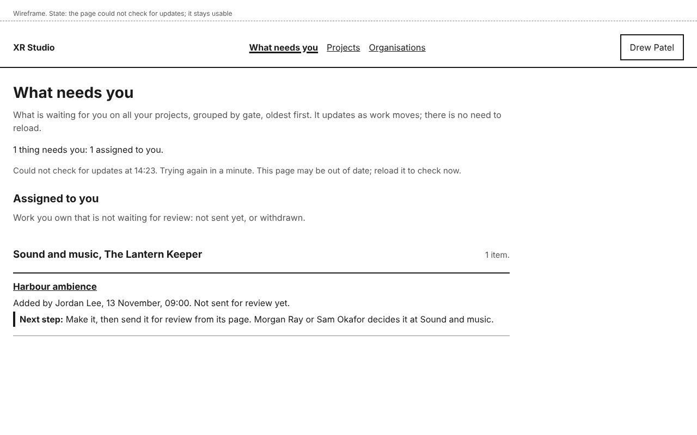 | |
| Drew's first task, opened | 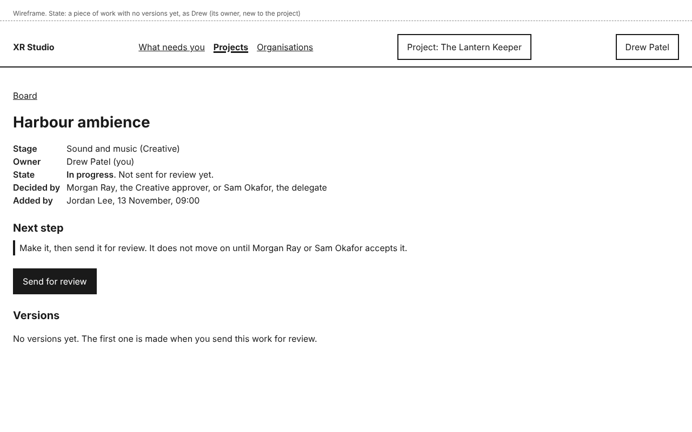 | From design-work-and-versions: **Next step** and **Send for review**. |

## Layout

- Main navigation, from slice 4: **What needs you**, **Projects**, **Organisations**. On **What needs you**, its link has `aria-current="page"`.
- Content is one column at every width, at most 960 pixels wide. Group headings put the count on the right from 600 pixels and below the heading under that.
- Addresses (added to decision-navigation-and-urls): `/what-needs-you`.
- Control names and headings: **What needs you**, **For your decision**, **Returned to you**, **Assigned to you**, **Waiting for others**, **Next step:**, **Your stages**, **How work moves on <project>**, **Board**, and the tags **Blocking** and **New**.

## States and errors

- **Nothing needs you:** "Nothing needs you right now." and "Nothing is waiting for your decision, nothing you sent has come back, and no work is assigned to you. This page updates by itself when that changes.", with a link to each project's **Board** and **Your stages** below.
- **New to a project, nothing assigned yet:** "Nothing needs you right now.", then "Nothing is assigned to you yet on The Lantern Keeper. Ask the project's producer, Jordan Lee, or its director, Morgan Ray, to add your first piece of work. It will appear here, under Assigned to you, without a reload.", with **How work moves on <project>** open. The producer and director named are the people with those roles on the project.
- **Only waiting items:** "Nothing needs you right now. 3 things you sent are waiting for others." with **Waiting for others** below.
- **No projects:** the person lands on **Projects** instead (design-dashboard-shell). Opening **What needs you** shows "You are not on any projects" with the same text and buttons as that page.
- **Only roles without dashboard access:** unchanged: "Nothing in the dashboard for you yet" (design-people-and-roles).
- **Could not check for updates:** "Could not check for updates at 14:23. Trying again in a minute. This page may be out of date; reload it to check now." in the status line.
- **An item the person can no longer see** (removed from the project, or an approver change): it leaves the page at the next update, replaced by "<title>: you can no longer decide this." or, after removal from a project, the next request shows "You no longer have access to this project" as today (design-people-and-roles).
- **Loading:** the page is drawn on the server; updates after that are quiet.

## How it works

- **How does the system know?**
  - Each section is a query over records that already exist: decision items from the queue's own query (design-review-queue), returned and waiting items from the latest versions and the approvals ledger, assigned work from the work's owner, blocking from the waiting items that name a stage. Nothing is stored for this page, so it survives a reload, another device and a restore, and always agrees with **Review** and **Board**.
  - "Sent nothing on that project yet", which opens **How work moves on <project>**, is read from the person's items on that project.
  - The update request returns the same lists with a version stamp, as on the board.
- **What enforces each promise?**
  - "Shows only what the person's role allows": the page uses the same server-side queries as **Review**, **Sent by you** and **Board**, which already check the person's assignments and roles per project. A project the person is not on is never queried. A test signs in as two people on different projects and checks each list, and as a person removed from a project.
  - "Adds no record of its own": there is no table and no command for this page. A test checks that the page's queries are read-only (it runs them in a read-only transaction).
  - "Grouped by gate, oldest first, blocking first": a unit test of the ordering with seeded items.
  - "Updates without a reload": an end-to-end test with a second browser session that decides an item, checking the first page's row and status line change with no navigation.
  - "Finds the first task without help": the moderated first-task test above, run in the delivery with a person new to the pipeline, before the story is accepted.
- **What is published together?** Not applicable.

## Accessibility

- One `h1`; the four sections are `h2`; groups are `h3` sections labelled by their heading; items are `h4` links in a list, so a screen reader user can jump section by section and group by group.
- **Blocking**, **New** and **Next step:** are text, not colour. The next step is also set off by a rule at its left, for sighted readers.
- The status line is a polite live region, present and empty from page load. Updates never move focus; a row under focus is changed in place, not removed.
- **How work moves on <project>** is a native `details` element, so it opens with Enter or Space and announces its state. Its table has a caption.
- Targets are at least 44 by 44 pixels. No horizontal scrolling at 320 pixels.
- All mock-ups were checked with axe (WCAG 2.2 AA tags) at 1280 and 320 pixels wide, with no violations. The manual WCAG 2.2 AA check (WEB-002) is done on the built page in the delivery.

## Open items

- `docs/user/review.md` ("Send a revised version") and `docs/user/your-projects.md` ("After you sign in, Projects lists...") describe slice 3 and slice 1 as built. Their wording is changed in the slice 4 delivery, when the behaviour changes, so the slice 3 tutorial run still matches the product until then. The new wording is in docs-versions-and-feedback and docs-what-needs-you.
- Feedback that is not part of a decision (a colleague's note on a waiting version) shows on the work's page and the item's page only. Nothing on this page marks it as new until the alerts of slice 9.
- Email and badge alerts that point to this page: story-review-and-status-notifications, slice 9.
- Items from agents (chat drafts waiting for the person) join **Returned to you** and **Assigned to you** with slice 7.
- The role-to-stage table is `[proposed]` until the lead accepts it; later layers may add stages to it.
