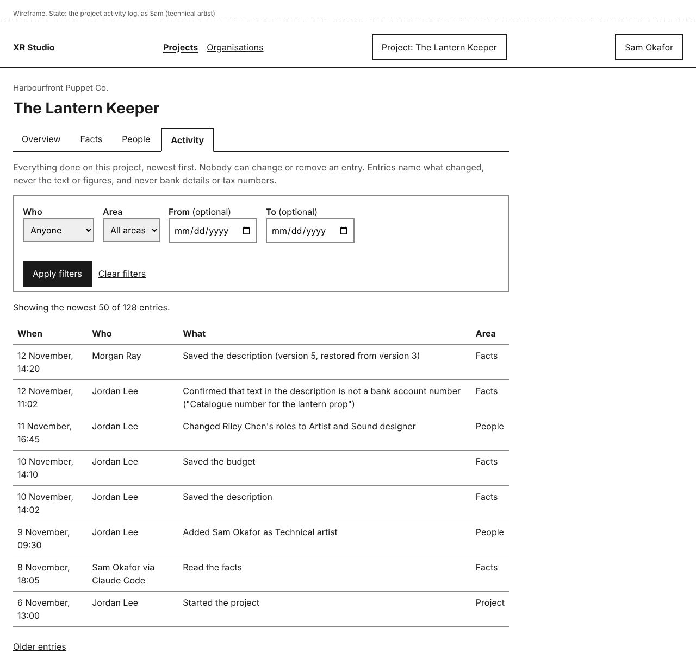
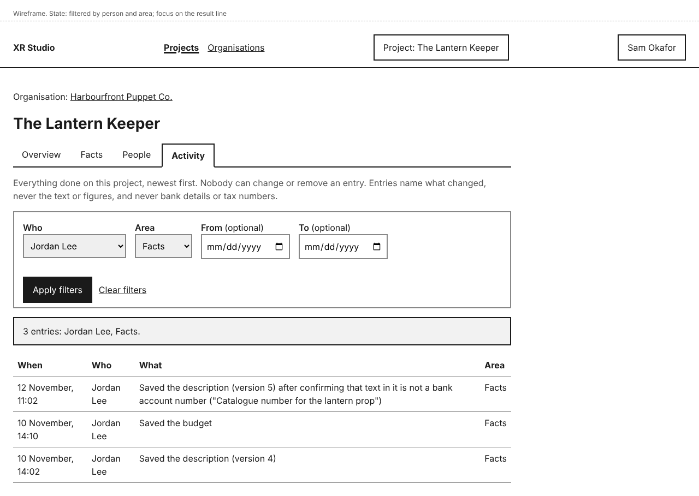
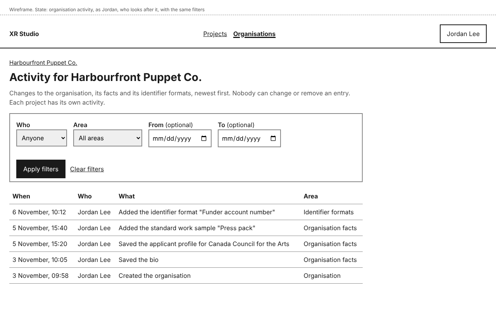

# Activity

Every change on a project is recorded in its activity log: who did what, and when. Nobody can edit or remove an entry, so you can always find out who changed a fact or a role, and check that a confirmation was recorded.

Today the log records people's changes to facts, people and roles, approvers and the project itself, work sent for review and the decisions on it, every confirmation that some text is not an identifier, and the deletion of a held file nobody confirmed in time, shown as done by XR Studio. It records changes, not who opened which page. In a later release, when agents and Claude Code sessions arrive, it also records each agent action with its stage and tool and the person who requested or approved it.

Organisations have their own activity log for changes to the organisation, its facts and its identifier formats.

## Read a project's activity

You need the Director, Producer or Technical artist role on the project.

Open the project and select **Activity**, the last tab. Entries are listed newest first, fifty at a time, each with:

- **When**: the date and time, in your own time zone.
- **Who**: the person who made the change.
- **What**: what was done, in words, for example "Saved the description (version 4)" or "Changed Riley Chen's roles to Artist and Sound designer".
- **Area**: Project, Facts, People, Approvers or Review.

A line above the list says how many there are, for example "Showing the newest 50 of 128 entries." Select **Older entries** to see the next fifty.

An entry says what was saved, never the text or figures of a fact, so an entry about the budget does not show the budget. The one free text an entry can hold is a person's answer when they confirmed that some text is not an identifier, for example "Saved the description (version 5) after confirming that text in it is not a bank account number ("Catalogue number for the lantern prop")".

## Filter the activity

1. Above the list, choose any of:
   - **Who**: anyone with an entry on the project, including people since removed, shown as "<name> (removed)". **Agents** is also listed, but there are no agent entries until agents arrive in a later release. Filtering by agent and by **Stage** comes then too.
   - **Area**: Project, Facts, People, Approvers or Review.
   - **From** and **To**: a range of dates. Both days are included, so the same date in both shows that one day.
2. Select **Apply filters**.

The page shows how many entries match and which filters you used, for example "3 entries: Jordan Lee, Facts." **Clear filters** shows everything again.

## Read an organisation's activity

You need to look after the organisation.

On the organisation's page, select **Activity**. It lists changes to the organisation itself, its facts, its standard work samples and its identifier formats, and confirmations made on them, with the same columns and filters, except that **Who** lists only people. Its areas are Organisation, Organisation facts and Identifier formats.

## Entries nobody can change

There is no way to edit or remove an entry, in the dashboard or otherwise. If a record is removed at the end of its retention period (a later release), the log keeps an entry saying so: "A record from <date> was deleted at the end of its retention period (<rule>). Its content is gone; this entry stays."

## Who can do this

| Log | Who can read it |
|---|---|
| A project's activity | Director, Producer, Technical artist |
| An organisation's activity | People who look after the organisation |

Other roles do not see the **Activity** tab. A Director who does not look after the organisation sees the project's activity, not the organisation's.

## If something goes wrong

| You see | What it means | What to do |
|---|---|---|
| "No entries match these filters." | Nothing in the log matches what you chose. | Change the filters, or select **Clear filters**. |
| "Agents arrive in a later release, so there are no agent entries yet." | You filtered **Who** by **Agents**. | Choose a person instead. |
| "Choose a From date before the To date." | **From** is later than **To**. | Change one of the dates. The values you chose are kept. |
| "This page is not available" | Your roles on the project do not include reading its activity, or you do not look after the organisation. | Ask the project's director or producer, or a person who looks after the organisation. |
