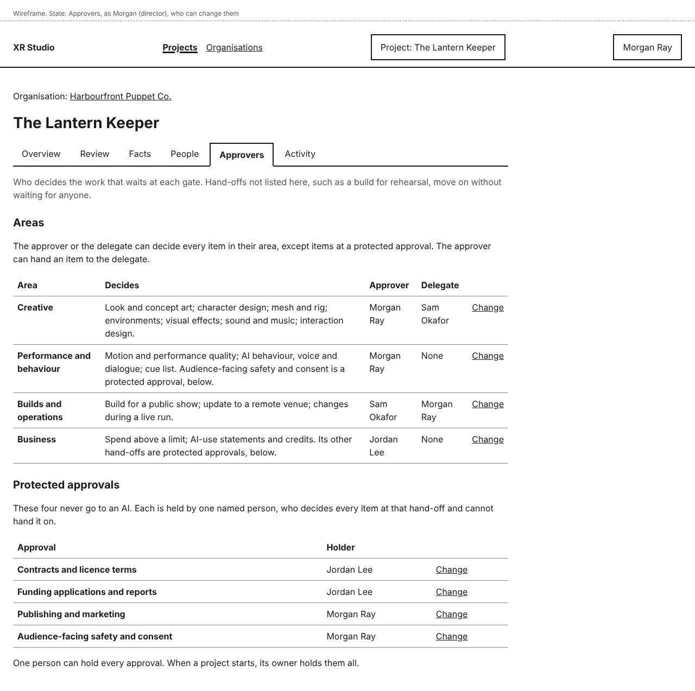
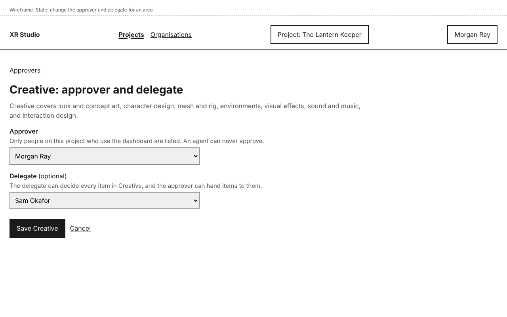
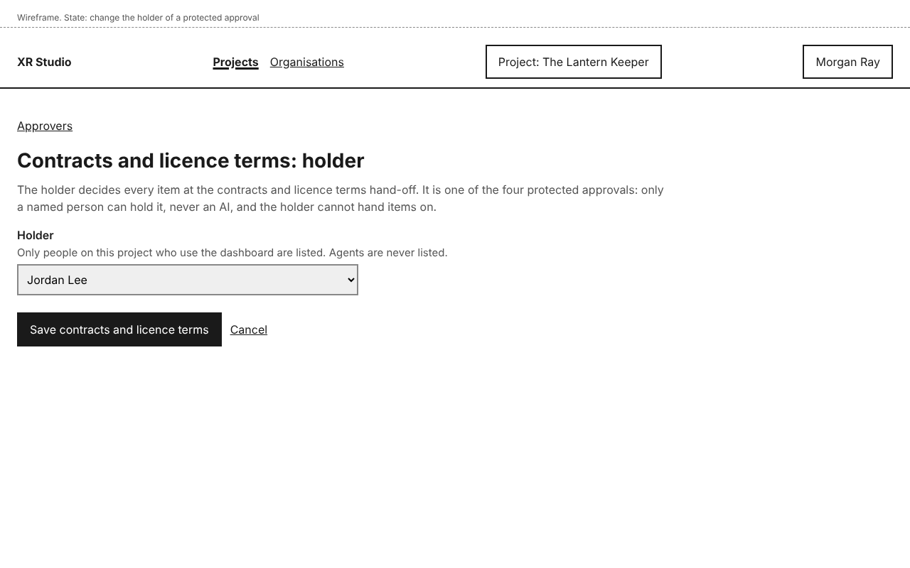
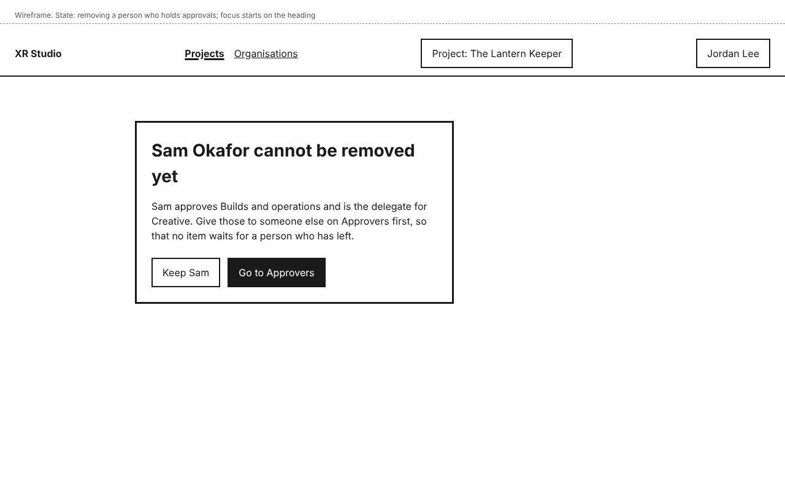

# Approvers

Much of a production's work waits at a gate until a person accepts it: character design before mesh and rig, a build before a public show, a contract before it is signed. Approvers are the people who decide. You name them per project, on the project's **Approvers** tab. Holding a role never makes someone an approver.

There are two kinds:

- Areas. The gates are grouped into four areas: Creative, Performance and behaviour, Builds and operations, and Business. Each area has an approver and, if you want one, a delegate. Either of them can decide any item in the area.
- Protected approvals. Four kinds of approval never go to an AI: contracts and licence terms, funding applications and reports, publishing and marketing, and audience-facing safety and consent. Each has one holder, a named person, who decides every item of that kind and cannot hand it on.

When a project starts, its owner holds every approval, with no delegates. So if you run a production alone, there is nothing to set up. One person can hold every approval.

## See who approves what

Open the project and select **Approvers**. Everyone on the project who uses the dashboard can see it.

- **Areas** lists each area, the gates it decides, its **Approver** and its **Delegate** ("None" when there is none).
- **Protected approvals** lists the four protected approvals and the **Holder** of each.

Work at a gate that is not listed, such as a build for rehearsal, moves on without waiting for anyone.

Three of the protected approvals are Business gates and one, audience-facing safety and consent, is a Performance and behaviour gate. Items at those gates go to the holder, not to the area's approver or delegate.

## Name an approver and a delegate for an area

You need the Director or Producer role on the project.

1. On the **Approvers** tab, select **Change** beside the area.
2. Choose the **Approver**.
3. Choose a **Delegate (optional)**, or **No delegate**.
4. Select **Save <area>**, for example **Save Creative**.

You see, for example, "Creative saved: Morgan Ray approves it, with Sam Okafor as delegate. Items already waiting in Creative now wait for them."

The lists show only people on the project who use the dashboard. Anyone who has not signed in yet is marked "(invited, not signed in yet)": an item can wait for them before they have started, so check with them. Agents are never listed, and can never approve.

A delegate can decide every item in the area, the same as the approver. The approver can also hand single items to the delegate from the review queue (see [Review](review.md)).

## Name the holder of a protected approval

You need the Director or Producer role on the project.

1. Under **Protected approvals**, select **Change** beside the approval.
2. Choose the **Holder**.
3. Select **Save <approval>**, for example **Save contracts and licence terms**.

You see, for example, "Contracts and licence terms saved: Jordan Lee holds it."

The holder decides every item of that kind and cannot hand it on. Only a person can hold a protected approval; agents are never listed.

## What happens to work already waiting

A change applies at once. Items already waiting in that area, or of that protected kind, now wait for the people you named. Anyone who could decide them before and no longer can stops seeing them in their queue.

## Removing someone who approves

You cannot remove a person from the project while they hold an approval or are a delegate. On **People**, instead of the removal confirmation, you see, for example, "Sam Okafor cannot be removed yet" and which approvals they hold, with **Keep Sam** and **Go to Approvers**. Give their approvals to someone else, then remove them.

The same applies if you change their roles so that none of them uses the dashboard.

## Who can do this

- The project's Director or Producer can change approvers, delegates and holders.
- Everyone else on the project sees the **Approvers** tab without **Change**, and a line naming who can change it.
- Agents cannot change approvers, and cannot be chosen.
- Every change is recorded in the project's **Activity**, under the area Approvers.

## If something goes wrong

| You see | What it means | What to do |
|---|---|---|
| "Choose someone other than the approver as delegate, or No delegate." | You chose the same person as approver and delegate. | Choose another person as **Delegate**, or **No delegate**. Your choices are kept. |
| "<name> cannot be removed yet" | The person holds an approval or is a delegate. | Select **Go to Approvers**, give their approvals to someone else, then remove them. |
| Your **Review** tab says you approve no area | Nobody has named you yet. On a new project, the owner holds every approval. | If you are the Director or Producer, name yourself on **Approvers**. Otherwise ask one of them. |
