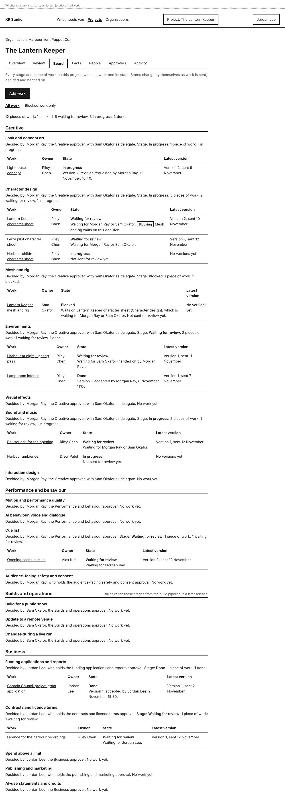
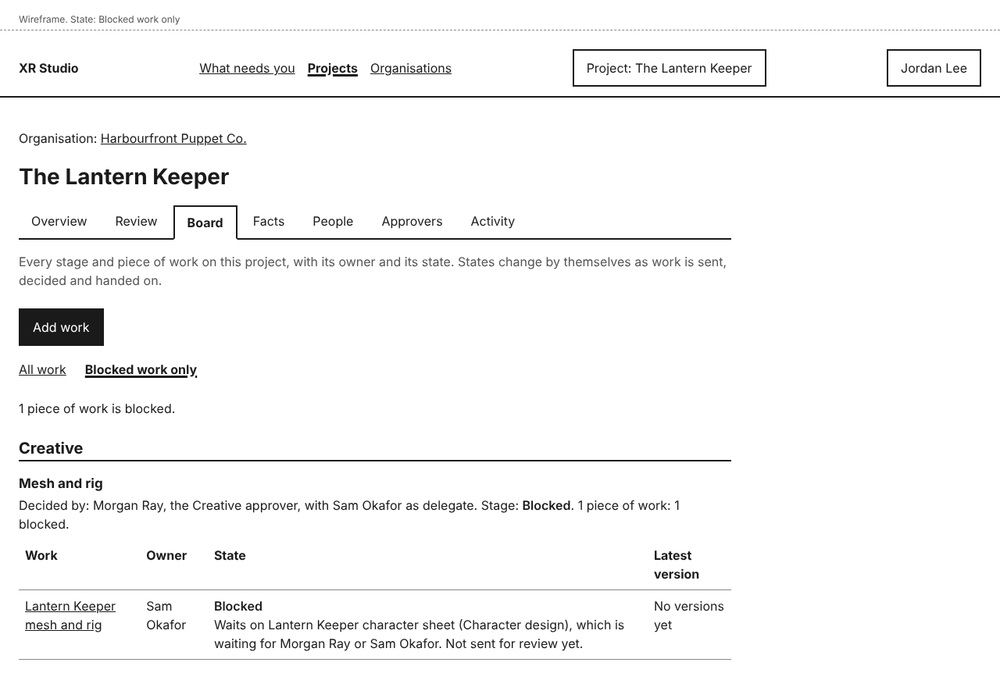
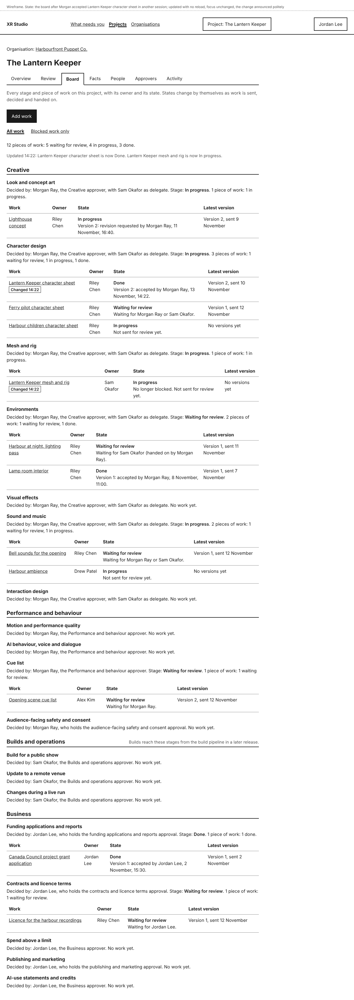
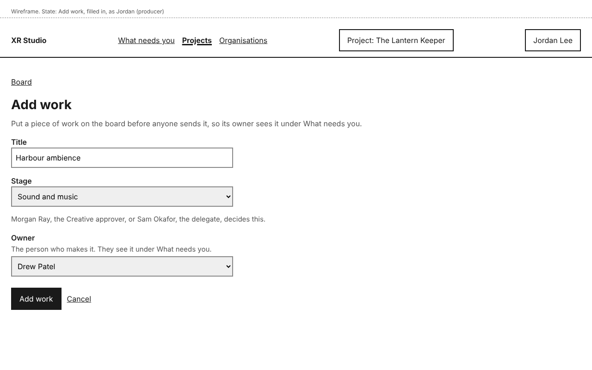
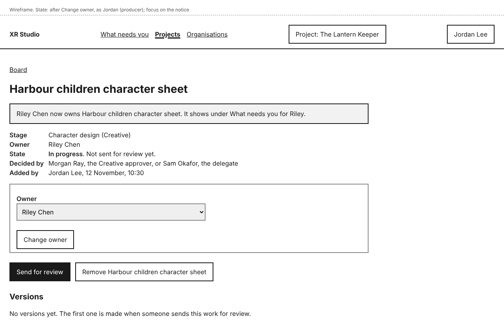

# Board

A project's **Board** shows every stage and every piece of work on it, with who owns each and where it stands. It is a tab on the project, after **Review**. Everyone on the project who uses the dashboard can open it.

A piece of work is anything that goes through a gate: an asset such as a character sheet or a mesh, and also a cue list, a licence or a funding report. Each piece of work has one stage, one owner and its versions (see [Versions and feedback](versions-and-feedback.md)).

## See where everything stands

Open the project and select **Board**.

A line at the top counts the work, for example "12 pieces of work: 1 blocked, 6 waiting for review, 3 in progress, 2 done."

The board lists every stage that has a gate, grouped by area (Creative, Performance and behaviour, Builds and operations, Business), in the same order as **Approvers**. Each stage shows:

- **Decided by**: the stage's owner, who decides work at it: the area's approver and delegate, or the holder of its protected approval (see [Approvers](approvers.md));
- its state, and a count of its work, or "No work yet";
- a table of its work: **Work**, **Owner** (the person who makes it), **State** and **Latest version**.

Each piece of work has one of four states, with a line saying why:

- **In progress**: not sent for review yet, or its latest version came back with a revision request, was rejected or was withdrawn.
- **Waiting for review**: its latest version is waiting at the gate. The line says who it waits for.
- **Blocked**: its stage is waiting on a decision about other work. Someone sent that other work for review and said this stage waits on it. The line names the work it waits on and who must decide it, for example "Waits on Lantern Keeper character sheet (Character design), which is waiting for Morgan Ray or Sam Okafor."
- **Done**: its latest version was accepted.

If more than one applies to a piece of work, it shows the first of Done, Blocked, Waiting for review and In progress. So work with a version waiting at the gate shows **Blocked** while its stage waits on another decision, and the line under it says a version is waiting too.

A stage takes the first of these that any of its work has: Blocked, In progress, Waiting for review, Done. So a stage is Done only when all its work is.

Nobody sets these states by hand. They change by themselves when work is sent, decided, withdrawn or handed on, and when approvers change.

The three Builds and operations stages stay empty in this release: builds reach them from the build pipeline in a later release.

## Show only blocked work

Select **Blocked work only**. Only the stages with blocked work are shown, and the line reads, for example, "1 piece of work is blocked." Select **All work** to see everything again.

To unblock work, the blocking item must be decided: the line says who decides it. Open the blocking work to see it.

## When things change

You do not need to reload. The board checks for changes every 15 seconds while it is open. A row that changed shows **Changed <time>**, and a line above the board says what changed, for example "Updated 14:22: Lantern Keeper character sheet is now Done. Lantern Keeper mesh and rig is now In progress."

In **Blocked work only**, work that stops being blocked stays on the page, with its new state, until you open the board again.

## How work gets on the board

- **When someone sends work for review** from the **Review** tab, it joins the board as a new piece of work, owned by the person who sent it.
- **When a director or producer adds it**, before anyone has started. Use this to give someone their first task: it shows under **What needs you** for its owner (see [What needs you](what-needs-you.md)).

### Add work

You need to be the project's director or producer.

1. On the **Board**, select **Add work**.
2. Type a **Title**.
3. Choose the **Stage**. A line appears saying who decides it.
4. Choose the **Owner**: the person who will make it.
5. Select **Add work**.

The new work's page opens with, for example, "Added Harbour ambience to Sound and music, owned by Drew Patel. It shows under What needs you for Drew."

Keep bank details and tax numbers out of the title: agents can read it. XR Studio checks it as it does facts (see [Identifier formats](identifier-formats.md)).

### Change the owner

On the work's page, a director or producer chooses another **Owner** and selects **Change owner**. You see, for example, "Riley Chen now owns Harbour children character sheet. It shows under What needs you for Riley."

### Remove work added by mistake

On the work's page, a director or producer selects **Remove <title>** and confirms. Only work with no versions can be removed. Work that has been sent for review stays on the board, because its versions are part of the review record.

## Who can do this

- Everyone on the project who uses the dashboard can see the board and every piece of work on it.
- Only the director and producer can add work, change its owner and remove it.
- Agents cannot add, change or remove work.
- Adding work, changing an owner and removing work are recorded in the project's **Activity**, under the area Review.

## If something goes wrong

| You see | What it means | What to do |
|---|---|---|
| "Nothing is on the board yet." | Nobody has sent work for review or added work on this project. | Add work, or send work for review from **Review**. |
| "Nothing is blocked." | No work is waiting on another decision. | Select **All work** to see everything. |
| "Could not check for updates at 14:23. Trying again in a minute." | The board could not reach XR Studio. It may be out of date. | Wait, or reload the page to check now. |
| "Enter a title.", "Choose the stage this work is at." or "Choose who owns this work." | Something is missing in **Add work**. | Fill it in. What you chose is kept. |
| "Keep the title to 120 characters or fewer." | The title is too long. | Shorten it. Nothing is cut for you. |
| An error saying the title looks like a bank account, tax or card number | It matches one of your organisation's identifier formats. | Take the number out, or select **It is not a <format>** (see [Identifier formats](identifier-formats.md)). |
| "Not removed: Riley Chen sent version 1 at 10:02." | Someone sent the work for review while you were removing it. | Nothing. Change the owner instead if it is with the wrong person. |
| An owner shown as "(no longer on the project)" | The owner was taken off the project. | Choose a new **Owner** and select **Change owner**. |
| No **Add work** button | Your roles on this project are not director or producer. | Ask the project's director or producer to add it. |
