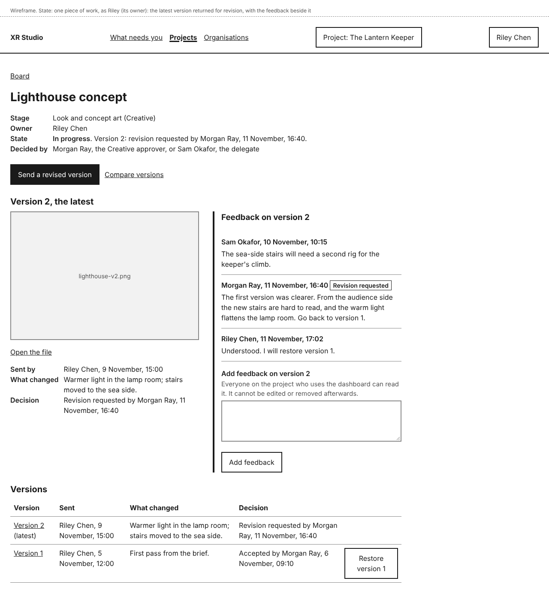
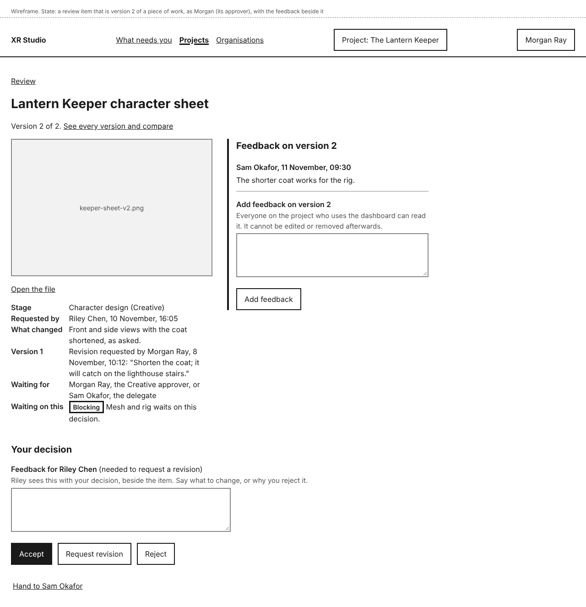
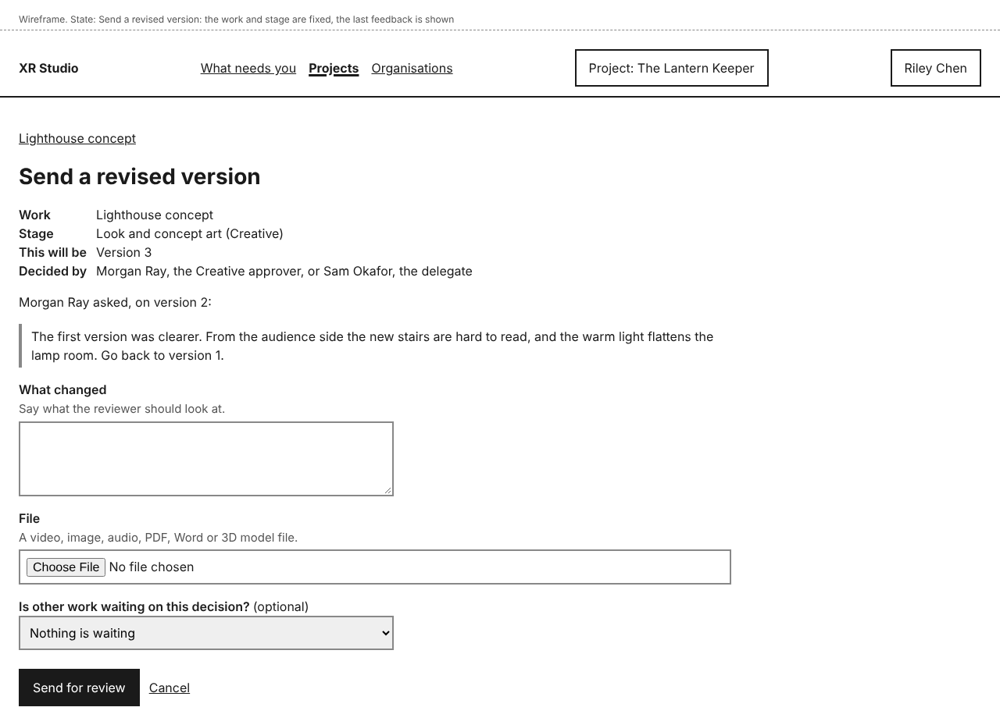
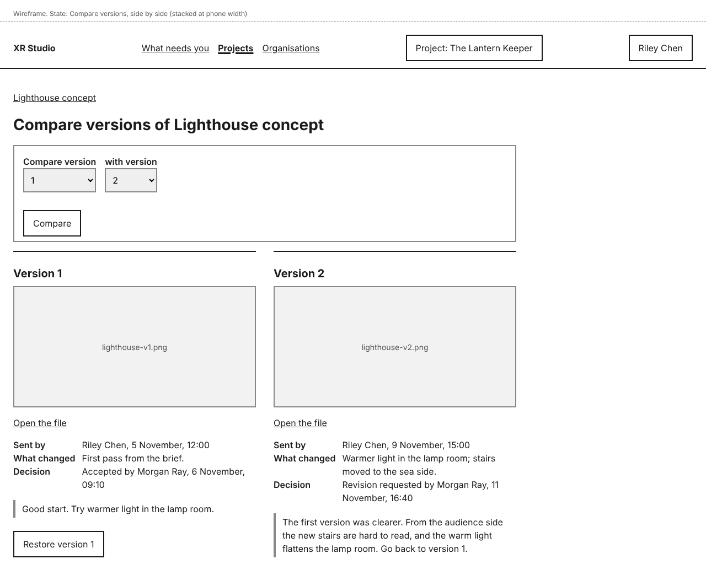
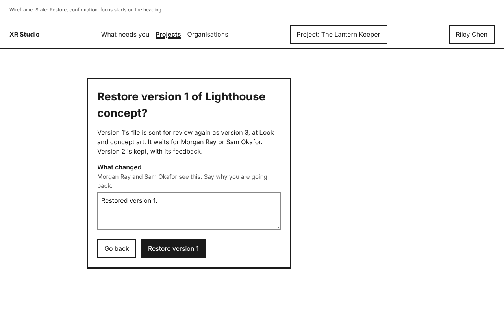

# Versions and feedback

Every piece of work keeps all its versions. Each time it is sent for review, the file becomes its next version: version 1, version 2 and so on. Feedback is written on a version and shown beside it. You can compare any two versions side by side, and go back to an earlier one without losing the later ones.

Open a piece of work from the project's **Board**, from **What needs you**, or from **See every version and compare** on a review item.

## See a piece of work and its feedback

A piece of work's page shows its **Stage**, **Owner**, **State** and who decides it. Below that is its latest version: a preview, **Open the file**, who sent it, what changed, and the decision.

Beside the version (below it on a phone) is **Feedback on version <n>**, oldest first. The reviewer's feedback with their decision is there too, tagged **Accepted**, **Revision requested** or **Rejected**.

Under it, **Versions** lists every version, newest first, with who sent it, when, what changed and its decision. Select a version's number to open it.

Try it: [Give feedback and compare versions](../../tutorials/give-feedback-and-compare-versions.md)

## Give feedback on a version

1. Under **Add feedback on version <n>**, write your feedback.
2. Select **Add feedback**.

Your feedback is added with your name and the time, and you see "Feedback added."

Anyone on the project who uses the dashboard can read it and add their own. You can add feedback to any version, waiting or decided. Work that has never been sent has no version yet, so feedback starts once its first version is sent. Adding feedback does not decide anything: only the approver's **Accept**, **Request revision** or **Reject** does that (see [Review](../review/review.md)).

Feedback cannot be edited or removed once added, so check it before you select **Add feedback**. Keep bank details and tax numbers out of it: agents can read it.

When you review an item that is a later version, its page says, for example, "Version 2 of 2.", shows what was decided on the version before, and has the same feedback beside the preview.

## Send a revised version

After a revision request (or at any other time), make the change, then:

1. On the work's page, select **Send a revised version**. You also find it beside the item in **Sent by you** on the **Review** tab.
2. The form shows the work, its stage, which version this will be, who decides it, and the last feedback.
3. Say in **What changed** what is different.
4. Choose the **File**.
5. Check **Is other work waiting on this decision?**: it is filled in from the last version.
6. Select **Send for review**.

You see, for example, "Sent for review: Lighthouse concept, version 3. It waits for Morgan Ray or Sam Okafor." The new version goes through the gate like the first one.

Only one version of a piece of work can wait at a time. To replace one that is waiting, the person who sent it withdraws it first with **Withdraw version <n>** on the work's page.

In this release people send every version. Versions regenerated by agents come in a later release, and will be listed the same way.

## Compare two versions

1. On the work's page, select **Compare versions**. The latest version and the one before it are shown side by side.
2. To compare others, choose them in **Compare version** and **with version**, then select **Compare**.

Each side shows the version's preview, **Open the file**, who sent it, what changed, and its decision and feedback. On a phone the two versions are one above the other.

Compare shows the two versions whole. It does not mark what changed inside a file, so open both files to look closely.

## Restore an earlier version

1. Select **Restore version <n>**, either in **Versions** on the work's page or under that version in **Compare versions**.
2. The confirmation says which version number the restored one will get. **What changed** is filled in with "Restored version <n>."; add why you are going back.
3. Select **Restore version <n>**, or **Go back** to leave everything as it was.

You see, for example, "Restored version 1 as version 3. It waits for Morgan Ray or Sam Okafor. Versions 1 and 2 are kept, with their feedback."

Restoring sends the earlier file for review again as a new version. It is reviewed again, even if it was accepted before. No version is deleted or changed, so you can always go back again.

**Restore** is not offered while a version of that work is waiting for review. Withdraw the waiting version first.

## Who can do this

- Everyone on the project who uses the dashboard can see every version and its feedback, add feedback, compare versions, send a revised version and restore an earlier one. Each is recorded with their name.
- Only the approver or delegate of the work's stage, or the holder of its protected approval, can decide a version.
- Agents cannot add feedback or restore versions in this release.
- Feedback added and versions restored are recorded in the project's **Activity**, under the area Review. The text of feedback is not copied there.

## If something goes wrong

| You see | What it means | What to do |
|---|---|---|
| "Write your feedback before adding it." | You selected **Add feedback** with nothing written. | Write it, then select **Add feedback** again. |
| "Keep feedback to 2,000 characters or fewer." | Your feedback is too long. | Shorten it. Nothing is cut for you. |
| An error saying your feedback looks like a bank account, tax or card number | It matches one of your organisation's identifier formats. | Take the number out, or select **It is not a <format>** (see [Identifier formats](../organisations/identifier-formats.md)). |
| "Choose two different versions." | You chose the same version twice in **Compare versions**. | Choose another, then select **Compare**. |
| "<title> has one version so far." | There is nothing to compare with yet. | Compare once a second version is sent. |
| "Version 2 is waiting for review. To restore an earlier version, withdraw version 2 first." | A version is waiting, so you cannot restore now. | Wait for the decision, or ask the person who sent the waiting version to withdraw it. |
| "Not restored: Riley Chen sent version 3 at 09:18, and it is waiting for review." | Someone sent a new version while you were restoring. | Withdraw it first if you still want to restore. |
| A notice that your file is held | The restored PDF or Word file looks like it holds a bank or tax number. | Confirm with **It is not a <format>, add <file>**, or send a copy with those numbers removed. |
