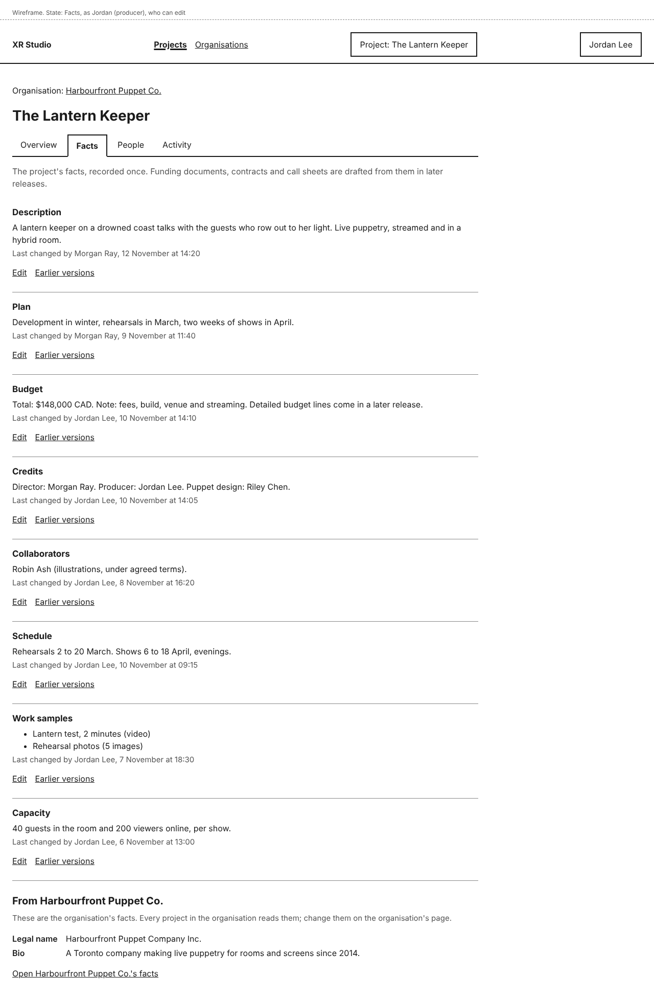
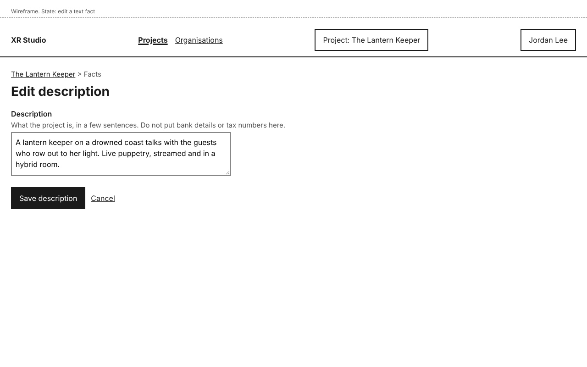
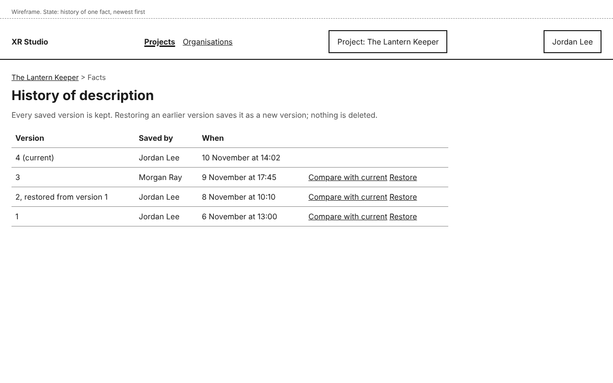
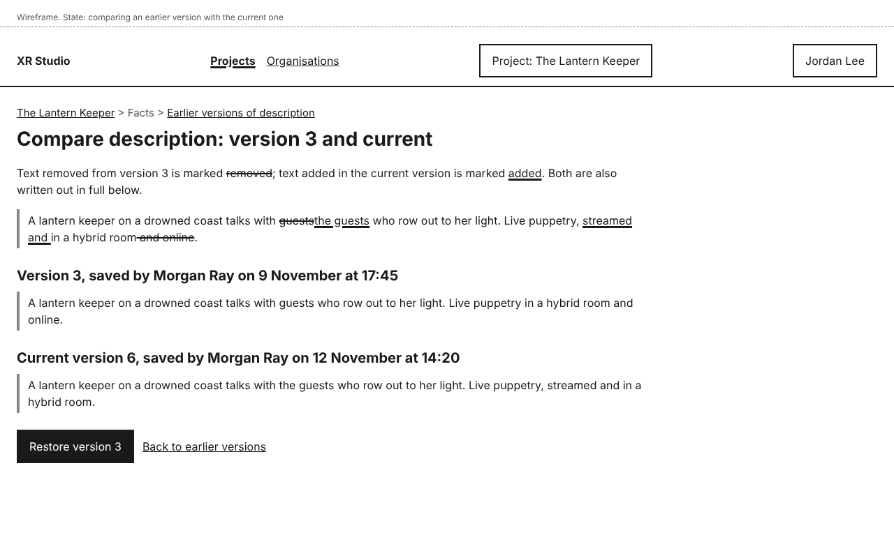
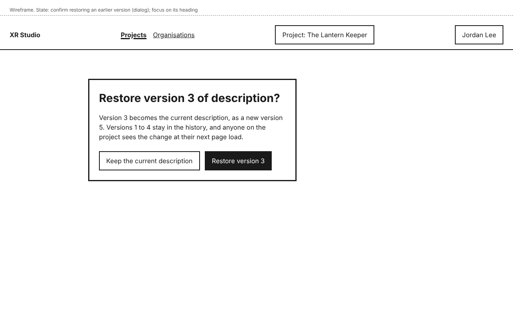
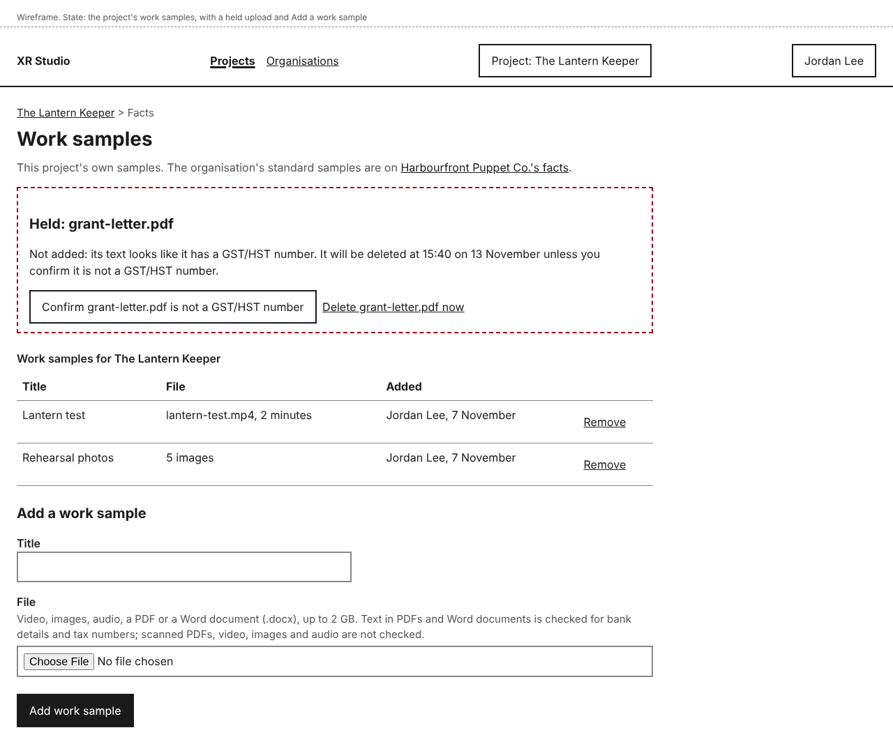
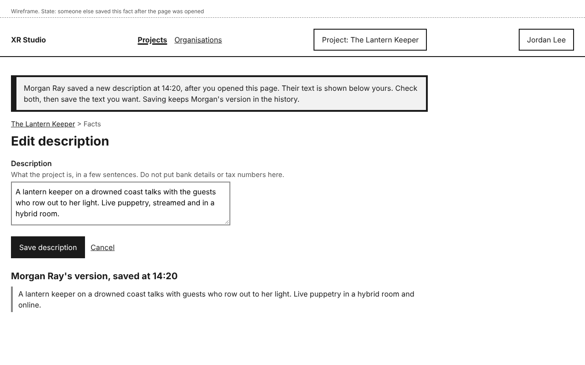
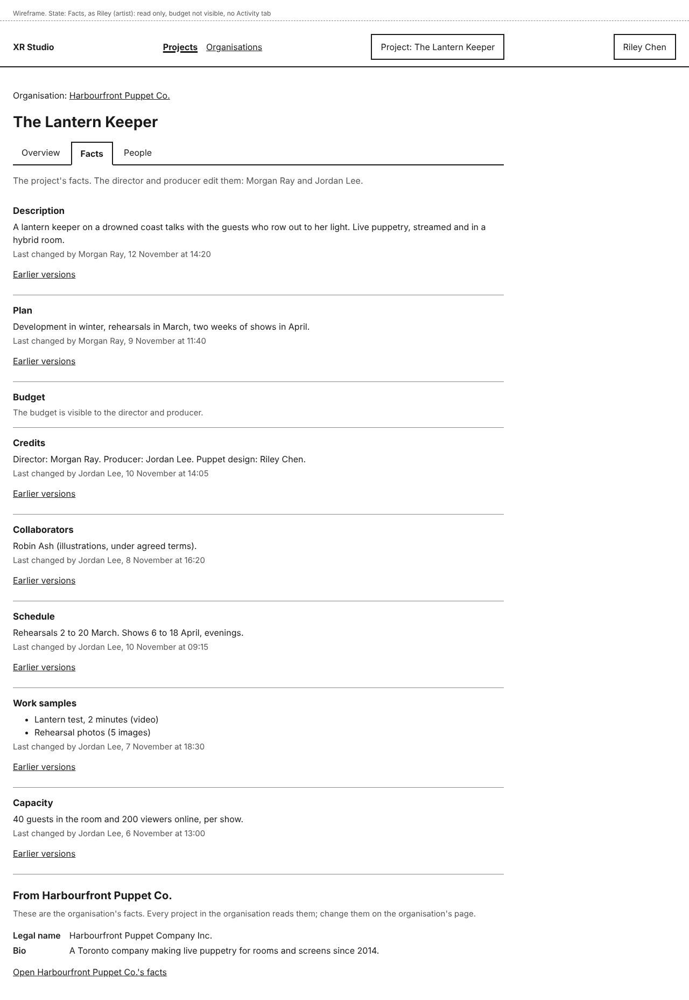

# Project facts

A project's facts are recorded once, on its **Facts** tab: the description, plan, budget, credits, collaborators, schedule, work samples and capacity. Later releases draft funding applications, contracts and call sheets from this one record, so a figure changed here is the figure every draft uses.

Every save is kept as a version. You can see who last changed each fact, read its earlier versions and compare one with the current text. The director and producer can also restore an earlier version without losing anything.

## See a project's facts

Open the project and select **Facts**. It sits between **Overview** and **People**. Above the project's name, **Organisation: <organisation>** links to the organisation's page.

The facts are listed in this order: **Description**, **Plan**, **Budget**, **Credits**, **Collaborators**, **Schedule**, **Work samples** and **Capacity**. Under each one you see its value and "Last changed by <name>, <date and time>". Times are shown in your own time zone.

Below them, **From <organisation>** shows the organisation's legal name and bio, which every project in the organisation reads. You cannot edit them here; select **Open <organisation>'s facts** to go to them. See [Organisation facts](../organisations/organisation-facts.md).

A fact that has never been saved shows "Not recorded yet." with **Add** instead of **Edit**.

Try it: [Record a project's facts](../../tutorials/record-a-projects-facts.md)

## Edit a fact

You need the Director or Producer role on the project.

1. On the **Facts** tab, select **Edit** beside the fact (or **Add**, if it is not recorded yet).
2. Change the text or figures. You edit one fact at a time, on its own page.
3. Select **Save <fact>**, for example **Save description**. **Cancel** leaves without saving.

The **Facts** tab opens with a notice, for example "Description saved.", and the fact shows you as the last person to change it. Everyone on the project whose role lets them see that fact sees the new value the next time they open the page.

### What each fact takes

| Fact | What you enter |
|---|---|
| Description, Plan, Credits, Collaborators, Schedule | Text. |
| Budget | **Total in Canadian dollars**, in whole dollars, and an optional **Note**. "148000", "148,000" and "$148,000" are all read as 148000. Detailed budget lines and actual cost come in a later release. |
| Capacity | **Guests in the room per show** and **Viewers online per show**, each a whole number. 0 is allowed, for example for a show with no online audience. |
| Work samples | Files with a title, on their own page. See [Add and remove work samples](#add-and-remove-work-samples). |

Do not put bank details or tax numbers in a fact. Facts can be read by agents, so text that looks like one is not saved. See [Bank details, tax numbers and identifier formats](../organisations/identifier-formats.md).

## Earlier versions of a fact

1. On the **Facts** tab, select **Earlier versions** beside the fact.
2. The list shows every saved version, newest first, with who saved it and when. The current version is marked "(current)". A version made by restoring says so, for example "2, restored from version 1".
3. Select **Compare with current** beside a version. The page marks what changed and writes out both versions in full. **Back to earlier versions** returns to the list.

Anyone who can see the fact can read and compare its earlier versions.

## Restore an earlier version

You need the Director or Producer role on the project.

1. On the fact's **Earlier versions** page, select **Restore** beside the version you want. You can also select **Restore version <n>** on the page that compares it with the current one.
2. A dialog asks, for example, "Restore version 3 of description?". Select **Restore version 3**, or **Keep the current description** to leave it as it is.

The **Facts** tab opens with a notice such as "Description restored to version 3, saved as version 7. Earlier versions are kept." Restoring saves the earlier text as a new version; no version is removed or changed, so you can restore the one you replaced later.

Restored text is checked for bank details and tax numbers like any save. If an identifier format was turned on after that version was saved, you may see "Not saved"; see [Bank details, tax numbers and identifier formats](../organisations/identifier-formats.md).

## Add and remove work samples

You need the Director or Producer role on the project. Everyone else who can see the facts sees the list of samples on the **Facts** tab.

1. On the **Facts** tab, select **Edit** beside **Work samples** (or **Add**, if there are none yet). The work samples page opens.
2. Under **Add a work sample**, type a **Title** and choose a **File**: video, images, audio, a PDF or a Word document (.docx), up to 2 GB.
3. Select **Add work sample**. While the file uploads, a progress bar shows how far it has gone and about how long is left, and the button reads **Uploading**. Keep the page open. **Stop uploading** cancels it.

The sample appears in the list with its title, file, who added it and when.

To remove a sample, select **Remove** beside it, then **Remove <title>** in the dialog, or **Keep <title>** to leave it. You see, for example, "Lantern test removed from the work samples. It stays in the earlier versions of Work samples." Restoring that earlier version of **Work samples** brings the file back. Restoring brings back the whole list as it was in that version, so samples added since then leave the current list (they stay in the later versions).

Text in PDFs and Word documents is checked for bank details and tax numbers when you add them. Scanned PDFs, video, images and audio are not checked, so do not add scans or photos of bank or tax documents. A file whose text matches is held, not added, and listed at the top of the page as **Held**; see [A document that is held](../organisations/identifier-formats.md#a-document-that-is-held).

The organisation's standard work samples have their own page; the line at the top of this page links to it.

## If someone else saved while you were editing

If another person saves the same fact after you opened it, your text is not saved and nothing is overwritten. The page says, for example, "Check before saving: Morgan Ray saved a new description at 14:20", shows their version above the form, and keeps your text in the box.

- Select **Save my <fact>**, for example **Save my description**, to make your text the newest version. Theirs stays in the earlier versions.
- Or change your text first, for example to combine both, then select **Save my <fact>**.
- **Cancel** leaves without saving your text.

## Who can do this

| Fact | Who sees it | Who edits it |
|---|---|---|
| Description, Plan, Credits, Collaborators, Schedule, Work samples, Capacity | Every role that uses the dashboard | Director, Producer |
| Budget | Director, Producer | Director, Producer |

- If your roles do not let you edit, you see the facts without **Edit**, and a line names who edits them. On **Earlier versions** you can use **Compare with current** but not **Restore**.
- A fact your roles do not let you see is listed by name with who can see it, for example "The budget is visible to the director and producer.", and no value. Its earlier versions are not available to you either.
- Venue attendants, performers and collaborators do not use the dashboard and never see facts.
- Written feedback on drafts, and restoring by roles other than the director and producer, come with drafts in a later release.
- Agents and Claude Code sessions cannot read or change facts yet. In a later release, an agent will be able to suggest facts from a document you point it at, marked as drafts until you accept them.

Every change to a fact is recorded in the project's **Activity**. See [Activity](../activity/activity.md).

## If something goes wrong

| You see | What it means | What to do |
|---|---|---|
| "Enter the number of guests in the room as a whole number, like 40." | **Guests in the room per show** is not a whole number. | Type a whole number. 0 is allowed. Your other values are kept. |
| "Enter the number of viewers online as a whole number, like 200." | **Viewers online per show** is not a whole number. | Type a whole number. 0 is allowed. |
| "Enter the total in whole Canadian dollars, like 148000." | **Total in Canadian dollars** is not a whole number of dollars. | Type the total without cents. |
| "Check before saving: <name> saved a new <fact> at <time>" | Someone saved the fact after you opened the page. | See [If someone else saved while you were editing](#if-someone-else-saved-while-you-were-editing). |
| "Not saved: this looks like a <format>" | The text matches an identifier format, such as a bank account number. | See [Bank details, tax numbers and identifier formats](../organisations/identifier-formats.md). |
| "Enter a title for the work sample." | **Title** is empty. | Type a title. If the file is no longer chosen, choose it again. |
| "Choose a file to add." | No file was chosen. | Choose a file. |
| "Choose a video, image, audio, PDF or Word file." | The file is not one of the types work samples take. | Choose another file, or save it as a PDF first. |
| "The file is larger than 2 GB. Choose a smaller file." | The file is over the limit. | Choose a smaller file, or a shorter cut of the video. |
| "The upload of <file> stopped before it finished. Choose the file again to try again." | The connection dropped or the page was closed during the upload. | Choose the file again and select **Add work sample**. The title is kept. |
| "This page is not available" | You opened the address of a fact or page your roles do not let you see. | Ask the project's director or producer. |
