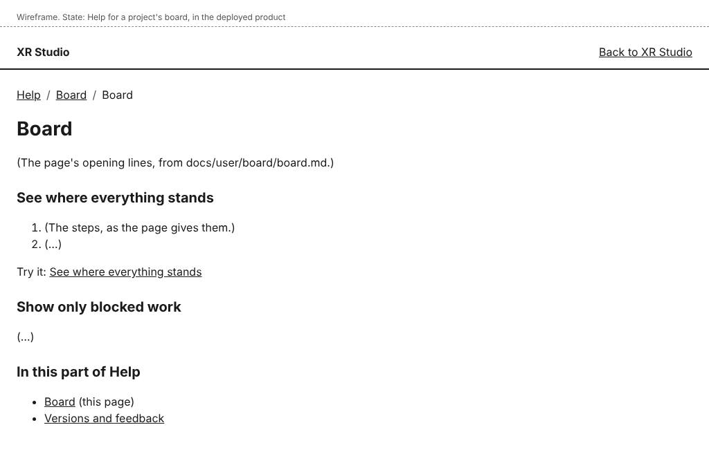
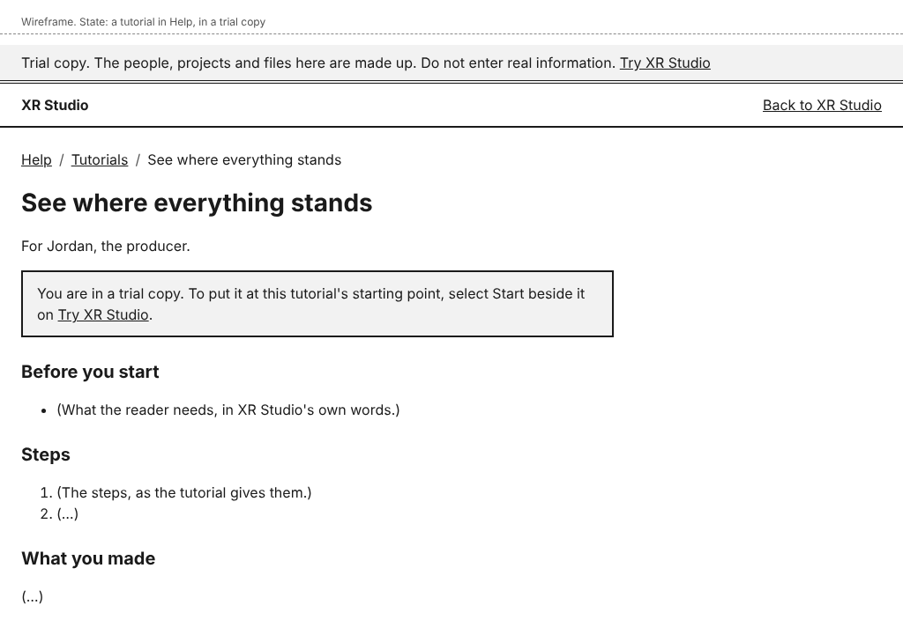

# Help and tutorials

Help describes each page of XR Studio and has a tutorial for each task. It is the same text the people who made XR Studio approved and tried.

## Open help for the page you are on

1. On any page, select **Help** in the header, before your name.
2. The help for that page opens. If the page has no help of its own, the help for that part of XR Studio opens, or the first page of Help.
3. Select **Back to XR Studio** to return.

The line at the top of a help page shows where you are: Help, the part of XR Studio, and the page. Select Help there to see every part, in the order you meet them, and where each role starts.

## Follow a tutorial

1. On a help page, find the task you want. Under its steps, select the link after **Try it**.
2. The tutorial opens. It says who it is for, and under "Before you start" what you need: an account, a role, or an earlier tutorial.
3. Follow the steps in XR Studio with your own account. Keep the tutorial open in a second tab.

A step that begins with another person's name, such as "As Riley:", is done by that person. The names are the made-up people of the trial copies. "Before you start" says which role each one has. In your own production, ask the person with that role.

Where a step says to open an email, open it in your own mailbox.

A tutorial names pages and controls only. You need no command and no setting to follow one.

## Send someone a tutorial

Copy the address of the tutorial from your browser and send it. Help opens without signing in, so a person you have just added can read it at once.

## Who can do this

Everyone. Help holds no project information, so it is the same for every role.

## If something goes wrong

- **This page is not available** on a help address: the page was moved or renamed. Select **Back to XR Studio**, then **Help**.
- A tutorial step does not match what you see: your role may not allow that step. "Before you start" names the role each person needs. If your role is right, tell your producer or director.
