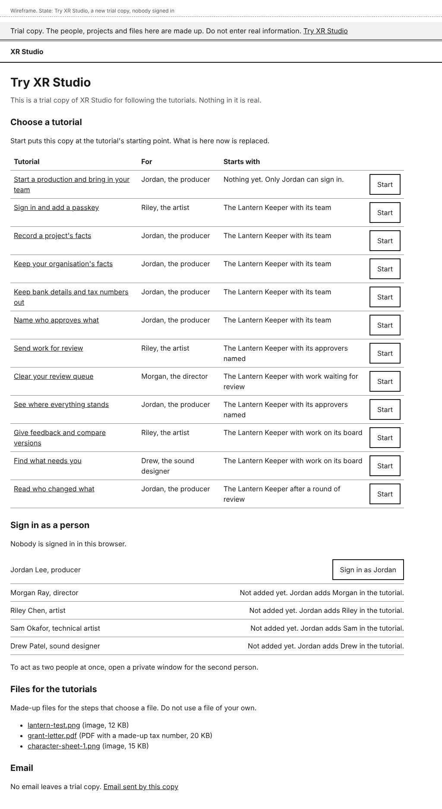
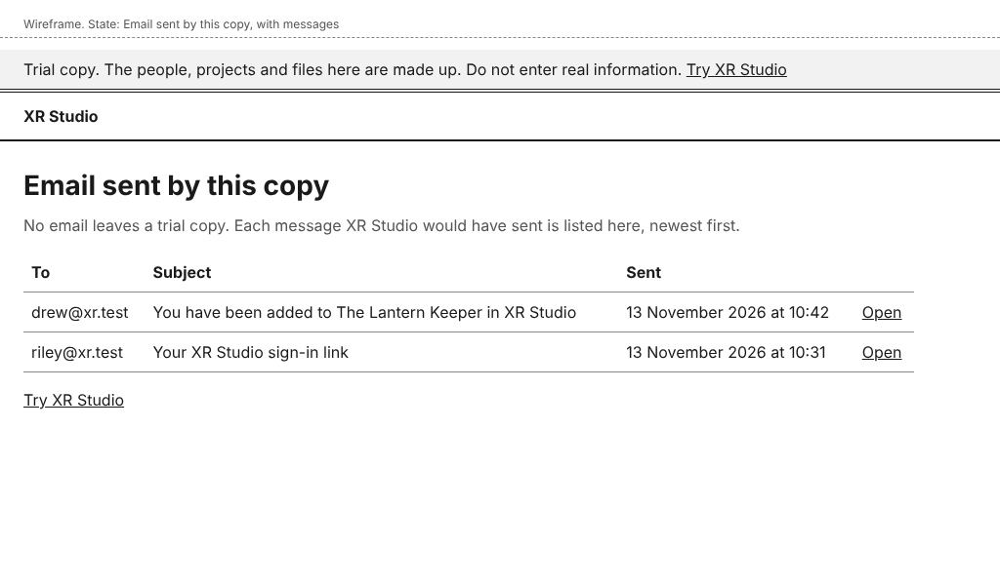

# Trying XR Studio

A trial copy is a separate copy of XR Studio for following the tutorials. Its people, projects and files are made up, and no email leaves it. Each change to XR Studio that waits for a decision has one, opened from a link. The XR Studio your production uses is not a trial copy: these pages do not exist there.

Every page of a trial copy has this line at the top: "Trial copy. The people, projects and files here are made up. Do not enter real information." Do not type real names, addresses or figures into one.

## Open a trial copy

1. Open the link to the trial copy. It is in the description of the change you were asked to decide on, under "Try it", with the tutorials to follow. If you are asked to sign in to Vercel first, do so. A trial copy opens only for members of the team's Vercel account; if you are not one, ask the project lead. **Sign in** opens, with the trial line above it.
2. Select **Try XR Studio** in the trial line.

A person on the team who has XR Studio's files can start a trial copy on their own computer instead. In the repository's folder they run `pnpm run try`. It prints the address of **Try XR Studio**, and stopping it deletes the copy.

## Start a tutorial

1. On **Try XR Studio**, under "Choose a tutorial", find the tutorial. **For** says who it is written for, and **Starts with** says what the trial copy will hold.
2. Select **Start** beside it. A dialog asks, for example, "Start Record a project's facts?" and says that everything done in the trial copy so far is replaced.
3. Select **Start**, or **Keep what is here** to leave the copy as it is.

You see, for example, "This copy now holds the starting point for Record a project's facts: The Lantern Keeper with its team. Sign in as Jordan to begin." Select **Open the tutorial** to read it.

You do not have to do the earlier tutorials first: **Start** puts the copy where they would have left it. Select **Start** again at any time to do a tutorial again.

**Start** signs everyone out of the copy. A trial copy opened from a link is one copy for everyone who has the link, so if someone else is using it, **Start** replaces their work too. It is also made again, from the beginning, each time the change it belongs to is updated.

## Sign in as a person

Under "Sign in as a person" there are five made-up people: Jordan Lee, producer; Morgan Ray, director; Riley Chen, artist; Sam Okafor, technical artist; and Drew Patel, sound designer.

1. Select the person, for example **Sign in as Jordan**. There is no email and no password.
2. You are signed in as that person, on the page they would see first.

To act as two people at once, open a private window for the second person, open **Try XR Studio** there, and select them.

A person who has not been added to a project yet has no button. The page says, for example, "Not added yet. Jordan adds Riley in the tutorial." Once Jordan adds Riley, select **Sign in as Riley**: it accepts Riley's invitation, as the link in the email would.

## Use the tutorials' files

Where a tutorial asks you to choose a file, use the made-up file it names. **Try XR Studio** lists them under "Files for the tutorials", each with a link to download it. Do not use a file of your own.

## Read the email a trial copy would have sent

1. On **Try XR Studio**, select **Email sent by this copy**.
2. Each message is listed with who it was to, its subject and when it was sent, newest first. Select **Open** beside one.
3. The message shows its text. You can follow its link, for example to sign in with an email link as a tutorial asks.

Select **Back to email sent by this copy** to return to the list.

## What a trial copy does not show

- Email is not delivered, so you cannot see how a message looks in a mail program, or what a spam filter does to it.
- In a trial copy opened from a link, a file can be 4 MB at most.
- A file held because it looks like it has a bank or tax number is not deleted after 24 hours.
- A passkey you add works in that trial copy only.

## Who can do this

Anyone who can open the trial copy. A trial copy opened from a link is limited to the people working on XR Studio.

## If something goes wrong

- **This page is not available** when you open **Try XR Studio**: this is not a trial copy. Sign in with your own account.
- "Riley is not on a project in this copy yet. Jordan adds Riley in Start a production and bring in your team.": sign in as Jordan and add the person, or select **Start** beside a later tutorial.
- "In a trial copy on the web, a file can be 4 MB at most. This limit is not in XR Studio itself.": choose a smaller file.
- "No email has been sent by this copy yet.": do the step that sends the email first, then open the list again.
- What you did has gone: someone selected **Start**, or the trial copy was made again after a new change. Select **Start** beside your tutorial and begin again.
