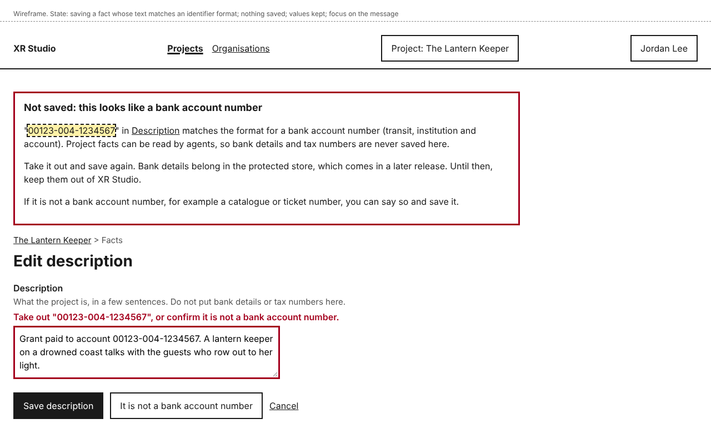
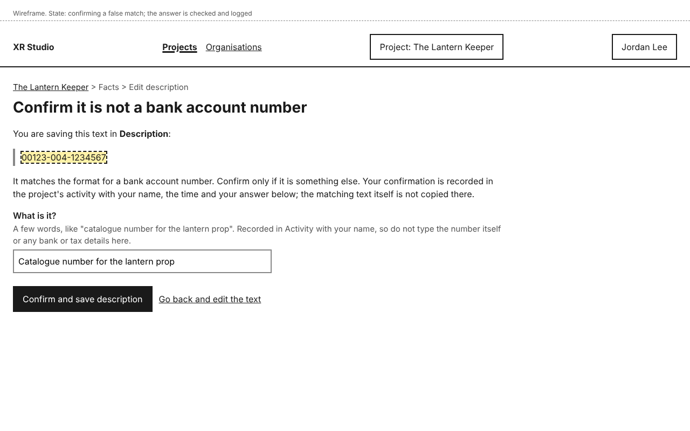
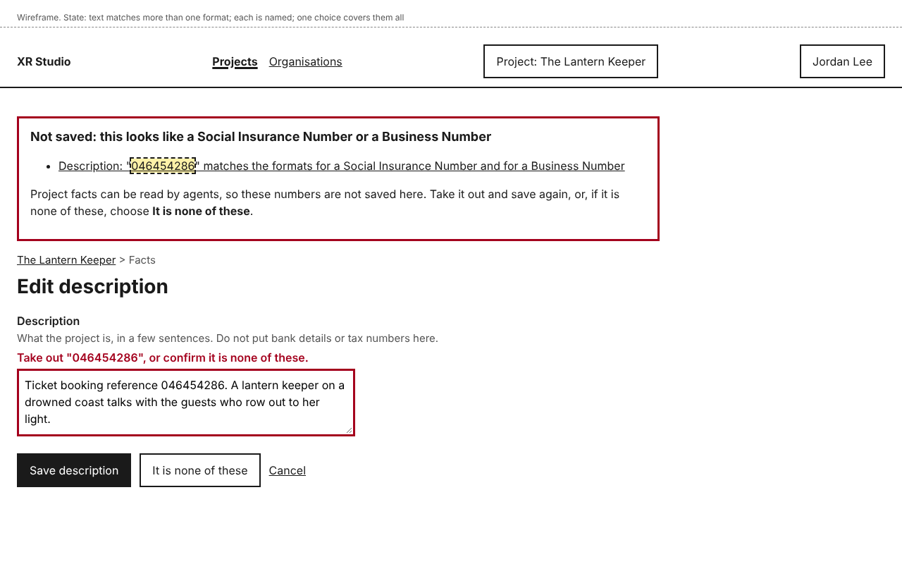
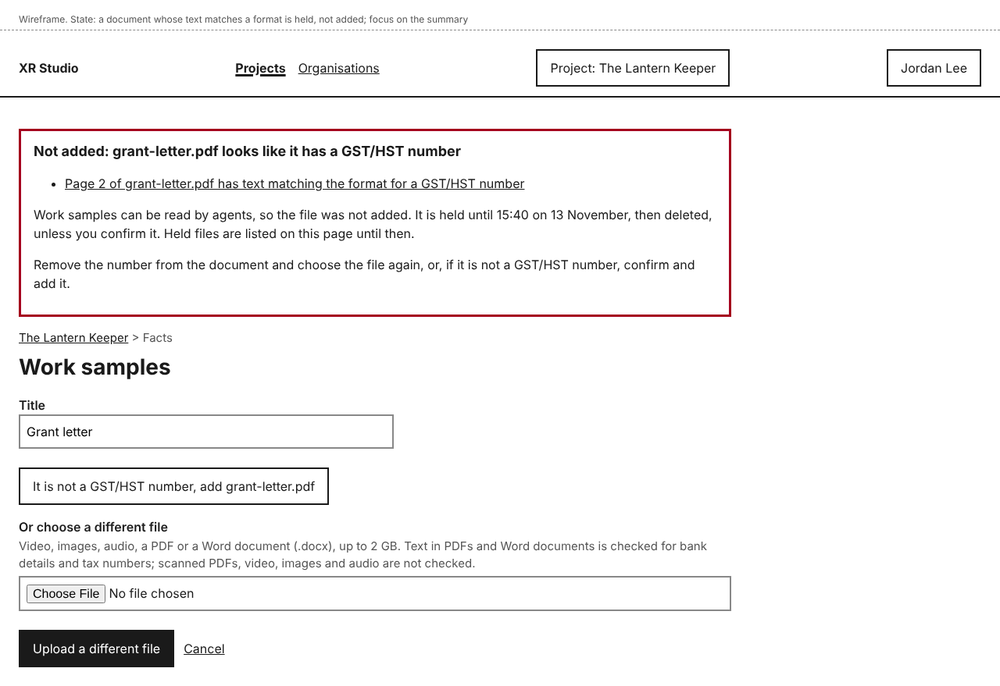
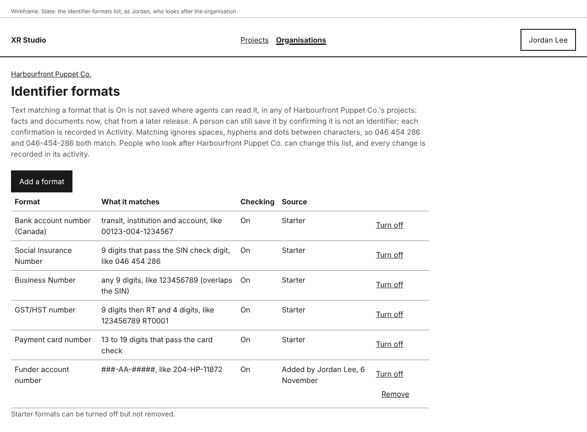
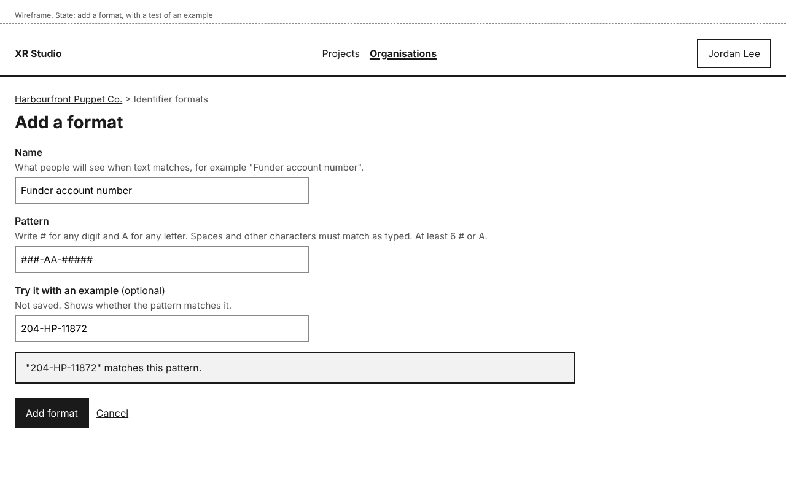
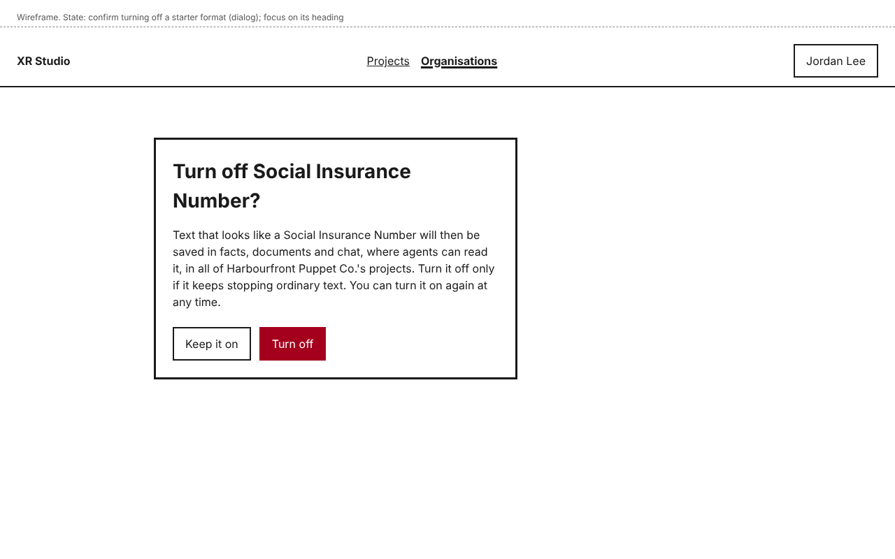

# Bank details, tax numbers and identifier formats

Facts, organisation facts and work samples can be read by agents, so bank details, tax numbers and similar identifiers must not be saved in them. XR Studio checks text against a list of identifier formats before saving it, and stops anything that matches.

Identifiers will be kept in a protected store, which comes in a later release. Until then, keep them out of XR Studio.

Sometimes ordinary text only looks like an identifier: a catalogue number, a ticket number. You can confirm that it is not one and save it. Your confirmation is recorded with your name and the time.

## What is checked

- Every save of a project fact or organisation fact, including a funder applicant profile.
- Every restore of an earlier version.
- The text of PDFs and text files added as work samples. Video, images and audio are not checked.

Matching ignores spaces, hyphens and dots between characters, so "046 454 286", "046-454-286" and "046454286" all match the same format. The formats used are those turned on for the project's organisation; see [Keep the list of identifier formats](#keep-the-list-of-identifier-formats).

## Text that looks like an identifier

When you save a fact whose text matches a format, nothing is saved. The edit page comes back with your text still in the box and a message such as "Not saved: this looks like a bank account number". It quotes the matching text and says which format it matches.

If it is an identifier, take it out and save again.

If it is not, confirm so:

1. Select **It is not a <format>**, for example **It is not a bank account number**. Any changes you made in the box first are kept.
2. Under **What is it?**, say in a few words what the number is, such as "catalogue number for the lantern prop". Do not type the number itself, or any bank or tax details. Your answer is recorded in the activity log, which nobody can edit.
3. Select **Confirm and save <fact>**, for example **Confirm and save description**. **Go back and edit the text** returns to the edit page with your text kept.

The **Facts** tab opens with a notice such as "Description saved. Your confirmation that "00123-004-1234567" is not a bank account number is recorded in Activity." The activity entry names you, the time, the format and your answer; the matching text itself is not copied there.

Your confirmation covers that exact text in that fact. Later saves that still contain it are not stopped again. New text that matches is.

### Text that matches several formats

Some formats overlap. Any 9 digits can be a Business Number, and 9 digits that pass the SIN check can also be a Social Insurance Number. The message then names them all, for example "Not saved: this looks like a Social Insurance Number or a Business Number", and the button reads **It is none of these**. Confirming covers every format named.

If different pieces of the text match, each is listed in the message with a link to its field.

## A document that is held

When you add a PDF or text file as a work sample and its text matches a format, the file is not added. You see, for example, "Not added: grant-letter.pdf looks like it has a GST/HST number". The message says which page matched and when the file will be deleted: it is held for 24 hours, then deleted unless you confirm it.

- If it is not an identifier, select **It is not a <format>, add <file>**, answer **What is it?** as above, and confirm. The file is added.
- If it is, remove the number from the document, then use **Or choose a different file** and **Upload a different file**.

Until it is confirmed or deleted, the held file is listed at the top of the work samples page with the time it will be deleted, so you can come back to it. Select **Confirm <file> is not a <format>** to confirm it, or **Delete <file> now**.

## Keep the list of identifier formats

You need to look after the organisation. The list belongs to the organisation and applies to every project in it.

On the organisation's page, select **Identifier formats**. Each format shows its name, what it matches with an example, whether checking is **On** or **Off**, and its source: **Starter**, or who added it and when.

The starter formats are:

| Format | What it matches |
|---|---|
| Bank account number (Canada) | Transit, institution and account, like 00123-004-1234567 |
| Social Insurance Number | 9 digits that pass the SIN check digit, like 046 454 286 |
| Business Number | Any 9 digits, like 123456789. It overlaps the SIN. |
| GST/HST number | 9 digits then RT and 4 digits, like 123456789 RT0001 |
| Payment card number | 13 to 19 digits that pass the card check |

Starter formats can be turned off and on, but not removed. Every change to the list is recorded in the organisation's **Activity**.

### Add a format

1. Select **Add a format**.
2. Type a **Name**, such as "Funder account number".
3. Type a **Pattern**. Write # for any digit and A for any letter; other characters match as typed, and spaces, hyphens and dots are ignored when checking. For example, ###-AA-##### matches 204-HP-11872. A pattern needs at least 6 # or A, so that it does not match ordinary numbers like dates and prices.
4. If you like, type an example under **Try it with an example**. When you stop typing or leave the field, the page says whether it matches the pattern. The example is not saved.
5. Select **Add format**.

You see, for example, "Funder account number added. It is checked from now on; text already saved is not changed."

### Turn a format off or on

Select **Turn off** beside the format. A dialog explains that text that only looks like that kind of number will then be saved where agents can read it, in all of the organisation's projects. Select **Turn off** to go ahead, or **Keep it on**. Turn a format off only if it keeps stopping ordinary text.

The row then shows **Off** and **Turn on**. **Turn on** needs no confirmation; the format is checked from then on, and text already saved is not changed. A restore of older text is checked like any save.

### Remove a format you added

Select **Remove** beside it, then **Remove <format>** in the dialog, or **Keep <format>**. It is no longer checked in any of the organisation's projects. To check it again, add it again. If you might need it later, turn it off instead.

## Who can do this

- Anyone who can edit a fact can confirm that its text is not an identifier.
- Only people who look after the organisation see **Identifier formats** and can change the list. Anyone else who opens its address sees "This page is not available".
- An agent cannot confirm a match or change the list.

## If something goes wrong

| You see | What it means | What to do |
|---|---|---|
| "Not saved: this looks like a <format>" | Text in the fact matches that format. | Take it out and save again, or select **It is not a <format>** and confirm. |
| "Not added: <file> looks like it has a <format>" | Text in the document matches that format. The file is held, then deleted at the time shown. | Confirm it is not an identifier, or remove the number and upload the file again. |
| "Say in a few words what the number is." | **What is it?** is empty. | Type a short answer. |
| "Your answer also looks like a <format>. Say what it is in words, without the number." | Your answer to **What is it?** matches a format. It would be recorded in the activity log, so it is refused. | Describe the number in words, without typing it. |
| "Use at least 6 # or A in the pattern. A shorter pattern would match ordinary numbers like dates and prices." | The pattern is too short. | Make the pattern longer. Your other values, including the example, are kept. |
| "Enter a name for the format." | **Name** is empty. | Type a name. |
| "Enter a pattern, like ###-AA-#####." | **Pattern** is empty. | Type a pattern. |
| A restore gives "Not saved" | A format turned on since that version was saved matches its text. | Confirm it is not an identifier, or edit the current text instead. |
