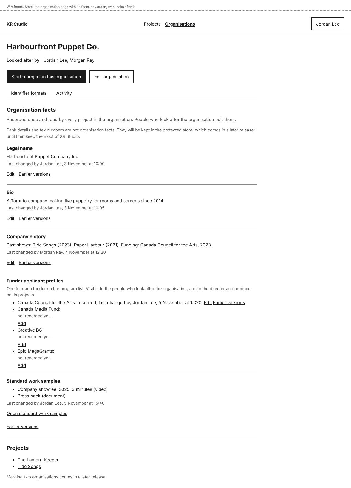
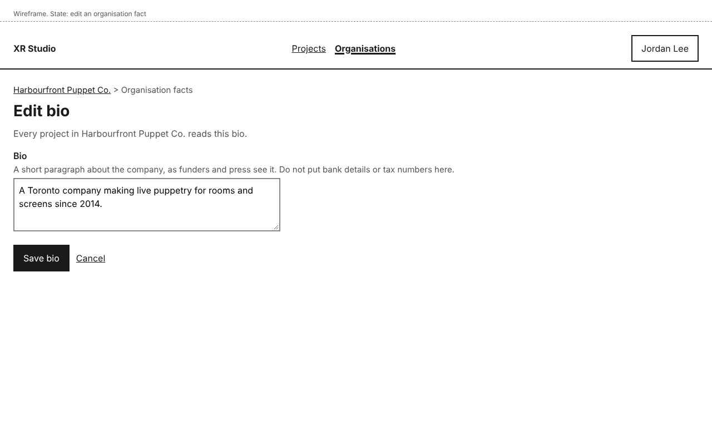
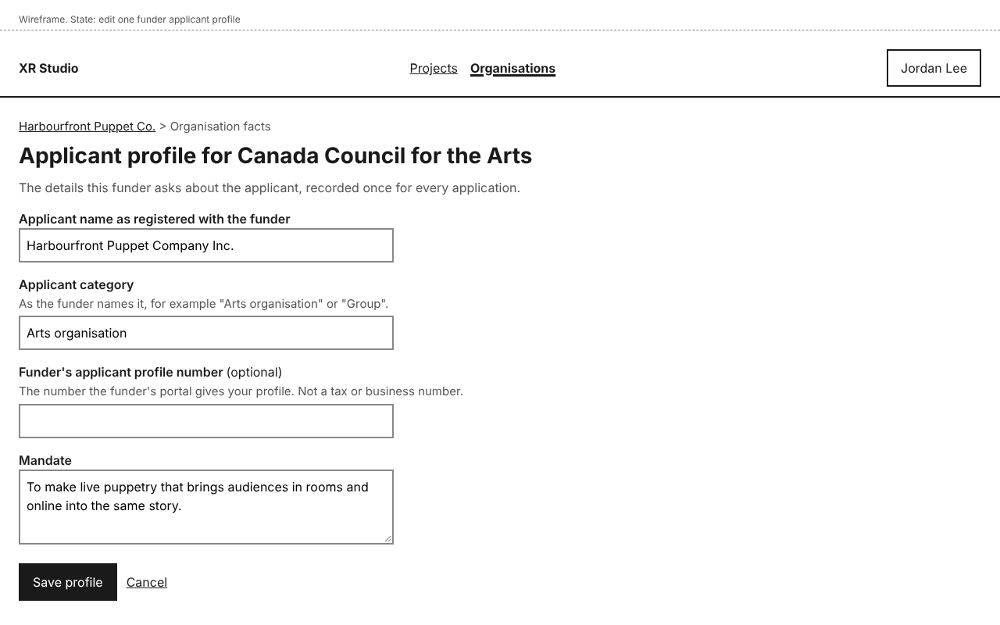
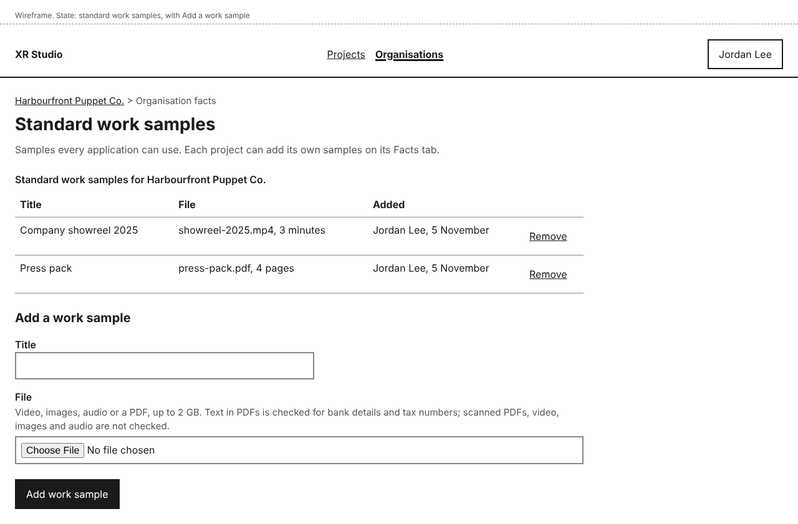
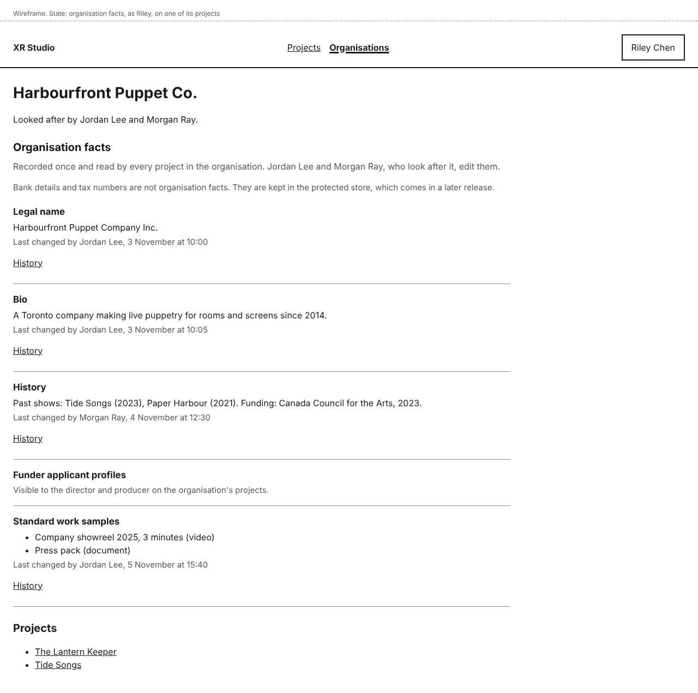

# Organisation facts

An organisation keeps the company's own facts: its legal name, bio, company history, an applicant profile for each funder, and standard work samples. They are recorded once, on the organisation's page, and every project in the organisation reads them, so you never type the company bio again.

Bank details and tax numbers are not organisation facts. They will be kept in the protected store, which comes in a later release; until then, keep them out of XR Studio. See [Bank details, tax numbers and identifier formats](identifier-formats.md).

## See an organisation's facts

Open the organisation's page from **Organisations**, or from **Organisation: <organisation>** above any of its projects. **Organisation facts** comes after the buttons and before **Projects**, in this order: **Legal name**, **Bio**, **Company history**, **Funder applicant profiles** and **Standard work samples**. Each shows its value and "Last changed by <name>, <date and time>".

A fact that has never been saved shows "Not recorded yet." with **Add**.

## How projects use them

Each project in the organisation shows the legal name and bio under **From <organisation>** on its **Facts** tab. They are read from the organisation each time, not copied, so when you change the bio, every project shows the new bio the next time its page is opened.

In later releases, funding applications, budgets and credits will be drafted from these facts alongside the project's own. A draft will show when a statement came from an organisation fact, and will be flagged if that fact changes.

## Edit an organisation fact

You need to look after the organisation (you are listed under **Looked after by**).

1. On the organisation's page, select **Edit** beside the fact (or **Add**, if it is not recorded yet).
2. Change the text. **Legal name** is one line; **Bio** and **Company history** are text.
3. Select **Save <fact>**, for example **Save bio**. **Cancel** leaves without saving.

The organisation's page opens with a notice, for example "Bio saved. Every project in Harbourfront Puppet Co. now reads the new bio."

**Earlier versions**, **Compare with current**, **Restore**, and what happens when someone else saved while you were editing, all work as they do for project facts. See [Earlier versions of a fact](project-facts.md#earlier-versions-of-a-fact), [Restore an earlier version](project-facts.md#restore-an-earlier-version) and [If someone else saved while you were editing](project-facts.md#if-someone-else-saved-while-you-were-editing).

## Record a funder applicant profile

**Funder applicant profiles** lists one line for each funder: Canada Council for the Arts, Canada Media Fund, Creative BC and Epic MegaGrants. A later release replaces this with the full program list. Each line says whether that funder's profile is recorded.

1. Select **Add** beside the funder (or **Edit**, if the profile is recorded).
2. Fill in **Applicant name as registered with the funder**, **Applicant category** and **Mandate**. **Funder's applicant profile number (optional)** is the funder portal's own number for your company, not a tax or business number.
3. Select **Save profile**.

## Add standard work samples

Standard work samples are the company's showreel, press pack and other samples that every project can use.

1. On the organisation's page, select **Open standard work samples**.
2. Under **Add a work sample**, type a **Title** and choose a **File**: video, images, audio or a PDF, up to 2 GB.
3. Select **Add work sample** and keep the page open while it uploads.

Removing a sample, the upload progress and held files work as on a project's work samples page. See [Add and remove work samples](project-facts.md#add-and-remove-work-samples).

## Who can do this

| Fact | Who sees it | Who edits it |
|---|---|---|
| Legal name, Bio, Company history, Standard work samples | People who look after the organisation, and every dashboard role on its projects | People who look after the organisation |
| Funder applicant profiles | People who look after the organisation, and the Director and Producer on its projects | People who look after the organisation |

- Someone on one of the organisation's projects with another role, such as an artist, sees the general facts without **Edit**, and a line under **Funder applicant profiles** says who can see them.
- Only people who look after the organisation see **Identifier formats** and **Activity** on its page. A Director who does not look after it sees the project's activity, not the organisation's.
- Agents cannot change organisation facts yet. In a later release, an agent will be able to draft them from a document you point it at, marked as drafts until a person who looks after the organisation accepts them.

Every change to an organisation fact is recorded in the organisation's **Activity**. See [Activity](activity.md).

## If something goes wrong

| You see | What it means | What to do |
|---|---|---|
| "<organisation> has no facts recorded yet. People who look after it add them on its page." | You are on a project's **Facts** tab, and nobody has recorded the organisation's facts. | Ask a person who looks after the organisation. They are named on its page. |
| "Not saved: this looks like a <format>" | The text, or the applicant profile number, matches an identifier format. | See [Bank details, tax numbers and identifier formats](identifier-formats.md). |
| "Enter a title for the work sample.", "Choose a file to add." or "The file is larger than 2 GB. Choose a smaller file." | A work sample is missing its title or file, or the file is too large. | See the table in [Project facts](project-facts.md#if-something-goes-wrong). |
| "The upload of <file> stopped before it finished. Choose the file again to try again." | The upload was interrupted. | Choose the file again. The title is kept. |
