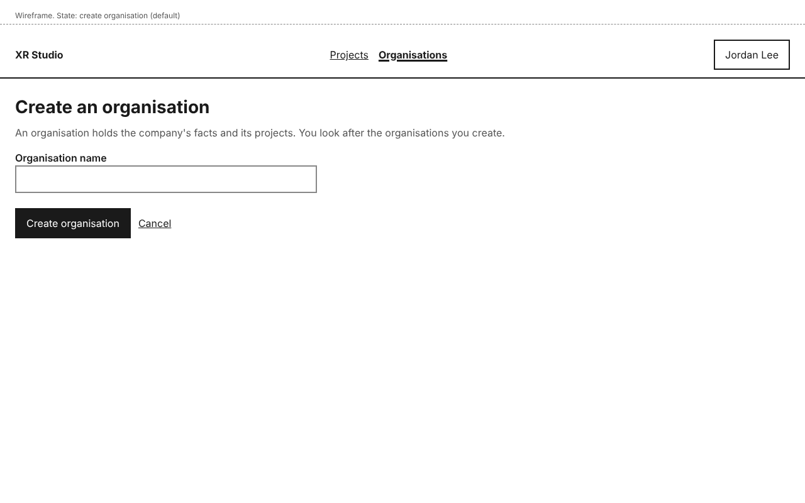
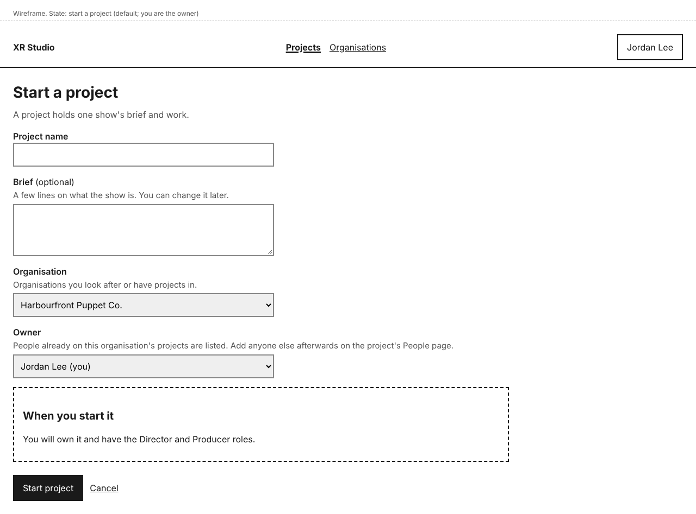

# Organisations and projects

A project holds one show's brief and work. Every project belongs to an organisation. In a later release, an organisation will also hold the company facts its projects share, such as the legal name, so they are entered once; until then the facts sections say there are none yet.

On a solo production you do not need to create an organisation first: select **Start a project** and XR Studio makes one for you.

Three ideas to keep apart:

- **Owner** (a project): the person who owns it. Today the tag carries no rights beyond the Director and Producer roles it comes with, and it cannot be changed after the project starts.
- **Looked after by** (an organisation): the people who can rename it and change who looks after it.
- **Roles** (a project): what each person on the project can see and do. See [People and roles](people-and-roles.md).

## Create an organisation

1. On **Projects** or **Organisations**, select **Create an organisation**.
2. Type the **Organisation name**.
3. Under **Looked after by**, tick who looks after it. You are ticked already; you can add people from your projects by ticking them in the list.
4. Select **Create organisation**.

The organisation's page opens. People who look after an organisation can rename it, change who looks after it and, in a later release, edit its facts.

## Start a project

1. On **Projects**, select **Start a project**. On an organisation's page, you can select **Start a project in this organisation** instead.
2. Type the **Project name**. Add a **Brief** if you like; you can change it later.
3. Choose the **Organisation**: any organisation you look after or have projects in.
4. Choose the **Owner**. You are chosen already. The list also shows people already on that organisation's projects, and it changes when you change the organisation; add anyone else afterwards on the project's **People** tab. You cannot change the owner after the project starts yet (handing on ownership comes in a later release), so choose carefully.
5. Read **When you start it**. It says which roles you and the owner will have.
6. Select **Start project**.

The project opens on its **Overview** with "Project started. You own it and have the Director and Producer roles." It also appears on **Projects**.

### Roles when the project starts

- The owner gets the Director and Producer roles.
- If you choose someone else as owner, they get Director and Producer, and you keep the Producer role. The notice then says, for example, "Project started. Morgan Ray owns it and has the Director and Producer roles. You have the Producer role."

### If you are not on any organisation yet

**Organisation** says a new organisation with the same name as the project will be made. You will look after it and can rename it later. Start the project as above.

## Change a project's name or brief

On the project's **Overview**, select **Edit name and brief**, make your changes and select **Save changes**. You see "Name and brief saved." The name follows the same rules as when you start a project (see the table below). Only the project's Director or Producer sees this button; everyone else sees who can make changes.

## Change an organisation

On the organisation's page, select **Edit organisation**. You can change its name and who it is **Looked after by**, then select **Save changes**. You see "Organisation saved." The name follows the same rules as when you create one. An organisation always has at least one person looking after it.

Merging two organisations comes in a later release.

## An organisation's page

It shows the organisation's name, who it is **Looked after by**, **Start a project in this organisation**, **Edit organisation** if you look after it, its **Projects** (the ones you are on, or all of them if you look after it), and **Organisation facts**, which stay empty until a later release.

## See your organisations

**Organisations** lists the organisations you look after and the organisations of projects you are on. The **You** column says "Look after it" or "On its projects".

## Who can do this

- Anyone signed in can create an organisation.
- You can start a project in an organisation you look after or have projects in.
- Only people who look after an organisation see **Edit organisation**.
- Only the project's Director or Producer sees **Edit name and brief**.
- Agents cannot create organisations or move projects between organisations.

## If something goes wrong

| You see | What it means | What to do |
|---|---|---|
| "Enter the project name." | **Project name** is empty, when starting a project or editing its name. | Type a name. Everything else you typed is kept. |
| "There is already a project called Tide Songs in Harbourfront Puppet Co. Choose a different name." | That organisation already has a project with this name. | Choose a different name. The same name is fine in another organisation. |
| "Enter the organisation name." | **Organisation name** is empty, when creating or editing an organisation. | Type a name. |
| "You already look after an organisation called Harbourfront Puppet Co. Choose a different name." | You look after an organisation with this name already. | Choose a different name. |
| "The person you chose can no longer own a project here. Choose another owner." | The owner you picked was removed from the organisation's projects while you were filling in the form. | Choose another **Owner**. |
| You cannot untick yourself under **Looked after by** | You are the only person looking after the organisation. | Tick another person in the **Looked after by** list, then untick yourself and select **Save changes**. |
</content>
