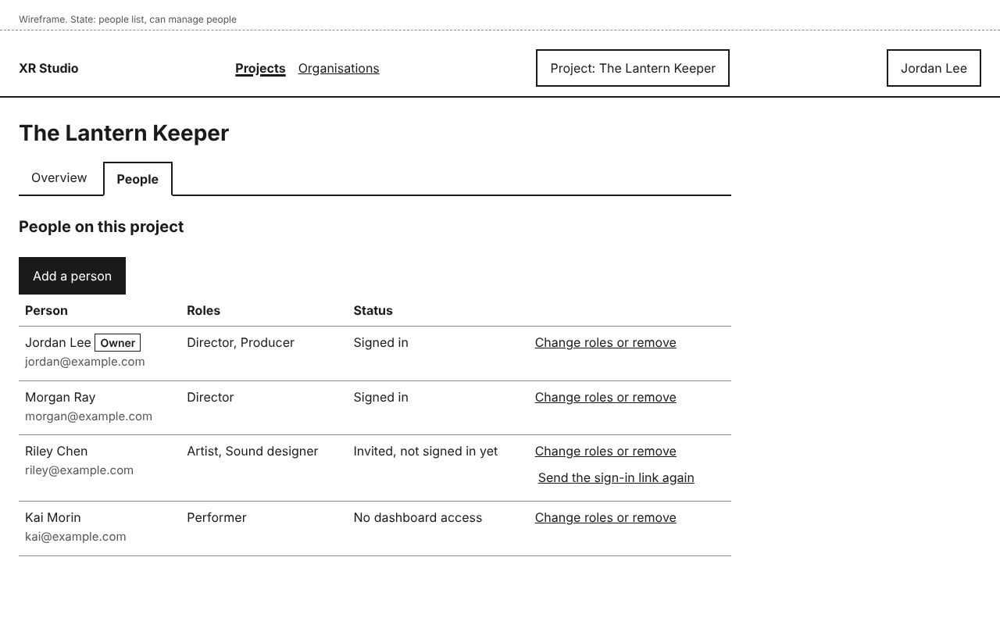
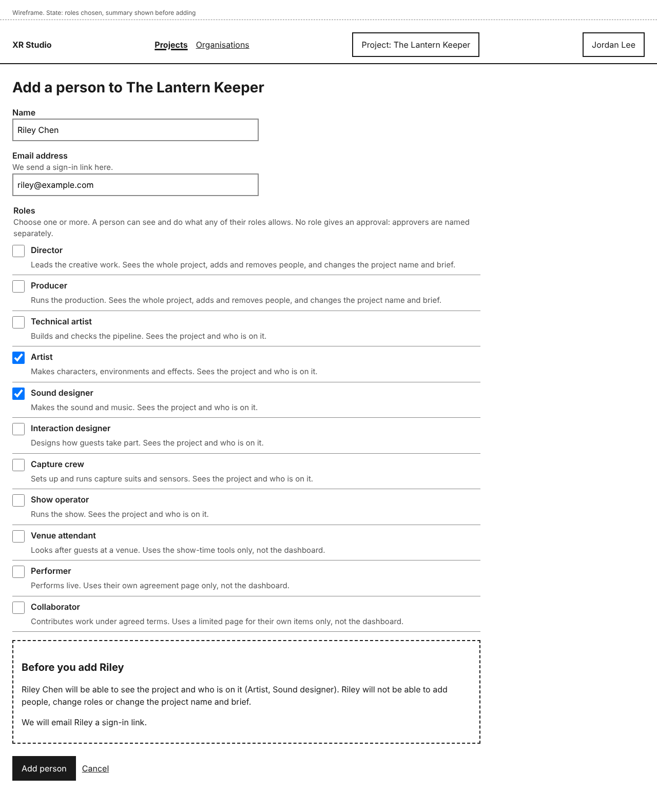

# People and roles

Everyone on a project has one or more roles. A role decides what the person can see and do. Holding a role never gives an approval; approvers are named separately, on the project's **Approvers** tab (see [Approvers](approvers.md)).

## See who is on a project

Open the project and select **People**. Each person is listed with their roles, an **Owner** tag beside the owner, and a status:

- **Signed in**: they have signed in at least once.
- **Invited, not signed in yet**: they have an invitation but have not used it.
- **No dashboard access**: none of their roles on this project uses the dashboard.

## Add a person

You need the Director or Producer role on the project.

1. On the **People** tab, select **Add a person**.
2. Type their **Email address**, and a **Name** if you like. If you leave the name empty, the email address is shown instead.
3. Tick one or more **Roles**. Each role says what it is for and what it gives in the dashboard today.
4. Read **Before you add <name>**. It sums up what they will and will not be able to do, and whether they get an invitation email.
5. Select **Add person**.

The **People** list opens with a notice, for example "Riley Chen added as Artist and Sound designer. We have emailed riley@example.com an invitation link that lasts 7 days."

What the new person gets depends on their roles:

- At least one role that uses the dashboard: an invitation email with a link that works once, for 7 days.
- Only Performer, Collaborator or Venue attendant: no email and no dashboard account. You see, for example, "Kai Morin added as Performer. XR Studio has not emailed Kai Morin: Performer does not use the dashboard. They will get a link to their own page when there is something for them, so let them know." Tell them yourself that XR Studio sends them nothing yet.
- Already uses XR Studio on another project: an email saying you added them, with a link to the project. You see, for example, "Sam Okafor added as Technical artist. We have emailed sam@example.com a link to the project."

## Send an invitation again

If someone has not signed in yet, select **Send the sign-in link again** beside them. Despite its name, the button sends an invitation link that lasts 7 days, not a 15-minute sign-in link. They get a new invitation link that lasts 7 days, and you see "We have sent Riley Chen a new invitation link to riley@example.com. It lasts 7 days. You can send another in a minute."

## Change someone's roles

1. On the **People** tab, select **Change roles or remove** beside the person.
2. Tick or untick **Roles**.
3. Select **Save roles**.

You see, for example, "Riley Chen's roles saved: Artist." The change applies the next time that person does anything in XR Studio. They do not need to sign out. Show machines get role changes at their next show-package refresh, in a later release.

### Changing your own roles

**Before you save** tells you whether you will still be able to add people and change roles, and who else can. If you are the only person on the project with the Director or Producer role, that role stays until you give it to someone else.

## Remove someone from a project

1. Select **Change roles or remove** beside the person.
2. Select **Remove <name> from the project**.
3. Confirm with **Remove <name>**, or select **Keep <name>** to go back.

You see, for example, "Sam Okafor removed from The Lantern Keeper. Their past work stays on the project." They lose access the next time they do anything in XR Studio. Their past work and its history stay on the project. Unticking every role and saving does the same, with the same confirmation. You cannot remove someone who holds an approval or is a delegate until you give their approvals to someone else (see [Approvers](approvers.md#removing-someone-who-approves)).

## What each role can do

Choose one or more. A person can see and do what any of their roles allows. Director and Producer give the same dashboard access today: both exist because they are different jobs, and later releases give each its own tools and approvals. "Sees the whole project" means everything the dashboard shows about it; in this release that is the same as "sees the project and who is on it", plus the edit and people actions.

| Role | What it is for | In the dashboard today |
|---|---|---|
| Director | Leads the creative work. | Sees the whole project, adds and removes people, and edits the project name and brief. |
| Producer | Runs the production. | Sees the whole project, adds and removes people, and edits the project name and brief. |
| Technical artist | Builds and checks the pipeline. | Sees the project and who is on it. Pipeline tools come in later releases. |
| Artist | Makes characters, environments and effects. | Sees the project and who is on it. Tools for making work come in later releases. |
| Sound designer | Makes the sound and music. | Sees the project and who is on it. Sound tools come in later releases. |
| Interaction designer | Designs how guests take part. | Sees the project and who is on it. Design tools come in later releases. |
| Capture crew | Sets up and runs capture suits and sensors. | Sees the project and who is on it. Capture tools come in later releases. |
| Show operator | Runs the show. | Sees the project and who is on it. Show tools come in later releases. |
| Venue attendant | Looks after guests at a venue. | Nothing; no dashboard sign-in. Show-time tools come in a later release. |
| Performer | Performs live. | Nothing; no dashboard sign-in. They get a link to their own agreement page when there is something to confirm. |
| Collaborator | Contributes work under agreed terms. | Nothing; no dashboard sign-in. They get a link to a limited page for their own items when there is something to sign off. |

## Who can do this

- The project's Director or Producer can add people, change roles and remove people.
- Everyone else on the project sees the **People** list without these actions, and a line naming who can make changes.
- Agents cannot add people or give, change or remove roles.

## If something goes wrong

| You see | What it means | What to do |
|---|---|---|
| "Enter an email address, like name@example.com." | **Email address** is empty or not an email address. | Type the full address. What you ticked is kept. |
| "Choose at least one role." | No role is ticked. | Tick at least one role. |
| "Riley Chen is already on this project. Use Change roles or remove for Riley Chen to change what they can do." | That address is already on the project. | Follow the link to change their roles instead. |
| A notice that the email could not be sent | The person was added, but the invitation did not go out. | Check the address with them, then select **Send the sign-in link again**. To fix a wrong address, remove them and add them again. |
| "You can send another in a minute" | You sent an invitation to this person less than a minute ago. | Wait a minute, then try again. |
| "You are the only person on this project who can add people and change roles, so this role stays until you give someone else the Director or Producer role." | Removing your role would leave nobody able to manage people. | Give someone else Director or Producer first: select **Change roles or remove** beside them, tick **Director** or **Producer** and select **Save roles**. Then change your own roles. |
</content>
</invoke>
