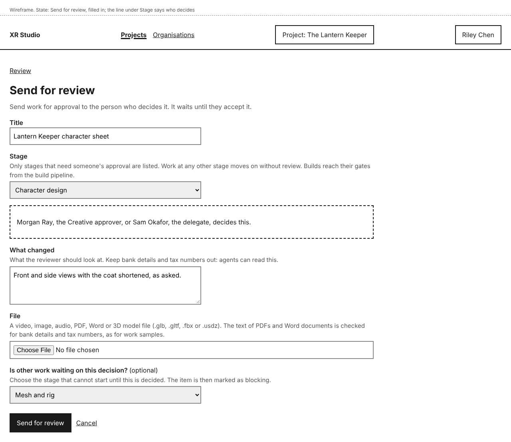
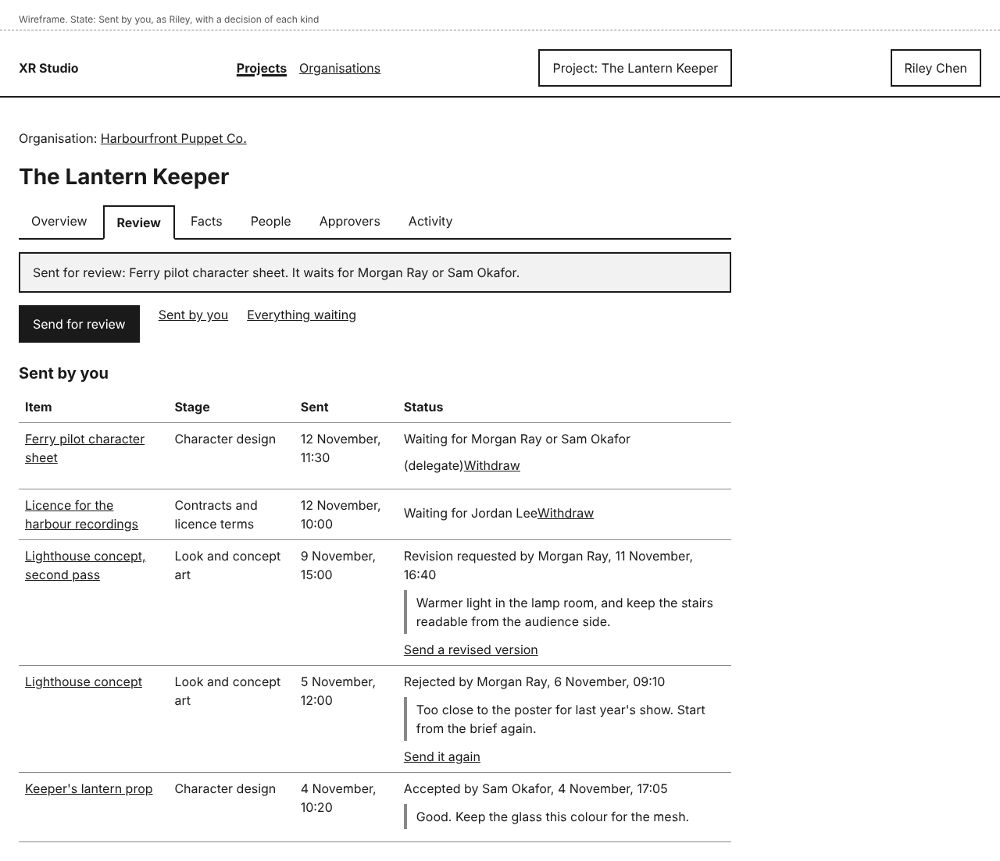
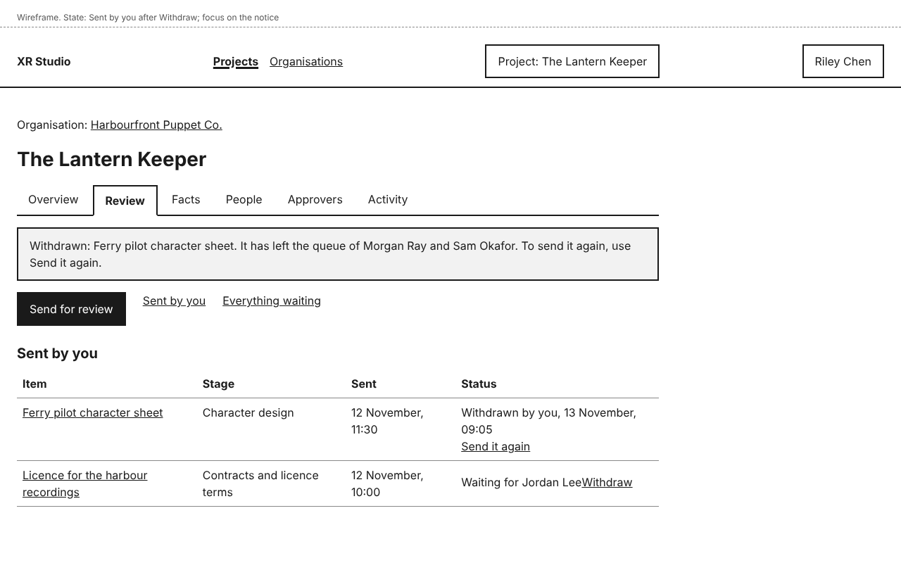
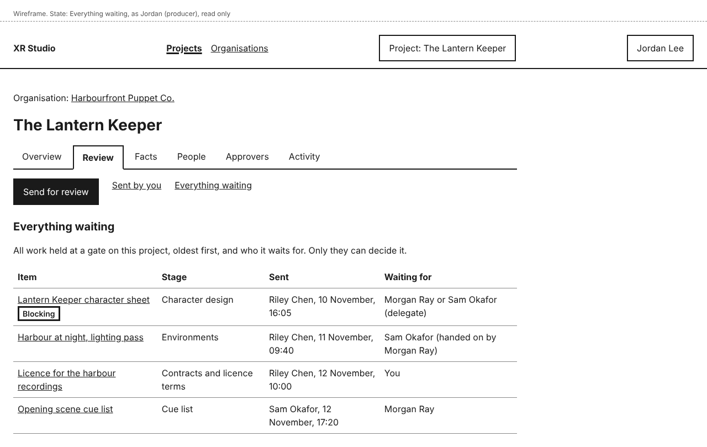
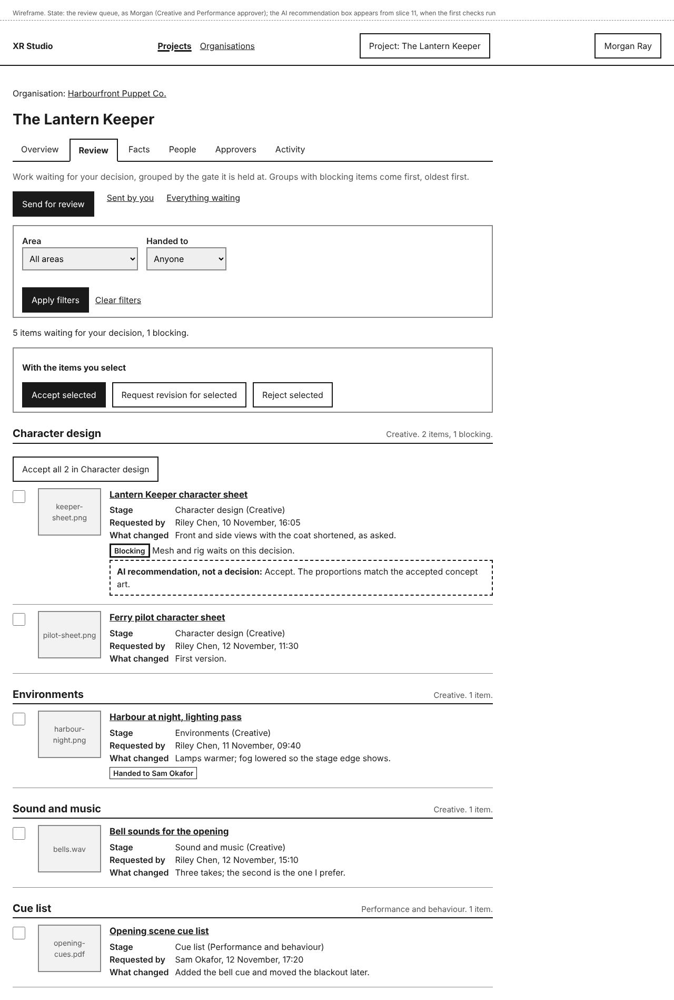
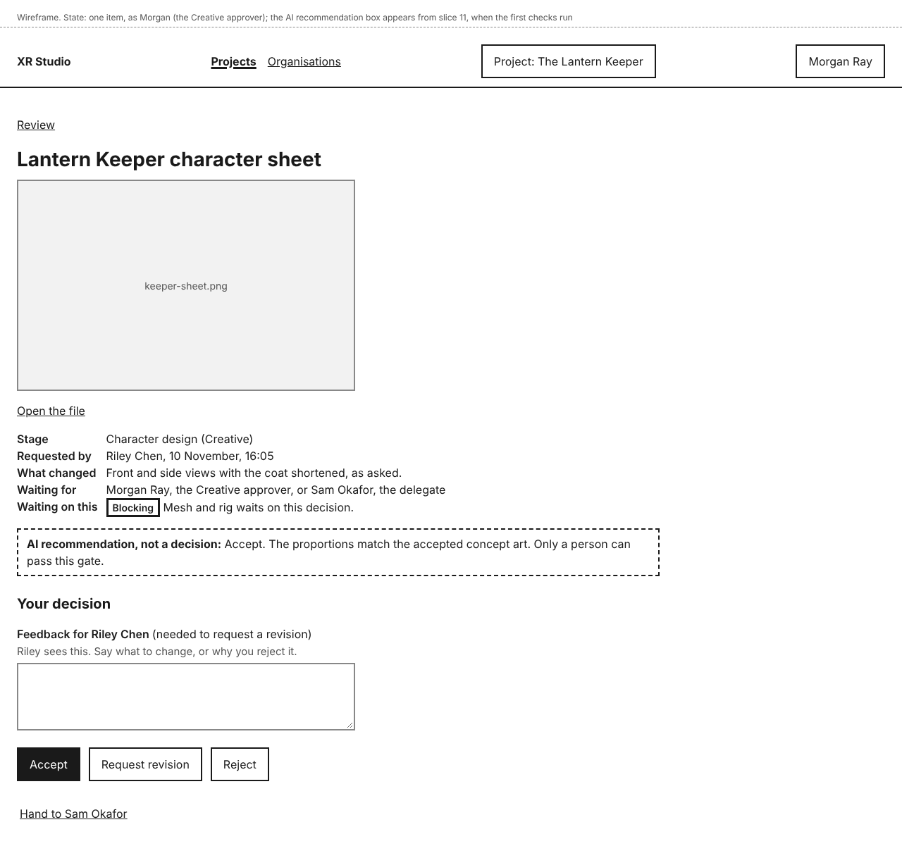
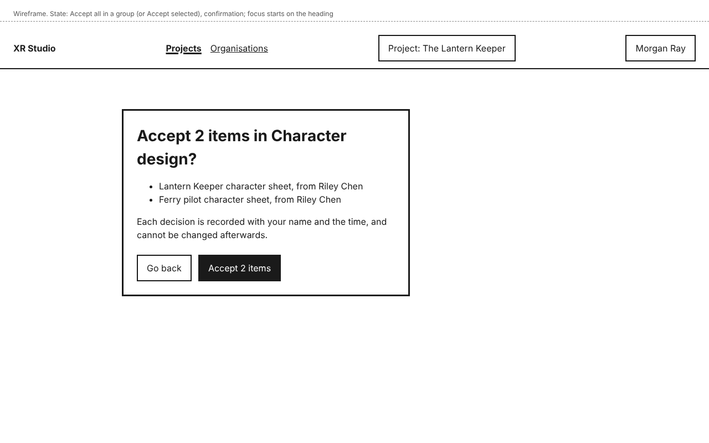

# Review

Work at a gated stage waits until a person accepts it. You send the work for review; the approver for that stage sees it in their queue and accepts it, asks for a revision, or rejects it. Nothing at a gate moves on without a person's decision. An AI can recommend a result, but it can never pass a gate. Who decides each stage is set on the project's **Approvers** tab (see [Approvers](approvers.md)).

In this release you send work for review yourself. In later releases agents and pipeline steps send their work the same way, and AI checks add recommendations.

Everything here is on the project's **Review** tab, which sits after **Overview**. Everyone on the project who uses the dashboard can open it. Work at a stage that does not need approval moves on without waiting, so it is never sent here.

In this release XR Studio sends no email or alert when something is waiting for you, or when your work is decided: check **Review**. Alerts come in a later release.

## Send work for review

1. On the **Review** tab, select **Send for review**.
2. Type a **Title**.
3. Choose the **Stage** the work is at. Only stages that need someone's approval are listed, grouped by area. A line appears under it saying who decides, for example "Morgan Ray, the Creative approver, or Sam Okafor, the delegate, decides this."
4. Say in **What changed** what the reviewer should look at.
5. Choose the **File**: a video, image, audio, PDF, Word or 3D model file (.glb, .gltf, .fbx or .usdz).
6. If another stage cannot start until this is decided, choose it under **Is other work waiting on this decision?**. The item is then marked as blocking, and its approver sees it before items that are not blocking. In this release only the sender can mark an item as blocking, so an item nobody marked is not tagged even if something waits on it. Otherwise leave **Nothing is waiting**.
7. Select **Send for review**.

**Sent by you** opens with a notice, for example "Sent for review: Ferry pilot character sheet. It waits for Morgan Ray or Sam Okafor."

Keep bank details and tax numbers out of the title, **What changed** and the file: agents can read them. XR Studio checks the text, and the text of PDFs and Word documents, as it does for facts and work samples (see [Identifier formats](identifier-formats.md)).

Builds are not sent by hand, so the build stages are not listed under **Stage**. They reach their gates from the build pipeline, in a later release.

## See what you have sent

Select **Sent by you**. Everything you have sent on this project is listed, newest first, with its stage, when you sent it, and its status:

- "Waiting for Morgan Ray or Sam Okafor (delegate)", or the holder for a protected approval: nobody has decided yet.
- "Accepted by <name>, <date and time>": the work has passed the gate. In this release nothing starts the next stage for you; the people working on it carry on.
- "Revision requested by <name>, <date and time>", with their feedback and **Send a revised version**.
- "Rejected by <name>, <date and time>", with any feedback and **Send it again**.

Any feedback the reviewer wrote is shown under the status.

### Withdraw something you sent

While an item is still waiting, select **Withdraw** beside it in **Sent by you**, or on its page. It leaves the queue at once, and you see, for example, "Withdrawn: Ferry pilot character sheet. It has left the queue of Morgan Ray and Sam Okafor. To send it again, use Send it again." Its status becomes "Withdrawn by you, <date and time>".

You cannot edit something you sent. To correct the stage, the file or the text, withdraw it and send it again.

### Send a revised version

Select **Send a revised version** (after a revision request) or **Send it again** (after a rejection or a withdrawal). **Send for review** opens with the title, stage and blocking choice filled in. Choose the new file, say what changed, and send it. In this release the new item is not linked to the old one: both stay in **Sent by you**, the old one with its decision and the new one waiting. Comparing versions comes in a later release.

## See everything that is waiting

Select **Everything waiting** to see all the work held at a gate on this project, oldest first: each item's stage, who sent it and when, a **Blocking** tag where something waits on it, and **Waiting for**, the person or people who can decide it. You can open any item to look at it. Only the people it waits for can decide it.

## Clear your review queue

If you approve an area, are its delegate, or hold a protected approval, the **Review** tab shows every item waiting for your decision on this project, and only those.

Items are grouped by stage, with the area beside each group. Groups with blocking items come first, oldest first. Each item shows a preview, its title, **Stage**, **Requested by** and **What changed**. Images, videos and PDFs show a picture; audio, Word and 3D model files show only their file name, so open them to check. You may also see:

- **Blocking**: another stage waits on this decision, for example "Mesh and rig waits on this decision."
- **Handed to <name>**: the approver handed it to the delegate.
- **AI recommendation, not a decision**: an AI check's suggested result, in a dashed box. It is only advice. In this release no AI checks run yet, so you will not see one; the pictures on this page show how it will look.

A line above the groups counts them, for example "5 items waiting for your decision, 1 blocking."

To narrow the list, choose an **Area** or a **Handed to** value and select **Apply filters**. **Clear filters** shows everything again.

## Decide on an item

1. Select the item's title. Its page shows a large preview, **Open the file**, its details, and **Waiting for**.
2. Under **Your decision**, write in **Feedback for <requester>** if you want to. The requester sees it with your decision. It is needed to request a revision.
3. Select **Accept**, **Request revision** or **Reject**. **Reject** asks you to confirm first.

The **Review** tab opens with a notice, for example "Accepted: Lantern Keeper character sheet. Recorded as your decision at 14:20 on 13 November. Riley Chen sees it under Sent by you." The item has left your queue.

A decision is final. It is recorded with your name and the time, and cannot be changed afterwards. After a revision request or a rejection, the requester sends the work again.

If you can decide an item you sent yourself, you may: so one person can run a whole production.

## Decide on several items at once

1. Tick the items.
2. Select **Accept selected**, **Request revision for selected** or **Reject selected**.
3. Check the list in the confirmation. To request a revision, write the **Feedback** every requester will see; to reject, feedback is optional.
4. Confirm, for example with **Accept 2 items**, or select **Go back**.

To accept a whole group of two or more items, select **Accept all <n> in <stage>** above the group, and confirm.

You see, for example, "Accepted 2 items in Character design."

## Hand an item to your delegate

If you approve an area that has a delegate, an item's page shows **Hand to <delegate>**. Select it, and you see "Handed to Sam Okafor: Harbour at night, lighting pass. It shows in Sam's queue as handed to them. You can still decide it." Either of you can decide it.

Delegates can choose **Handed to you** under **Handed to** to see only what was handed to them.

Protected approvals cannot be handed on.

## Who can do this

- Anyone on the project who uses the dashboard can send work for review, withdraw it while it waits, see what they sent, and see everything waiting.
- Only the approver or delegate of the item's area, or the holder of its protected approval, can decide it.
- Agents cannot accept, request a revision, reject or hand on. An AI recommendation never passes a gate.
- Every send, withdrawal, hand-on and decision is recorded in the project's **Activity**, under the area Review. Feedback is not copied there.

## If something goes wrong

| You see | What it means | What to do |
|---|---|---|
| "Enter a title.", "Choose the stage this work is at.", "Say what changed." or "Choose a file to send." | Something is missing. | Fill it in. What you typed is kept, but choose the file again. |
| "Keep the title to 120 characters or fewer." | The title is too long. **What changed** and feedback take up to 2,000 characters. | Shorten it. Nothing is cut for you. |
| "Choose a video, image, audio, PDF, Word or 3D model file." | XR Studio does not take that kind of file. | Send it in one of those types. |
| An error saying text looks like a bank account, tax or card number | The title, **What changed** or feedback matches one of your organisation's identifier formats. | Take the number out and send again, or, if it is not that kind of number, select **It is not a <format>** and say what it is (see [Identifier formats](identifier-formats.md)). |
| A notice that your file is held | The text of your PDF or Word document looks like it holds a bank or tax number. It is not sent, and is deleted after 24 hours unless you confirm. | If it is not such a number, confirm with **It is not a <format>, add <file>**. If the document really holds one, such as a signed contract or a funding report, send a copy with those numbers removed and keep the original outside XR Studio. |
| "Write feedback for <requester>: say what to change." | You asked for a revision without feedback. Nothing was recorded. | Write what to change, then select **Request revision** again. |
| "Write the feedback each requester will see." | You asked for a revision of several items without feedback. | Write what to change, then confirm again. |
| "Your decision was not recorded: Riley Chen withdrew this item at 09:05 on 13 November." | The sender withdrew it while you had it open. | Nothing to do. Select **Back to Review**. |
| "Not withdrawn: Morgan Ray accepted it at 09:04 on 13 November." | It was decided before you withdrew it. | If it needs changing, send a new item. |
| "Select at least one item." | You chose a batch action with nothing ticked. | Tick the items first. |
| "Your decision was not recorded: Sam Okafor accepted this item at 14:18 on 13 November, while you had it open. It has left your queue." | Someone else who can decide it got there first. | Nothing to do. Select **Back to Review**. In a batch, the others were decided, and the notice names the ones that were not. |
| "Nothing is waiting for your decision" | Your queue is empty. | Items appear when someone sends work at a stage you approve. |
| "You do not approve any area on this project, so nothing waits for your decision here." | You are not an approver, delegate or holder here. | See **Approvers** for who decides each area. |
| "You have not sent anything for review on this project." | **Sent by you** is empty. | Use **Send for review**. |
