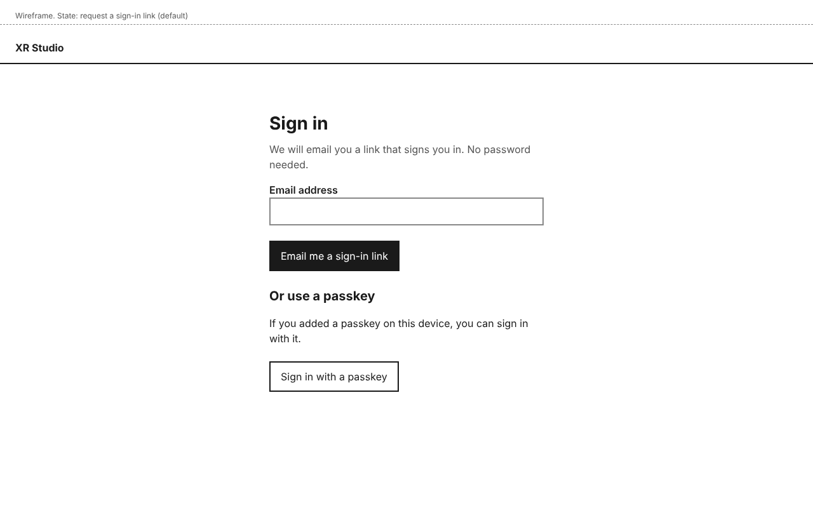

# Signing in

XR Studio has no passwords. You sign in with a link sent to your email address, or with a passkey on a device you have used before.

You can sign in if someone has added you to a project with a role that uses the dashboard. Performers, collaborators and venue attendants do not sign in to the dashboard; they get links to their own pages instead.

## Accept an invitation

When someone adds you to a project, you get an email titled "You have been added to <project name> in XR Studio".

1. Open the email on the device where you want to use XR Studio.
2. Select the link in it.

You are signed in and see the project. The invitation link works once, for 7 days. After that, ask the person who added you to send it again, or sign in with your email address as below.

## Sign in with an email link

1. Open XR Studio. You see **Sign in**.
2. Type your **Email address** and select **Email me a sign-in link**.
3. You see **Check your email**.
4. Open the email on the device where you want to use XR Studio and select the link.

You are signed in on that device. If you followed a link to a page in XR Studio before signing in, that page opens. Otherwise you see **Projects**.

The sign-in link works once, for 15 minutes. Asking for a new link stops any older link from working.

### If the email does not arrive

On **Check your email**:

- Wait a few minutes, and check your spam or junk folder.
- Check that this is the address the person who added you used. If not, select **Use a different email address**.
- Select **Send another link**. You see "If this address can sign in, we have sent another link." At most one email a minute goes to an address.

**Check your email** looks the same whether or not your address can sign in, so it does not tell anyone who is on a project. If no email ever arrives, ask the project's producer or director to add you.

## Add a passkey

A passkey lets you sign in on this device without waiting for an email. Your browser or password manager keeps it.

1. Select your name at the top of any page, then **Your account**.
2. Under **Passkeys**, select **Add a passkey**.
3. Confirm in your browser or password manager.

The passkey appears in the list, with the device it was made on and the date.

To stop using a passkey, select **Remove** beside it.

## Sign in with a passkey

1. Open XR Studio. You see **Sign in**.
2. Select **Sign in with a passkey**, or pick your passkey when your browser offers it in the **Email address** field.
3. Confirm in your browser or password manager.

## Sign out

Select your name at the top of any page, then **Sign out**. You see **You are signed out**. To come back, select **Sign in again**.

## Who can do this

- Anyone added to a project with a role that uses the dashboard (Director, Producer, Technical artist, Artist, Sound designer, Interaction designer, Capture crew or Show operator) can sign in.
- The first person on a new installation signs in because their address is on its list of first addresses.
- There is no way to sign up without being added.

## If something goes wrong

| You see | What it means | What to do |
|---|---|---|
| "Enter an email address, like name@example.com." | The email field is empty or is not an email address. | Type your full email address. |
| **This sign-in link no longer works** | The link was already used, has expired, or a newer link was sent. | Select **Send another link** to get a new one at the same address, or **Use a different email address**. |
| "That passkey did not work." | No passkey for XR Studio was found on this device, or the request was cancelled. | Select **Try the passkey again**, or type your **Email address** and select **Email me a sign-in link**. |
| **Check your email**, but no email comes | Your address may not be on a project yet, or the email is delayed. | See "If the email does not arrive" above. |

## The emails XR Studio sends

### Sign-in link

> Subject: Your XR Studio sign-in link
>
> Select this link to sign in to XR Studio: <link>
>
> It works once, for 15 minutes, on the device where you open it. If you did not ask to sign in, you can ignore this email.

### Invitation

Sent when someone adds you to a project and you are new to XR Studio.

> Subject: You have been added to <project name> in XR Studio
>
> <name of the person who added you> added you to <project name> as <roles>.
>
> Select this link to sign in and open the project: <link>
>
> It works once, for 7 days, on the device where you open it. After that, sign in at <XR Studio address> with this email address, or ask <name of the person who added you> to send it again.

### Added to a project

Sent when someone adds you to a project and you already use XR Studio.

> Subject: You have been added to <project name> in XR Studio
>
> <name of the person who added you> added you to <project name> as <roles>.
>
> Open the project: <link to the project>
</content>
