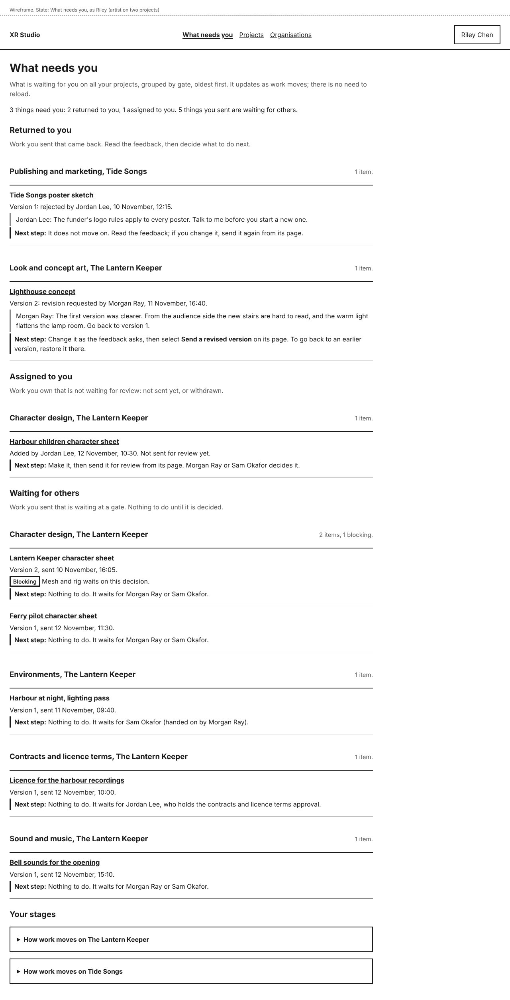
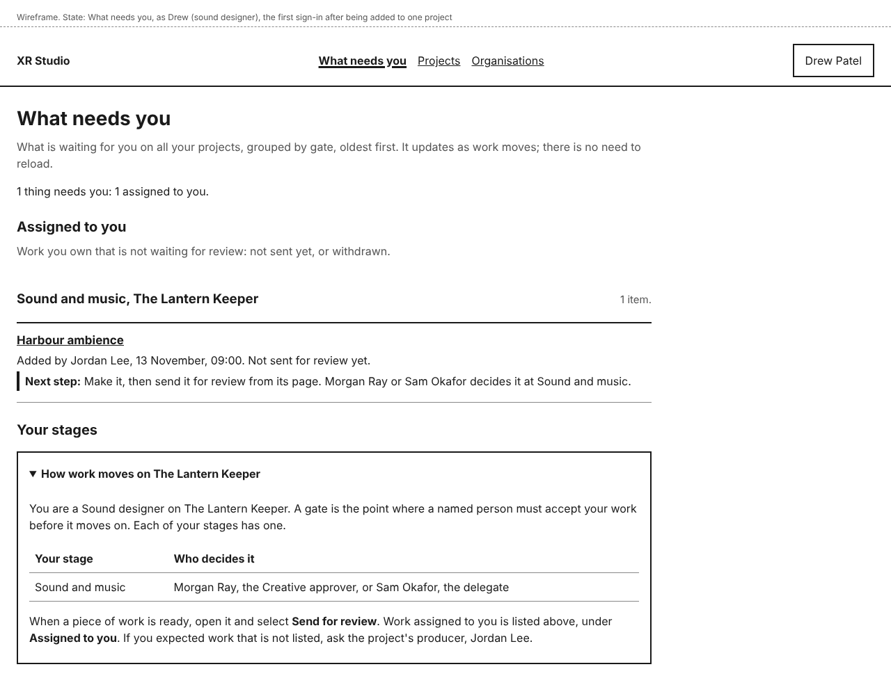
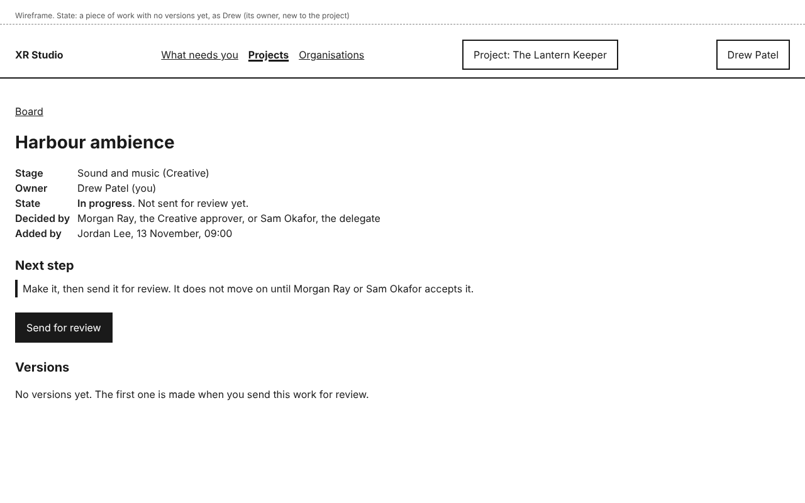
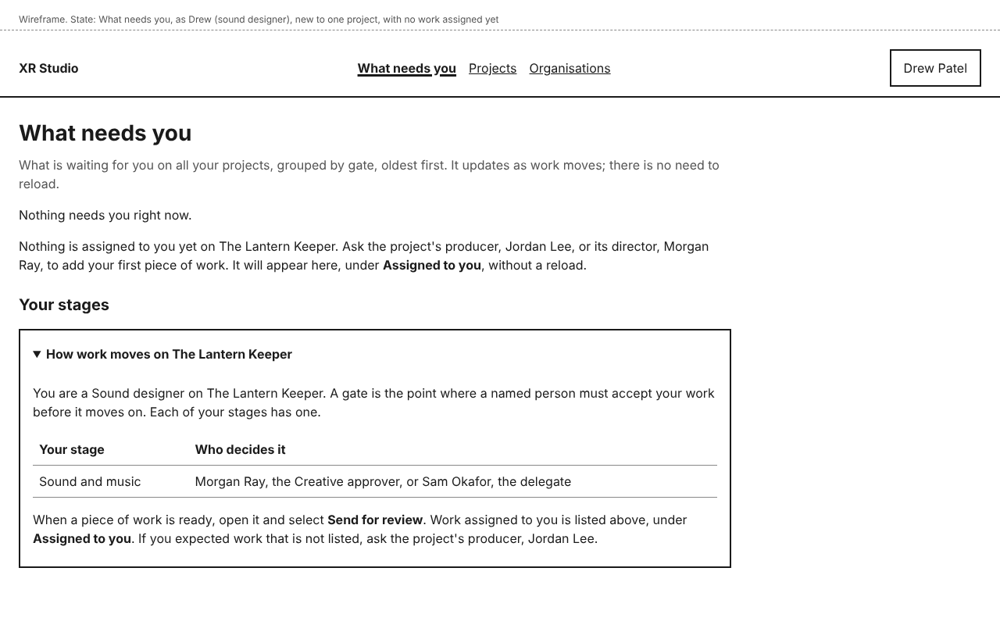
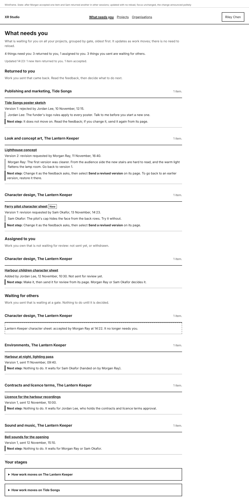

# What needs you

**What needs you** is the first page you see when you sign in. It lists what is waiting for you on all your projects, and says the next step for each. Its link is first in the menu at the top of every page, and selecting **XR Studio** at the top also brings you back to it.

When you accept an invitation to a project, you land here too. If you are not on any project yet, you see **Projects** instead (see [Your projects](../projects/your-projects.md)).

## Find what to do next

At the top, a line counts what needs you, for example "3 things need you: 2 returned to you, 1 assigned to you. 5 things you sent are waiting for others."

Below it, up to four lists. You only see the ones that have something in them:

- **For your decision**: work waiting at a gate you decide, as an approver, a delegate or the holder of a protected approval. The next step is "Decide: accept, request a revision or reject." The item opens on its review page, where you decide (see [Review](../review/review.md)). An item an approver handed to their delegate is listed for the delegate; the approver still finds it on the project's **Review** tab.
- **Returned to you**: work you sent that came back. The reviewer's feedback is quoted under it. After a revision request, change the work as the feedback asks, then select **Send a revised version** on its page. After a rejection, the work does not move on; if you change it, you can send it again.
- **Assigned to you**: work you own that is not waiting for review. If it was never sent, make it, then open it and select **Send for review**; the next step names who decides it. If you withdrew it, send it again from its page when it is ready.
- **Waiting for others**: work you sent that is waiting at a gate. Nothing to do; the next step says who it waits for.

Inside each list, work is grouped by gate (the stage it waits at) and project, for example "Character design, The Lantern Keeper". Work with the **Blocking** tag comes first: another stage cannot go ahead until it is decided, and the line under it says which. The rest is listed oldest first.

Select a title to open it. Work that came back or is assigned to you opens on its own page, with its versions and feedback (see [Versions and feedback](../board/versions-and-feedback.md)).

You only see work on projects you are on, and only what your roles there allow.

## If you are new to a project

Each stage has a gate: the point where a named person must accept your work before it moves on. Under the lists, **Your stages** has a panel for each of your projects, **How work moves on <project>**. It says which stages your roles work in and who decides each one. It is open until you send your first piece of work on that project; after that, select it to open it again.

For example, a sound designer new to The Lantern Keeper sees:

1. Under **Assigned to you**, "Sound and music, The Lantern Keeper", and the work **Harbour ambience**, with "Next step: Make it, then send it for review from its page. Morgan Ray or Sam Okafor decides it at Sound and music."
2. Under **Your stages**, that they work in Sound and music, and that Morgan Ray, the Creative approver, or Sam Okafor, the delegate, decides it.

Selecting **Harbour ambience** opens it, with **Send for review**:

If nothing is assigned to you yet, the page says so and names the project's producer and director: ask one of them to add your first piece of work (see [Board](../board/board.md)). It then appears under **Assigned to you** without a reload.

## When things change

A colleague's feedback on your work, outside a decision, shows on the work's own page, not here. Open your work to read it. Alerts for new feedback come in a later release.

You do not need to reload. The page checks for changes every 15 seconds while it is open:

- Something new shows in its place with the **New** tag.
- Something that no longer needs you stays where it was until you next open the page, replaced by one line, such as "Lantern Keeper character sheet: accepted by Morgan Ray at 14:22. It no longer needs you."
- A line under the count says what changed, for example "Updated 14:23: 1 new item returned to you. 1 item accepted."

## If something goes wrong

| You see | What it means | What to do |
|---|---|---|
| "Nothing needs you right now." | Nothing waits for your decision, nothing came back, and nothing is assigned to you. | If you are new and expected work, ask the producer or director the page names. Otherwise nothing; to see where everything stands, open a project's **Board**. |
| "Could not check for updates at 14:23. Trying again in a minute." | The page could not reach XR Studio. What you see may be out of date. | Wait, or reload the page to check now. |
| "<title>: you can no longer decide this." | Someone changed who approves that stage. | Nothing. It now waits for the new approver. |
| "You no longer have access to this project" | You were taken off the project. | Ask its producer or director if you think this is a mistake. |
| Work you expected is not under **Assigned to you** | Nobody has put it on the board for you yet, or it has another owner. | Ask the project's producer or director. |
